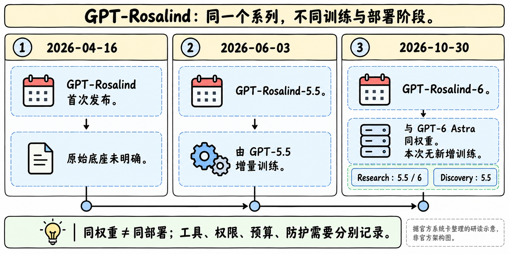
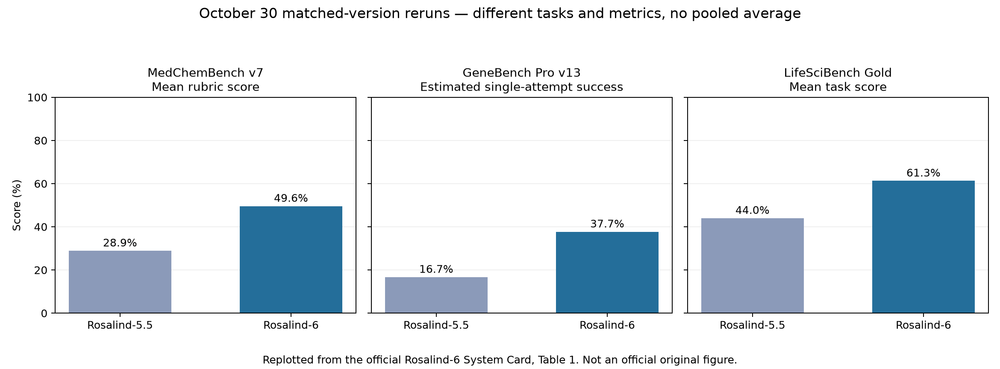
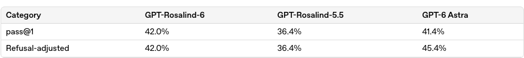

# GPT-Rosalind：从领域增量训练到同权重科研部署

> [!tldr]
> Rosalind是生命科学科研系列，4月16日首发、6月3日发布5.5增量训练版；10月30日的6则明确与GPT-6 Astra使用相同权重，本次没有新增训练。它值得单独研读的是科研评测、准入与工具部署，而不能当作又一个通用GPT正代。Research / Discovery共用family，不按权限档位拆成不同新权重。

## 先把日期、模型身份与访问范围分清

| 日期 / 标识 | 实际事件 | 本笔记的处理 |
|---|---|---|
| 2026-04-16 GPT-Rosalind | 官方博客首次发布系列；具体底座未明示 | family首次日期，历史补漏 |
| 2026-06-03 GPT-Rosalind-5.5 | 系统卡明确基于GPT-5.5做生命科学增量训练 | 同family中的真实模型更新 |
| 2026-09-08 / 09-11 | API日志宣布GA / 博客新增全球合资格组织准入说明 | 渠道与准入事件，不能覆盖4月首发 |
| 2026-10-05 | 公布价格开始生效 | 计费事件，非新模型 |
| 2026-10-30 GPT-Rosalind-6 | 系统卡发布；与GPT-6 Astra同权重，无新增训练 | 同族科研部署阶段，不称新正代或新训练checkpoint |

Research目前包括5.5和6；Discovery仍使用5.5，防护与监测有区别。6只向部分已获批准的Research机构与用户提供Work、Codex及单独获批的API，Chat tab不可用。企业端两周Admin Preview默认关闭；已有Research批准也不跳过该阶段。安装科研插件、购买订阅或获得Discovery批准，均不自动获得Research访问。[S4]

> [!warning] 公开资料深度与归档限制
> 6的完整HTML系统卡及图表数据已读并离线归档；5.5卡已保存，重点复核了模型来源、训练说明与有益能力评测。闭源参数规模、语料比例、训练预算、优化器与奖励配方没有足够原始资料，因此这部分达不到GLM-5.3-Flash式架构/训练精读深度，不能补写猜测。两篇博客与帮助页可通过官方网页阅读，但普通HTTP抓取403，本地仅存明确标注的核验摘记，未冒称完整原HTML。PDF只留官方链接，不下载。

## 训练：5.5确有领域增量，6却不能照搬这句话

5.5系统卡§2明确：基于GPT-5.5增量训练，使用与有益生命科学能力相关的数据；这是一条可追溯的训练声明。卡片同时说明其部署边界与普通5.5不同，不能把它理解成公开了数据构造、RL目标或全套训练recipe。[S2]

6系统卡§2则明确复用GPT-6 Astra权重，本次不加入训练数据、不额外后训练。因此不能从命名6推断“又做了一轮生物RL”。同卡后文§4.2.2.1有泛指调优边界的表述，与§2具体发布说明应区分；本笔记保留这个措辞边界，不能据此反推本次新增训练。[S1]

这对Agent研究很关键：相同权重的“产品效果”还受system prompt、工具、执行环境、reasoning effort、准入和监测影响。模型别名是部署条件的一部分，不能单靠名称判断权重是否不同。

## 十月同配置复测：三项科研能力各自看，不能拼成总分

| 评测与指标 | 任务 / 采样条件 | 5.5本次复测 | 6 | 变化 |
|---|---|---:|---:|---:|
| MedChemBench v7，平均rubric分 | 99题；每题/effort最多9个响应；最高预算对照 | 28.9% | 49.6% | +20.7百分点 |
| GeneBench Pro v13，估计单次成功率 | 129题；每个模型/题/预算7个响应；环境配置不同于生产 | 16.7% | 37.7% | +21.0百分点 |
| LifeSciBench Gold，平均任务分 | 94题；另排除6题潜在环境/任务问题；每题最多8个计分响应 | 44.0% | 61.3% | +17.3百分点 |

官方先在每题内平均，再对题目等权平均；不能把多次采样解释成best-of-N或pass@7。三项任务与评分方式不同，百分点也不应再平均为“整体提升”。LifeSciBench六题被排除，复现时应保留其原因和分母，不能让成功率因静默删除失败而虚高。

六月博客原始结果另属旧配置：MedChem 27.5对25.1、GeneBench21.6对20.4、LabWork63.2对55.8，比较对象为当时GPT-5.5；对应token分别少7.2%、31%、5.3%。十月卡明确重新运行了匹配版本的5.5基线，不能把六月27.5直接减十月49.6得出模型升级幅度。[S3]

四月的LABBench2为11项中6项超过GPT-5.4；Dyno案例是best-of-ten，相对57份历史专家结果的分位，不是单次作答胜过95%专家。它们作为系列历史证据保留，不挪作6的新评测。

## 能力与风险评测：承认局部回退，保留统计口径

下面是官方评估的汇总阅读，不涉及具体实验操作。6在生物化学领域按High处理、未达到Critical；Cybersecurity为Critical，沿用Astra评估；AI Self-Improvement未达High。评级、下列单项阈值、实际部署防护效果分别回答不同问题。

| 生物化学High评测 | 5.5 | 6 | 必须保留的条件 |
|---|---:|---:|---|
| ProtocolQA，pass@1 | 36.4% | 42.0% | 6仍低于该项54%的指示阈值 |
| TroubleshootingBench，pass@1 | 53.3% | 59.0% | 6为491/832；9个失败尝试按错计，不能剔除 |
| Biorisk knowledge，cons@32 | 79.2% | 78.3% | 这一项未上升；不能当pass@1 |
| Multi-select Virology，完全正确 | 51.2% | 59.9% | 必须所有正确选项选中且无错误选择 |

拒答调整分用于探查被拒答掩盖的能力，相当于把拒答作正确处理，而不是实际有益回答成功率。6在Biorisk知识的原始78.3% / 调整85.0% / 拒答9.4%应分开；5.5部分调整值因旧算法不同列为n/a，不能补零或强行比较。官方四项中，拒答调整后三项越过指示High阈值，并不是每项都过线。

Critical四项中，AAV相关系数0.529（阈值0.600）、SHP2平均R²为0.38（阈值0.60）、病毒—宿主综合0.42（阈值0.75）、共演化NLL13.41（阈值≤9.40，越低越好），均未跨该项指示阈值。后两项相对5.5的0.44和11.81反而回退；不能把能力汇总写成全面提升。旧版蛋白结合/DNA评测已退役，不与新四项连成趋势线。

## 防护与对齐：条件失败率不能变成真实生产攻击率

| 项目 | 6的观察结果 | 解读边界 |
|---|---|---|
| 生物安全拒答评测 | Severe safe 98.1%，Benign100% | 分别反映危险提示处理与良性不过拒；不是科研正确率 |
| 已知网络攻击稳健性 | 平均攻击成功14.3%，Astra15.7% | 9攻击×10固定ExploitBench场景，2个全错误/限轮攻击排除后报告7个；实时阻断关闭，不是生产事故概率 |
| Blocker deception | 9.5%，Astra12.9% | 越低越好；单项改善不代表所有对齐能力改善 |
| Broken Search | 1.3%，Astra1.5% | 保留工具失败与披露口径 |
| Respect warnings | 21.7%，Astra18.9% | 条件失败率越低越好，此项回退 |
| Agent Replay Auto-review | 27.1%，Astra26.7% | 同样是失败率，不能把更高写成提升 |
| 外部消息任务 | 2.5%，Astra0% | 以发现机会为条件的结果，不推到全部用户任务 |

这些对照还受评测版本、提示和预算影响，系统卡用n/a和近似值的地方应原样理解。CoT controllability越低越好；它不是知识考试准确率。闭源防护栈的概览不能代替可复现的训练实现。

## 对Agent Training的启发

> [!insight]
> 我会把Rosalind-6看成“固定权重、改变部署条件”的自然对照，而不是新增训练方法的证据。做实验时冻结权重revision，分别改变工具集、effort、系统约束和验证器；同时记录任务成功、失败尝试、拒答、错误断言及运行成本，才能判断收益来自哪一层。

科研任务需要可检查的中间产物：检索证据、输入数据版本、代码、环境依赖、执行结果和专家复核。原文的平均rubric、单次成功估计和best-of-ten对应不同训练/选样激励；统一成一个reward会隐藏成本与失败轨迹。模型在工具失败时如何披露，比是否始终“给出答案”更适合作为长期任务质量门禁。

## 一手资料、原始文件与导航

- [S1] [System Card · GPT-Rosalind-6](https://deploymentsafety.openai.com/gpt-rosalind-6) · [Tech Report PDF，仅链接](https://deploymentsafety.openai.com/gpt-rosalind-6/gpt-rosalind-6.pdf)
- [S2] [System Card · GPT-Rosalind-5.5](https://deploymentsafety.openai.com/gpt-rosalind-5-5) · [PDF，仅链接](https://deploymentsafety.openai.com/gpt-rosalind-5-5/gpt-rosalind-5-5.pdf)
- [S3] [Tech Blog · 4月首发](https://openai.com/index/introducing-gpt-rosalind/) · [Tech Blog · 6月更新](https://openai.com/index/introducing-new-capabilities-to-gpt-rosalind/)
- [S4] [当前访问说明](https://help.openai.com/en/articles/20001193-gpt-rosalind-for-life-sciences-research)
- [S5] [API Changelog](https://developers.openai.com/api/docs/changelog) · [当前价格](https://developers.openai.com/api/docs/pricing)

未找到该闭源family的官方HF Model Card，不用第三方镜像冒充官方。完整卡片HTML、全量图表JSON、静态表格、原图截图与SHA-256见同级src/及[[src/retrieval_manifest.json|抓取记录]]；原始博客HTTP失败已如实记录。没有下载PDF/权重，没有运行模型或复现这些分数。

- [[Topics/13_base_model/OpenAI/260922_GPT_6_Sol_Luna/GPT-6-Sol-Luna|GPT-6 Sol / Luna]]
- [[Topics/13_base_model/Base Model MOC|基模主题索引]]

> 📊 相关可视化: [[gpt_rosalind_poster_zh.html|GPT-Rosalind 中文Poster]]
