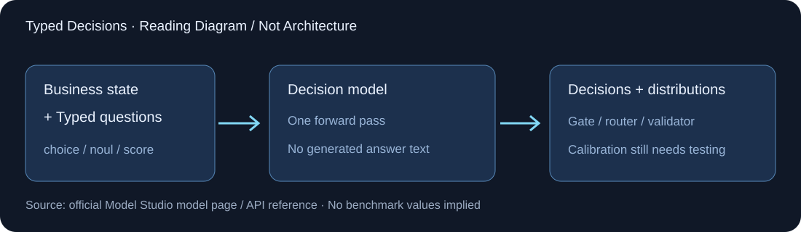

# Decision Model Preview

> [!tldr]
> 我的判断：这是把“写一段答案”改成“直接输出类型化判断分布”的独立服务模型。一次 state 可以并行提出多个选择、是非和序数问题；零生成文本减少输出预算依赖，但不自动证明概率校准良好、推理成本低或复杂问题更准确。

> [!warning] 资料深度不足
> 官方可核验材料目前只有模型页、首发目录与接口文档，没有 Tech Blog、HF Model Card、训练报告、架构图或评测表。由于原始技术资料较少，本笔记达不到 GLM-5.3-Flash 那种训练/实验深度；配图为明确标注的接口示意，不冒充官方内部结构。基础模型、参数、训练目标和数据来源均不补推。

## 日期、归属与身份

百炼官方新模型目录在中国区和新加坡区都列出 **2026-09-24** 的 `decision-model-preview`。日期来自该发布记录，不是页面 Updated at。它放在 Alibaba/Qwen 团队下的判断专项支线，**官方只称百炼决策模型，并未证明它属于 Qwen 某个正代或由 Qwen 直接微调**。

| 官方规格 | 含义 |
|---|---|
| Provider | Alibaba Cloud Model Studio |
| 输入 | 文本或业务 state；最大 65,536 tokens |
| 输出 | typed decision；最大生成文本长度 0 |
| Context | 65,536 |
| 问题类型 | `choice` / `noul` / `score` |
| API | `POST /compatible-mode/v1/systemone` |
| 模型页限制 | function calling、web search、cache、batch、fine-tuning 未支持 |
| 发布页价格 | 限时免费，不当作长期固定承诺 |

模型页把传统 Structured Outputs 标为不支持，API 却返回结构化 decision；两者不矛盾：前者是文本生成端点的通用 JSON 能力，后者是专用 typed 接口，不能当 Chat Completions 替代调用。

## 一次请求，多个类型化判断

`state` 可以是字符串、对象或数组，后两者序列化为模型输入；`questions` 是 id→问题定义的映射。`choice` 给出选项及说明，`noul` 提出是非问题，`score` 给出从低到高的等级含义。

API 文档说所有问题在一个 forward pass 中判断，不生成文本。它能减少自由语言解析的不确定性，但问题数量增加时 latency 仍近线性增长，所以“没有输出 token”不意味着每个额外问题免费或计算恒定。

| 输出 | 应怎样使用 |
|---|---|
| choice | 选中项、完整概率分布、confidence；确认可选类别涵盖真实世界 |
| noul | P(yes)，0–1；按错误代价设计阈值，不直接用0.5处理所有场景 |
| score | 等级索引的概率加权期望，可为小数；附概率分布与 legend，先定义清晰等级再评估排序/校准 |

文档建议每次 ≤16 个问题，choice 最多255选项；score 的属性表写2–10等级，而限制段又写2–255，存在不一致。因此建议采用3–7个清晰可区分等级，实际服务边界以验证结果为准，不能挑较大的数字包装能力。

## 工作流例子与不该推导的结论

工单 state 可同时判负责团队、是否升级、严重度；Agent router 可判应交给哪个工具/模型；结果 validator 可判是否满足验收条件。与先生成解释再提取标签相比，它的价值在于接口明确、输出分布直接可消费，而不是博客已经证明性能领先——官方没有提供这类对照。

概率不是凭空获得真实性：选项遗漏、指令歧义、输入分布变化都会影响分布；confidence 的语义与校准目标也需要明确。在高风险决策中只能作为辅助信号，不能凭概率自动替人做不可逆动作。

## 对 Agent Training 的启发

> [!insight]
> 将判断模型当 gate 或 verifier 时，单列误放行、误拒绝、覆盖率和每次有效判断成本；用独立终态 oracle 检查误报成功。校准需要可靠标签和 held-out 数据，不能用“置信度很高”替代成功验证。

可以固定同一批 state 和 rubric，对比直接 typed 判断、生成标签、先解释再标签三路线；测 ECE/Brier、任务成本、p95 latency、多问题互相干扰以及换序稳定性。由于没有权重/训练配方，不能把服务对比误称为模型内部算法消融。

## 原始资料

- [Official Model Page](https://help.aliyun.com/en/model-studio/decision-model-preview)
- [Official Release Record](https://help.aliyun.com/zh/model-studio/newly-released-models)
- [Official API Reference](https://help.aliyun.com/en/model-studio/decision-model-api)
- `src/` 保留三页原始 HTML 和正文提取；当前没有独立报告可链接。

> 📊 相关可视化: [[Topics/13_base_model/Alibaba_Qwen/Variants/260924_Decision_Model_Preview/decision_model_preview_poster_zh.html|Decision Model 中文 Poster]]
