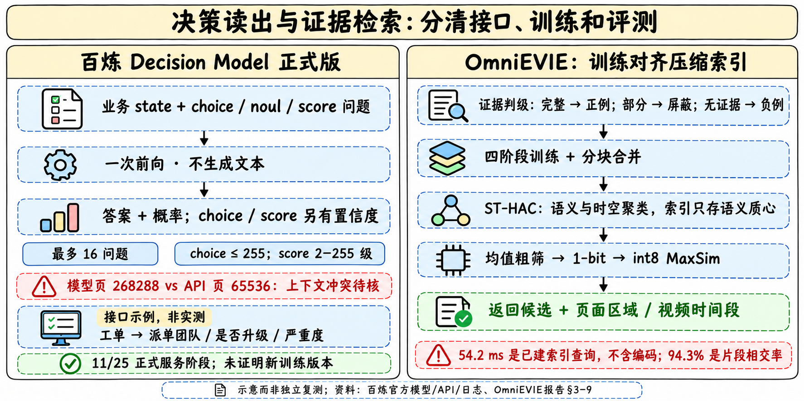

# Decision Model 正式版 — 业务判断服务阶段与尚未对齐的接口上限

> [!tldr]
> 我的判断：11/25的新信息是百炼决策模型从Preview进入正式服务阶段，仍归9/24同一专项族。它输出typed判断的概率，不是让聊天模型按JSON格式生成答案；官方没有公开底座、参数或新训练证据，不能据正式型号上线另增Qwen主干。

> [!warning] 资料不足与显著冲突
> 官方上架日志给出2026-11-25；正式模型页输入/上下文为268288，而同日API页仍写65536，必须按实际接口核验后冻结配置，不能擅自选择较大值。模型页“结构化输出不支持”与SystemOne typed响应不是同一概念：前者不能被解释成有通用JSON Schema聊天生成能力。未发起真实计费调用，所有返回数值仅官方示例；训练/Bench/校准与延迟曲线仍未披露。

## 正式版规格与日期

| 项目 | 官方披露 |
|---|---|
| 型号与归属 | decision-model正式版、decision-model-preview预览版；推理供应商阿里云百炼。没有证实其Qwen底座 |
| 输入/输出 | 文本、图像输入；业务state加typed问题，输出答案、概率分布和部分类型confidence；不生成文本 |
| 任务 | choice多选一、noul是否、score有序等级；面向工单、审核、Agent路由/结果核验 |
| 输入限制 | 模型页268288；API页65536；最大输出长度“—”，不能解读为无限文本输出 |
| 不支持 | Function Calling、联网搜索、上下文缓存、批量推理、调优、前缀续写；不是完整Agent控制器 |
| 北京原价 | 输入¥0.3/百万token；RPM5000、TPM5000000 |
| 新加坡原价 | 输入¥0.306/百万token；同RPM/TPM |

上表价格只记录官方2026-11-26抓取快照，不是成本测量；问题和判据也占输入预算。旧family Preview首发保留9/24。11/25 formal model-id记录为同族服务阶段；API增补SDK能力本身不另计模型发布。

## 请求与返回：三类问题的含义不同

> [!tldr]
> 多问题共用一次forward可减少重复读取state，但问题数仍影响时延；不能把“无输出token”写成“延迟不随任务复杂度变化”。

协议为`POST /compatible-mode/v1/systemone`，挂在业务workspace网关；state可String/Object/Array，对象会序列化。questions是调用者命名ID→问题对象，含type、instructions、criteria。北京与新加坡各有独立区域endpoint，不把个人workspace/key写入笔记或发布包。Python DashScope≥2.0.1、Java≥2.23.3，也给出TypeSafeSDK/curl例子；这些是接入依赖，不证明模型训练版本。

| 类型 | criteria | 返回的正确解释 |
|---|---|---|
| choice | 1–255项选项名→描述，建议完整选项和other兜底 | choice字符串、概率分布、confidence；不是任意工具调用 |
| noul | 可选true/false描述 | noul=P(yes)，0到1；不是已经threshold成bool，也未承诺一定有confidence |
| score | 2–255级从低到高等级描述，建议3–7级 | score为等级索引概率加权期望，可位于两级间；legend映射、概率和confidence |

最多16问题，官方称时延随问题数近线性增长。一次forward且没有autoregressive文本输出，所以输出文本长度不驱动延迟；实际总延迟仍受state长度、问题、选项/等级、图片、并发与服务队列影响，文档没有受控曲线。

## 工单示例怎样用，怎样不能用

官方例子state是支付后24小时未到账工单，同时问department(choice)、escalate(noul)、severity(score)。返回示例department选billing、概率.94、confidence.88，说明**confidence不能直接当最大选项概率**。severity概率{0:0,1:.01,2:.73,3:.26}，期望=.01+1.46+.78=2.25；不是选中了一个新的“2.25级”。escalate .99是P(yes)，业务行动阈值应外设并验证。示例latency52.9ms和input125token不是我们的测量，也不足以支撑P50/P99或百万请求吞吐。

正式版与Preview没有公开同题同协议对照，所以不能把上线解释为准确率、金融核验或置信校准改善。百炼路由/核验服务和LemonDecider/WePocketModel虽然都提到SystemOne、typed outputs，也没有官方证据证明同权重或完全相同边界：Lemon的多图/分题策略与此服务16问题/255选项上限不得互相移植。

## 与Qwen4 Preview下线分开登记

同一11/25日志还说明qwen4-max-preview下线，旧ID自动路由qwen4-max，按正式价，预览折扣结束。这是已有Qwen4家族的服务生命周期变化，不作新训练代际。本笔记不将Decision Model误归入Qwen4正式版，也不把自动别名路由作为本条发布日期依据。

> [!insight]
> 对Agent Training：把业务state→判据→概率→阈值/行动拆开，固定选项次序、文字、成本和未知类；测试confidence校准、分布外拒绝、条件翻转、敏感度与多问题干扰。服务返回的高confidence只是一项输出，不可直接当verifier ground truth或金融题正确性证明。正式版上线前后的收益需要同条件测量，当前资料只够接口与范围审计。

## 来源与原件

- [[Decision-Model-Preview|既有Preview笔记]]，原先9/24日期保持；本次为11/25正式阶段补充。
- [Official Release Record](https://help.aliyun.com/zh/model-studio/newly-released-models)、[Official Model Page](https://help.aliyun.com/zh/model-studio/decision-model-stable)、[API Contract](https://help.aliyun.com/zh/model-studio/decision-model-api)。原始HTML均在src/。
- 待核：65536/268288实际上限、图像请求契约、模型/数据/训练、正式版与Preview受控分数、confidence定义与延迟分布。

> 📊 相关可视化: [[decision_model_stable_poster_zh.html|中文Poster]]
