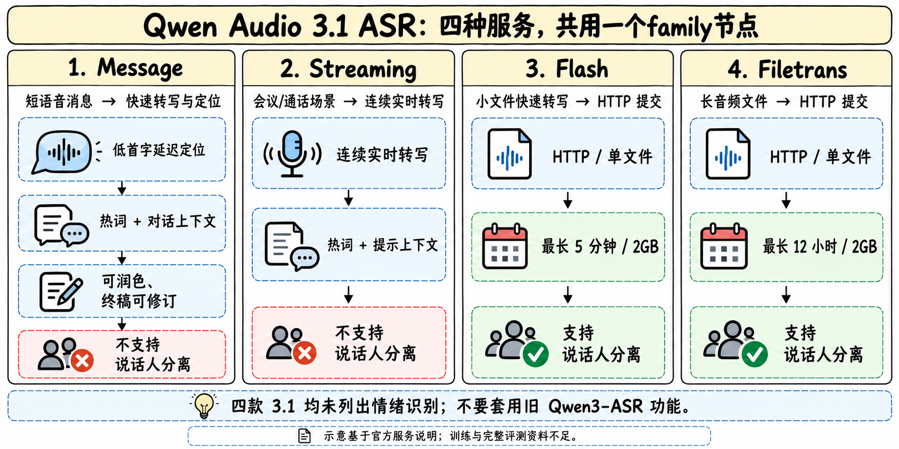
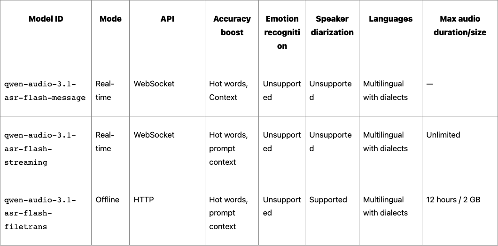

# Qwen Audio 3.1 ASR family

> [!tldr] 我的判断
> 3.1 ASR的主要选型差异是交互协议和输出稳定性：Message面向短句即时输入，Streaming面向连续转写，Flash与Filetrans处理离线文件。四种服务共用一个family节点；“同为ASR”并不意味着都带说话人分离或情绪识别。语音Agent还必须处理从中间结果到最终文本的修订，不能把每个临时token直接当不可逆指令。

> [!warning] 原始训练资料较少，达不到完整报告级精读标准
> 已读官方ASR能力总表、实时识别说明与发布账本。当前未查到本3.1 family的可核验HF模型卡、完整训练报告、数据构成、网络结构、训练损失、统一WER/CER或延迟对照。**所以本文达不到GLM-5.3-Flash / Kimi-K3完整技术精读的机制和评测深度。** 手绘图是服务关系示意，不是网络结构；旧Qwen3-ASR的公开训练技术和情绪能力不移植成3.1事实。本次没有调用模型或运行费用评测。

## 首发与归档：2026-09-21的历史补漏

官方发布账本将四款`qwen-audio-3.1-asr-flash`、`-message`、`-streaming`、`-filetrans`列于9/21，作为同一ASR family归档，Atlas归语音识别支线。本轮10/30看到回填条目，不代表模型10/30首发；本条不硬塞进10/1起的近30天新模型表。

## 先按输入与输出选服务

| 成员 | 输入/协议 | 主要场景 | 说话人分离 | 明列情绪识别 |
|---|---|---|---|---|
| Flash-Message | 实时音频 / WebSocket | 输入法、短语音消息 | 不支持 | 不支持 |
| Flash-Streaming | 连续音频 / WebSocket | 会议、课堂边说边看 | 不支持 | 不支持 |
| Flash | URL或Base64单文件 / HTTP | 较短离线音频 | 支持 | 不支持 |
| Flash-Filetrans | URL单文件 / HTTP | 长录音、访谈、播客 | 支持 | 不支持 |

官方“情绪识别”一节推荐的是**旧`qwen3-asr-flash-realtime`和`qwen3-asr-flash-filetrans`**；不能因为页面同处一个总览就归到3.1四款。官方发布记录还明确列方言ASR/AST可控输出；Message可保留方言原文或转普通话文本。这是已披露的转写/有限转换范围，不能推广成任意语言互译、回答问题或工具调用。

## Message：快反馈与终稿修订是两件事

Message定位短输入和低首字延迟，可返回中间结果，在说话片段结束后修订终稿，并可选文本润色。`intermediate_result_enabled`和`disfluency_removal_enabled`分别控制中间输出与去口语化，最终结果还包含句级/词级时间戳。去口语化改善阅读，不等于更忠实保留原话，尤其应检查口头否定、自我纠正和数字表达。

支持即时热词、预编译热词和`input.context`历史用户转写/助手回复。上下文可帮助消歧，也可能让旧实体过度影响新一句话。实验应设置同音词、换话题和错误历史三种条件，测正确修订与错误诱导；当前官方材料没有给出这些消融成绩。

中间结果先用于可撤销展示；涉及发消息、下单或修改文件的操作，需等待明确终稿及应用确认。这个策略是应用建议，不声称服务提供了恰好一次的外部副作用保证。

## Streaming：连续阅读，不把“无限时长”误读成无限资源

Streaming面向会议/课堂连续转写，强调中间结果准确性，支持热词和提示上下文。官方总表时长写Unlimited，本文只按该服务字段理解，不外推为单连接永久不掉线、请求不受速率/账户限制或任意网络都低延迟。

实时输入要求单声道；Message规格明确16kHz，Streaming表列支持任意采样率。音频编码/采样率声明、真实字节和服务参数必须一致，不能只改文件后缀。弱网恢复、端点检测、音频丢包与重新发送都可能改变转写结果，应与模型错误分开计数。

## 离线：更长文件与speaker标签各有成本

| 约束 | Flash | Filetrans |
|---|---|---|
| 单文件时长上限 | 5分钟 | 12小时 |
| 单文件大小上限 | 2GB | 2GB |
| 传入方式 | URL或Base64 | 文件URL |
| 热词/提示上下文 | 支持 | 支持 |
| 说话人分离 | 支持 | 支持；启用时建议≤2小时 |

12小时上限与启用diarization时≤2小时建议必须同时保留。speaker标签是同一录音内“谁在什么时候说话”的分组，不是现实人物身份认证，也不保证重叠说话能完全拆开。服务支持多种音视频容器，不表示对所有码率、声道和异常文件都同样稳健。

## 多语言和声学鲁棒性：支持列表不等于实测证据

Message发布记录重点列印尼语、日语、泰语、菲律宾语、越南语、韩语和马来语，以及多人声、背景对话、远场与环境噪声；Flash另强调古诗词韵律、节奏和文言表达。它们是官方定位/改进声明，尚没有本代分语言、噪声强度或古诗词子集的错误率表。应保存能力范围，同时避免写成所有语言和所有噪声都达到同一水平。

## 评测应分清文字正确、及时可用、说话人正确

官方未公布本family统一WER/CER/延迟表，因此下面是可执行的验收设计，不是虚构成绩。对同一批干净/噪声/远场音频，固定逐字参考、标点规范、数字归一化和说话人标注后分别计算CER/WER、实体错误率、删除/插入/替换。不要仅以润色后的可读性替代忠实转写。

实时部分同时报告首字时间、终稿时间、p50/p95、单位音频时长的修订次数，以及中间文本误触发率。离线speaker部分另外看DER/JER、重叠语音和长录音说话人漂移。多语言/方言按组报告，避免平均值掩盖弱语言；厂商支持语言列表不等于同质量保证。

热词/上下文至少做无增强、正确增强、冲突增强三组，保持音频不变。长文件分段还要追踪边界丢字、时间戳偏移和speaker编号跨段一致性。对语音Agent，应额外测听错→确认→纠错→继续任务的最终状态成功率。

> [!insight] 对Agent Training：把识别修订当作环境事件
> 训练轨迹如果只保存最终文本，会丢掉真实用户看到的中间识别错误和助手提前行动造成的后果。可同时记录临时/终稿、音频时间和操作时间，训练可撤销预览、澄清与错误恢复。但公开资料不足以判断千问是否用了这种奖励设计，本文不作归因。

## 官方来源与导航

- [官方ASR总览与完整功能表](https://help.aliyun.com/en/model-studio/asr-model)
- [官方实时识别说明](https://help.aliyun.com/en/model-studio/real-time-speech-recognition-user-guide)
- [官方发布记录](https://help.aliyun.com/zh/model-studio/newly-released-models)：9/21四款服务，按family合并。
- [[Topics/13_base_model/Base Model MOC|基模主题索引]]；[[Qwen-Audio-3.1-TTS-Family|同代声音生成笔记]]。

> 📊 相关可视化：[[qwen_audio31_asr_poster_zh.html|中文Poster]]
