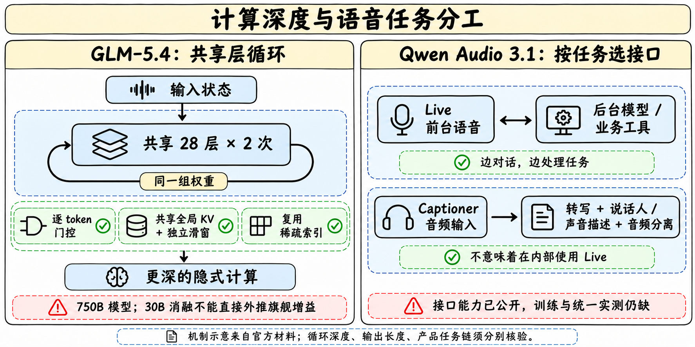

# Qwen Audio 3.1 Captioner — 音频全要素标注与分离专项

> [!tldr]
> 我的判断：它作为独立专项模型值得收录，因为输出不仅是ASR转写，还包括说话人、时间段、环境声/音乐与场景描述。当前公开资料主要说明异步服务契约，不能据API字段补造网络结构或训练方法。

> [!warning] 资料深度
> 首发取百炼发布表11/23，非页面更新时间。已读模型页、HTTP API与发布表原始HTML，未调用收费服务。无HF权重、独立Tech Report、训练数据/参数、统一WER/DER/声源分离指标或实测延迟；模型页上下文表为空，保持未知，不填写猜测值。手绘图只解释任务分工。

## 能力与边界

> [!tldr]
> 模型页声明音频输入、文本/音频输出；API当前清晰文档化的是文件异步标注结果，分离音频的完整返回契约仍待核实。

| 项目 | 已公开 | 未证实 |
|---|---|---|
|输入|单个HTTP(S)音频或视频文件；可选channel_id|最大时长/体积/所有编码边界|
|结果|分段语音/声音事件/背景及全局描述|官方统一准确率与完整分离音轨接口|
|工具/搜索/微调|模型页均不支持|不把captioner当对话工具Agent|
|结构化输出|模型JSON Mode不支持|异步服务结果JSON不等于生成JSON Mode|
|价格 / 地域|北京输入0.8、输出2.7元/百万Token，RPM600|音频时长和Token换算未见明确值|

这与Qwen Audio ASR只做转写的任务定位不同，因此单独支线；Live是前后台对话编排，另在既有Realtime族记文档更新，不凭服务新名称增加正代。

## 请求、状态与时间语义

> [!tldr]
> 提交成功只表示排队，必须核对SUCCEEDED及文件subtask_status，才能读取标注结果；结果链接有24小时有效期。

POST到空间专属北京域名的audio/asr/transcription，X-DashScope-Async=enable；请求含model、input.file_url与parameters.channel_id。返回task_id，GET tasks/{task_id}查询PENDING/RUNNING/SUCCEEDED/FAILED/CANCELED。成功再取transcription_url，需完整URL查询参数，本档案不保存任何实际签名链接。

结果外层有原始格式/采样率/时长、每声道transcripts、sentences及usage。transcripts[].text本身还是JSON字符串，要再解析一次。sentences的begin/end以毫秒表示，而内部sound/background的start_time/end_time与speech的start/end为MM:SS.cc、相对当前片段起点，跨段可为负；不能直接混成整段绝对时间，需保留offset和声道。

## 输出结构与可转化的数据价值

> [!tldr]
> 输出包含局部时序与全局汇总，适合构建音频事件检索材料；描述性标签需要证据核验，不能当事实身份。

sound_segments含时间、tag与description；speech_segments含language、text、speech_mode/speed/volume/intonation、speaker和speaker_index；background_segments描述音乐/环境/安静段。speech_globals汇总SPK编号、角色和声音特征，global.scene包含format/topic/style，global.emotion包含overall与flow。年龄/性别/姓名等听感或可识别描述并非身份认证，不作真实个人属性结论。

原API示例是文档合成样例，7秒完成的时间戳不能当延迟测试；也没有说明模型能稳定分离所有重叠人声、音乐或方言。评测应分WER/CER、speaker DER、时间误差、事件检索、分离SI-SDR及幻觉率；这些是我建议的验收维度，并非已发布成绩。

## Agent Training判断与来源

> [!insight]
> 可训练价值在“音频证据→带时间的可查片段→检索/判断”链条。标注成功不等于推理正确，须把声学证据与后续任务标签隔离。

可用独立音频材料核对跨段负时间、说话人关联与声音事件；记录模型ID、地域、原文件hash、声道、任务状态和费用。大规模数据构造应抽样核验转写与场景标签，不能把供应商生成描述直接升级为gold。完整训练细节和benchmark仍缺，当前档案只能达到接口与证据审计深度。

- [模型页](https://help.aliyun.com/zh/model-studio/qwen-audio-3-1-captioner)、[HTTP API](https://help.aliyun.com/zh/model-studio/qwen-audio-asr-captioner-http-api)、[发布表](https://help.aliyun.com/zh/model-studio/newly-released-models)。
- [[Qwen-Audio-3.1-Realtime]]、[[Qwen-Audio-3.1-Live]]：对话服务与离线标注分开。

> 📊 相关可视化: [[qwen_captioner_poster_zh.html]]
