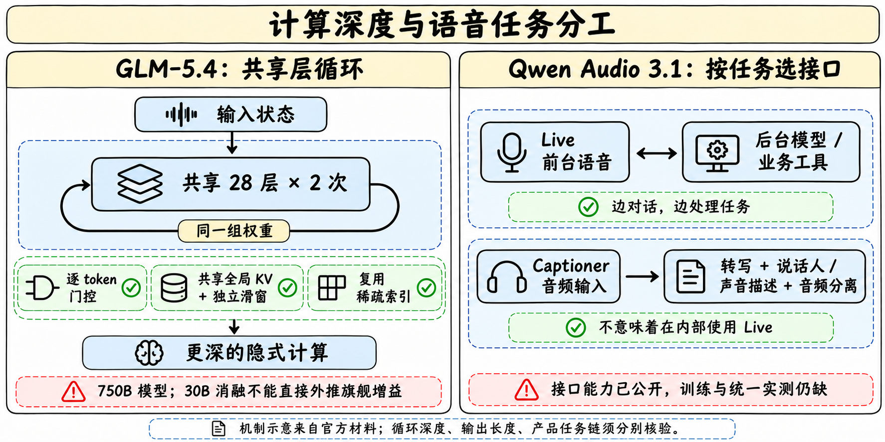

# Qwen Audio 3.1 Live — 前台说话与后台任务解耦

> [!tldr]
> 这次记录服务接口变化，合并进既有Audio3.1实时语音family，不计新基座或新训练阶段。关键变化是前台持续听说、后台处理任务，两者通过事件关联；连接服务名与实际前台session.model不可混为一个权重ID。

> [!warning] 契约差异
> 发布表11/23列qwen-audio-3.1-live；接入示例WebSocket连接model为3.1-live，session.model却是qwen-audio-4.0-realtime-preview。本轮按官方原样并列，未调用API，未据此推断4.0新正代。训练、权重继承与端到端延迟实测未披露。

## 前后台与工具

> [!tldr]
> Client由应用接管任务并校验回传；Responses由百炼调用配置的后台模型。函数调用call_id和任务delegation_id分别关联，不能互换。

前台听取语音、追问与播报，长业务不应阻塞音频主循环。Client接收session.delegation.created，按event_id去重，保存delegation_id与summary/context/supplements；进度用session.thinking.append，追问用instruction.append，结果用commentary.append。Responses把model/instructions/tools交给后台，可监听response.event的completed或failed。前台函数以session.tools声明，在session.event读function_call，按call_id只执行一次，再session.item.create回传function_call_output。response.create在Live用于显式后台生成，不可照搬旧Realtime用它触发前台语音的逻辑。

## 音频、会话与费用

> [!tldr]
> WebSocket主连接承担控制，可另协商WebRTC/AOQ媒体；语音采样率和事件去重共同影响实际体验。

模型页文本/音频输入输出，支持function calling、不支持内置联网搜索/JSONMode/缓存/批量/调优。前台指令与函数配置文本合计最多65536Token，不是完整语音历史长度。示例turn_detection=duplex，输入16kHz16bit单声道PCM，20ms/640bytes每帧；输出24kHzPCM。先等session.updated再发送；用户/模型字幕各自追加，多通道相同event_id去重。静音不等于结束。

北京0.003330元/秒，新加坡0.005177元/秒；连接至少3秒，空闲、静音和文字消息都计时，后台按实际Token另计。最多5条WebSocket；usage每5秒更新，最终以session.closed为准；文档称单次无时长上限，不借用既有Realtime的300秒条件。价格是运行当日文档事实，无独立成本测试。

## 训练与验收启发

> [!insight]
> 面向Agent的训练信号可以拆成任务委派正确、补充信息关联、后台终态正确与播报一致四项。仅听到流畅语音不能证明后台任务完成。

固定同业务工具与原生harness，检查重复事件、用户中途补充、后台失败/超时、旧结果误播、权限过滤和结束计费。Responses/Client不同责任边界不可混测，网络抖动、首音延迟、打断恢复与任务成功率需要实测。本轮只读文档，未建立连接、调用模型或生成示例回复。

## 来源

> [!tldr]
> 模型页给价格限制，接入指南给事件与控制流，二者均不是新权重证据。

- [模型页](https://help.aliyun.com/zh/model-studio/qwen-audio-3-1-live)、[接入指南](https://help.aliyun.com/zh/model-studio/qwen-audio-live)、[API目录](https://help.aliyun.com/zh/model-studio/qwen-audio-live-api-directory)。
- [[Qwen-Audio-3.1-Realtime]]、[[Qwen-Audio-3.1-Captioner]]。

> 📊 相关可视化: [[qwen_live_poster_zh.html]]
