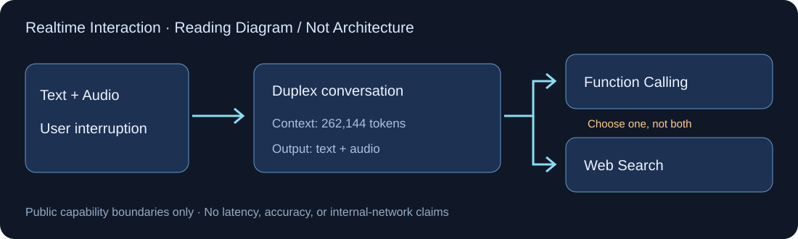

# Qwen Audio 3.1 Realtime

> [!tldr]
> 我的判断：3.1 是独立实时语音产品族的更新，不是 Qwen3.8 文本正代。公开证据的重点是双工交互、长上下文和工具接口约束；真正的模型训练改动与效果提升尚无公开报告支持，不能把服务规格当作新算法贡献。

> [!warning] 原始资料较少
> 当前可读一手资料是百炼模型页和官方新模型目录，尚未找到独立 HF 模型卡、Tech Blog、完整 Tech Report 或训练/实验图。因此本笔记达不到 GLM-5.3-Flash 的技术证据深度；配图是基于公开能力的整理示意，不是官方网络结构。参数、数据、损失、codec、训练成本与评测收益均未补推。

## 发布记录与 Family

官方目录在 **2026-09-20** 列出 `qwen-audio-3.1-realtime-plus`，说明沿用3.0 Plus协议、保留原有音色并新增8个系统音色。这个日期是已核实的官方服务发布记录；不使用页面 Updated at，不将供应商接入时间推广为未披露的权重训练完成日。

3.1 Realtime 与 Qwen3-ASR、Qwen3-TTS、Qwen3.8-Omni 分开：ASR只回答识别，TTS只回答合成，双工语音模型处理实时对话输入输出，Omni又是另一条综合多模态族。不能把这些名字有“音频”的型号全部合并为一个 SKU。

## 已确认规格

| 项目 | 官方模型页 |
|---|---|
| 输入 / 输出 | 文本与音频输入，文本与音频输出 |
| 对话 | 实时双工 |
| Context | 262,144 tokens |
| 最大输入 / 输出 | 245,760 / 16,384 tokens |
| 额外能力 | Function Calling、Web Search、voice cloning |
| 默认音色 | `longanqian_v3.1` |
| 关键互斥 | Web Search 与 Function Calling 不能同时启用 |

长上下文是总请求规格，不代表 262K 全是可用语音记忆；不同模态 token 与中间工具上下文怎样计量，还需要按运行时文档和真实请求验证。音色新增也不证明识别准确率、语音自然度或推理能力提高。

## 工具闭环：双工体验不等于可靠行动

双工模型要处理用户插话、旧音频取消、迟到的工具结果以及对话状态恢复。官方模型页只确认能力列表，没有公开这些边界的训练目标或benchmark。尤其 Search/Function Calling 互斥，应用必须显式选择工作模式，不能在集成时同时开启后再将服务错误归因于模型。

一种可验收流程是：听到新目标后建立当前任务状态，工具执行前校验授权，工具返回后检查用户是否已改变要求，然后再说结果。评测要区分“说得自然”和“任务确实完成”，并记录用户取消后的误行动。

## 成本口径与性能未知项

模型页查询日2026-10-14，中国区每百万token公开价格为文本输入/音频输入/文本输出/音频输出 ¥5/40/40/150；新加坡列 ¥5.995/47.963/47.963/179.861。它们是当日页面报价，不是永久承诺，也不能直接按字符数或音频秒数相乘。本文没有实际调用计费API。

没有官方 latency、WER、声学偏好、插话成功率或工具终态结果的对照表，所以不能写“比3.0快多少”“推理提升多少”。保留这类空白比给它画一张没有来源的性能图更有用。

> [!insight]
> 用固定语音任务测端点检测、打断恢复、工具权限和真实终态；同时记录p50/p95端到端延迟、错误播报、取消后误行动和每成功任务成本。再用相同提示与音频材料对比3.0/3.1，避免音色和服务后端变化掩盖模型收益。

## 原始资料

- [Official Model Page](https://help.aliyun.com/en/model-studio/qwen-audio-3-1-realtime-plus)
- [Official Release Record](https://help.aliyun.com/zh/model-studio/newly-released-models)
- 原始模型页、正文提取与官方日期证据在 `src/`；没有下载权重、PDF或音色样音。

> 📊 相关可视化: [[Topics/13_base_model/Alibaba_Qwen/Variants/260920_Qwen_Audio_3_1_Realtime/qwen_audio_3_1_realtime_poster_zh.html|Qwen Audio 3.1 中文 Poster]]
