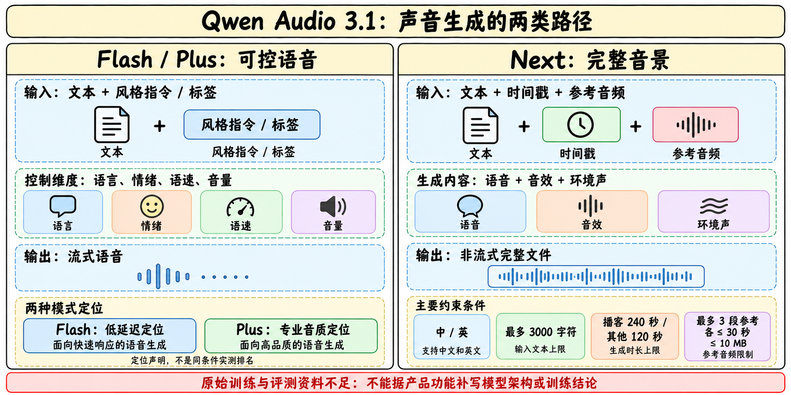
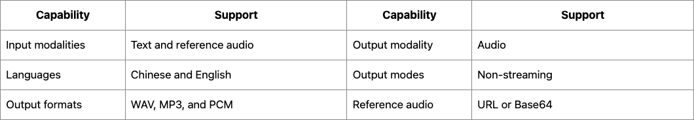

# Qwen Audio 3.1 TTS family

> [!tldr] 我的判断
> 3.1 TTS不能只读成一个更高音质的朗读器。Flash/Plus面向可控流式语音，Next则把语音、音效和环境声放在一次完整音频生成里。它们共用一个语音生成family入口，但实时对话与离线制作的约束相差很大；模型选型首先由输出方式和最终作品决定。

> [!warning] 原始资料较少，达不到GLM-5.3-Flash / Kimi-K3完整技术精读深度
> 本次已读官方三款模型页和官方发布账本并归档原文。公开材料以产品能力和服务限制为主，**没有查到该3.1 family可核验的HF原始模型卡、完整训练报告、数据配方、损失/消融或统一MOS/延迟评测**。因此本文达不到完整技术报告级的机制与效果归因深度。手绘图解释已披露的功能关系，不冒充官方网络结构图；没有用旧Qwen3-TTS报告填补本代未知，也没有调用收费API或运行模型。

## 日期与family：历史补漏，不把国际区上线算新模型

| 首次发布记录（北京） | 成员 | 定位 | 后续区域记录怎样处理 |
|---|---|---|---|
| 2026-09-18 | qwen-audio-3.1-tts-flash | 低延迟流式语音 | 10/12国际区上线，同SKU，不再算首发 |
| 2026-09-21 | qwen-audio-3.1-tts-next | AudioGen完整音景 | 10/22国际区上线，不另添模型 |
| 2026-10-21 | qwen-audio-3.1-tts-plus | 专业语音、内容制作 | 作为同family新增成员阶段，保留10/21更新 |

本family首日取9/18。发布时间来自官方发布记录中的实际条目，不取网页Updated at、抓取日期或API版本日期。这里是3.1音频产品族，**不是Qwen3.1通用语言正代**；在Atlas放语音支线。年初开放Qwen3-TTS仍保留自己的卡、报告和节点，不能仅凭相似名字合并成同一权重。

## Flash与Plus：控制声音，先固定听什么、如何听

官方对两者共同列出多语言/方言、流式合成、自由形式指令和细粒度标签，标签控制情绪、音调、persona、语速与音量。声线克隆描述强调对参考音频噪声和混响更稳健；**这是官方能力声明，尚缺同条件量化对照**，不能写成已实测噪声鲁棒性提升多少。

Flash强调语音助手、实时交互和客服的低延迟；Plus强调品牌音色、影视配音、角色演绎和专业作品音质。这是产品取舍的定位，不意味着Flash每项更快或Plus每项更准；没有公布首包延迟、实时率、MOS或跨语言分组误差条。复杂标签也可能增加不稳定性，应用验收要测复合指令和跨段一致性。

| 维度 | Flash | Plus | 当前不能补写的事实 |
|---|---|---|---|
| 输出 | 流式语音 | 流式语音 | 切块大小、声码器/codec结构未知 |
| 控制 | 风格指令与细粒度标签 | 风格指令与细粒度标签 | 指令依从率和冲突标签优先级未列 |
| 克隆 | 官方称抗噪/抗混响改进 | 同类能力描述 | 不证明任意参考音频都可忠实复现 |
| 长度 | 模型页为空白“—” | 模型页为空白“—” | 空白不等于无限输入/输出 |
| 训练/微调 | 产品表不支持服务微调 | 产品表不支持服务微调 | 不等于内部模型没有后训练 |
| 工具/结构化输出 | 未支持 | 未支持 | 声音生成不是独立工具Agent |

## Next：不是Flash的高延迟别名

Next接收文本、时间戳与参考音频，在一次生成里组合说话、音效与环境声。核心交付是完整声音场景：播客对话、影视音景、游戏声音等。它当前是**非流式**输出，不能把Flash/Plus流式属性移植过来，也不能由多说话人生成推断能识别任意输入音频中的说话人。

| Next硬限制 | 官方模型页记录 | 对作品规划的影响 |
|---|---|---|
| 明列语言 | 中文、英文 | 正文说multilingual，但表中只明确这两种；不承诺其它语种 |
| 输入文本 | 最多3000字符 | 先按内容段落切分，跨段声线一致性另验 |
| 时长 | 播客240秒；其它120秒 | 不是任意两分钟内一定满足复杂时间戳 |
| 参考音频 | 最多3段，每段≤30秒、≤10MB | 3段不等于支持任意数量角色 |
| 参考格式 | WAV、MP3、OGG Opus；不支持raw PCM | 输入/输出格式要分开 |
| 输出格式 | WAV、MP3、PCM | 可输出PCM不表示能输入raw PCM |
| 请求方式 | HTTPS，返回完整文件 | 实时助手应单独评估等待与中断策略 |

## 怎样验收，才能把“好听”变成可复查结论

以下是研究建议，非官方已公开成绩，也非本机实验结果。先固定同一文本、speaker reference、语言、采样/输出格式和服务区域，再做隐藏模型身份的成对试听。分开统计语义正确、漏字/重复、音色相似、韵律自然和情绪标签依从，避免一个综合MOS掩盖重要失败。

实时路径记录首音频包延迟、p50/p95、每秒生成时长、断句边界爆音、网络重连和用户打断；完整音景路径记录时间戳偏差、多角色声线串线、音效遮蔽台词和跨段一致性。噪声参考的对照只改变噪声/混响，保留干净参考基准，不能同时换说话人后宣称鲁棒性提升。

计费也需要统一分母。当前北京列表Flash为输入/输出token计价，Plus按万字符计价，Next输入/输出token分别计价；不同计费单位不能直接比较数字大小。应算每分钟合格音频的端到端成本，包含重生成、失败请求和人工剪辑。

> [!insight] 对Agent Training的启发
> 语音Agent的奖励不能只有文本任务成功。流式语音的打断、停顿和信息修订会改变用户行为；音景制作则有多轨时序约束。可以把“任务完成 + 可懂度 + 时序/声线一致性 + 响应成本”分开验证，但公开资料不足以断言Qwen已按这套目标训练。

## 官方来源与资料边界

- [官方Flash模型页](https://help.aliyun.com/en/model-studio/qwen-audio-3-1-tts-flash)
- [官方Plus模型页](https://help.aliyun.com/en/model-studio/qwen-audio-3-1-tts-plus)
- [官方Next模型页](https://help.aliyun.com/en/model-studio/qwen-audio-3-1-tts-next)
- [官方发布记录](https://help.aliyun.com/zh/model-studio/newly-released-models)：9/18、9/21与10/21；国际区接入日分开保存。
- [[Topics/13_base_model/Base Model MOC|基模主题索引]]；[[Qwen-Audio-3.1-ASR-Family|同代识别笔记]]，生成与识别不共享未披露能力。

> 📊 相关可视化：[[qwen_audio31_tts_poster_zh.html|中文Poster]]
