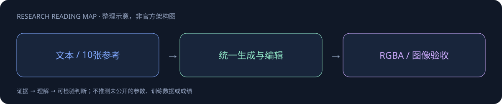
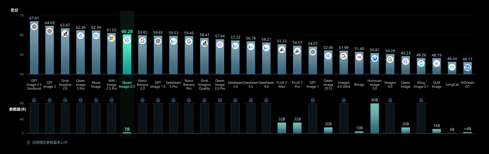

# Qwen-Image-2.1

> [!tldr]
> 7B 视觉生成组件，统一生成、编辑与 RGBA；包含 PE 与 8-step Turbo 变体。 同一 family 将文本生成、局部编辑、透明图层与主体抽取统一。前缀 KV 复用减少 denoising 的重复条件计算，混合粒度注意力改善效率；Turbo 是加速 checkpoint，不是新通用正代。

## 一页速览

| 维度 | 当前证据 |
|---|---|
| 发布时间 | 2026-09-20 |
| 类型 | 专项支线 / family · Image |
| 关键事实 1 | 7B；32 Single-Stream DiT layers |
| 关键事实 2 | 最多10张参考图 |
| 关键事实 3 | Turbo：8 denoising steps；CFG=1 |
| 检查日期 | 2026-10-13；官方原始资料在同级src/ |

## 统一生成、编辑与透明图层

视觉生成部分7B、32层Single-Stream DiT，采用混合粒度注意力与prefix KV缓存复用。这里的7B不是所有组件总参数。RGBA支持让模型能直接产出透明图层、修改图层并提取主体；它改变的是生产素材接口，不仅是图像视觉更好看。

## Family 内的模型不要重复算正代

| 组件 | 作用 | 发布口径 |
|---|---|---|
| 基础Qwen-Image2.1 | 生成、编辑、RGBA | 9月20日正式公开；仓库9月14日创建不直接算首发 |
| PE-T2I / PE-I2I | 生成或编辑提示增强 | 作为family配套，不另算通用基模 |
| Turbo | 少步数推理 | 10月9日仓库出现，确切正式发布日待核对，合并family |

基础示例40steps，Turbo8steps且CFG1；不能只用步数比宣称5倍端到端速度，编码器、VAE、分辨率与硬件都影响总耗时。支持10张参考图，圈注、涂鸦与mask可表达局部编辑范围；多参考对象必须检查身份和位置对应关系。

## 训练与部署公开到什么程度

model card给出架构概要和使用方法，没有提供完整训练语料/消融。Diffusers新Pipeline、Transformers版本与BF16要求需要固定revision；在线安装示例不是可复现版本。授权为Qwen Research，不能默认为Apache或MIT。

## 验收不是只看官方好图

用同一prompt和seed做生成、参考编辑、透明边缘、文字、细小物体五类测试。检查alpha是否真的透明、非编辑区域是否被改变、产品身份是否保持、最长中文是否可读。官方样例可展示覆盖范围，但没有盲评总表时，不能据此宣称全面超过另一生成模型。

## 对 Agent Training 的启发

> [!insight]
> 验收编辑局部性、未修改区域保持、身份一致性和 alpha 边缘质量。分别测40-step与8-step的质量/延迟，不把可生成透明背景等同于精确抠图；许可是 Qwen Research。

以上是基于已读官方资料的研究判断，不是官方保证，也没有在本机运行模型推理或复现论文成绩。下一步优先补独立验证器、固定任务/版本和完整失败轨迹，避免只保存最好样例。

## 一手资料与导航

- [S1] [HF Model Card](https://huggingface.co/Qwen/Qwen-Image-2.1)
- [S2] [HF Model Card · Turbo](https://huggingface.co/Qwen/Qwen-Image-2.1-Turbo)
- [S3] [HF Model Card · PE T2I](https://huggingface.co/Qwen/Qwen-Image-2.1-PE-T2I)
- [S4] [HF Model Card · PE I2I](https://huggingface.co/Qwen/Qwen-Image-2.1-PE-I2I)

原始下载文件与SHA-256见 [[src/retrieval_manifest.json|抓取记录]]。报告保留链接，不抓PDF；动态网页响应若只有壳文件，不将其标成完整离线正文。

- [[Topics/13_base_model/Base Model MOC|基模主题索引]]
- [[qwen-image-2_1_poster_zh.html|中文Poster]]

> 📊 相关可视化: [[qwen-image-2_1_poster_zh.html|Qwen-Image-2.1 中文Poster]]
