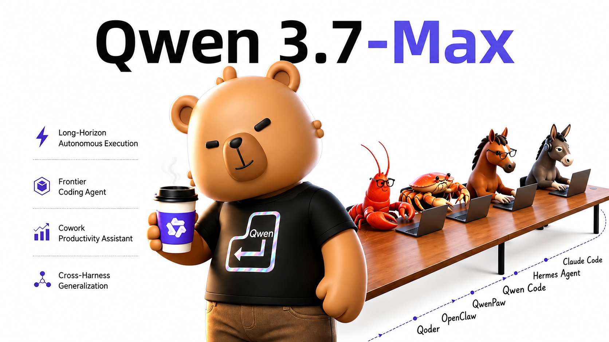
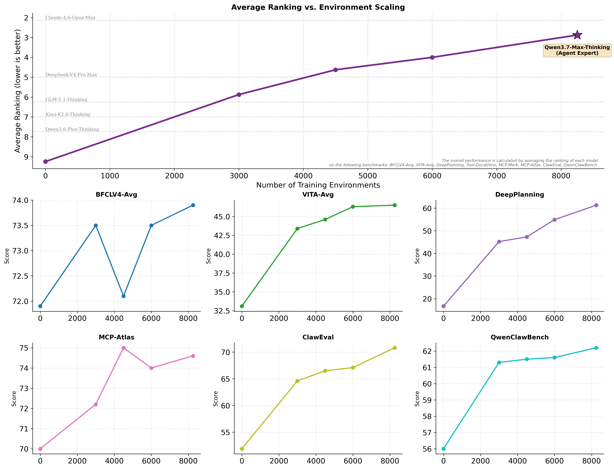
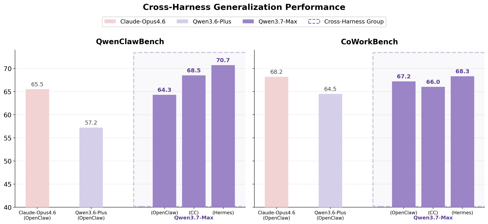
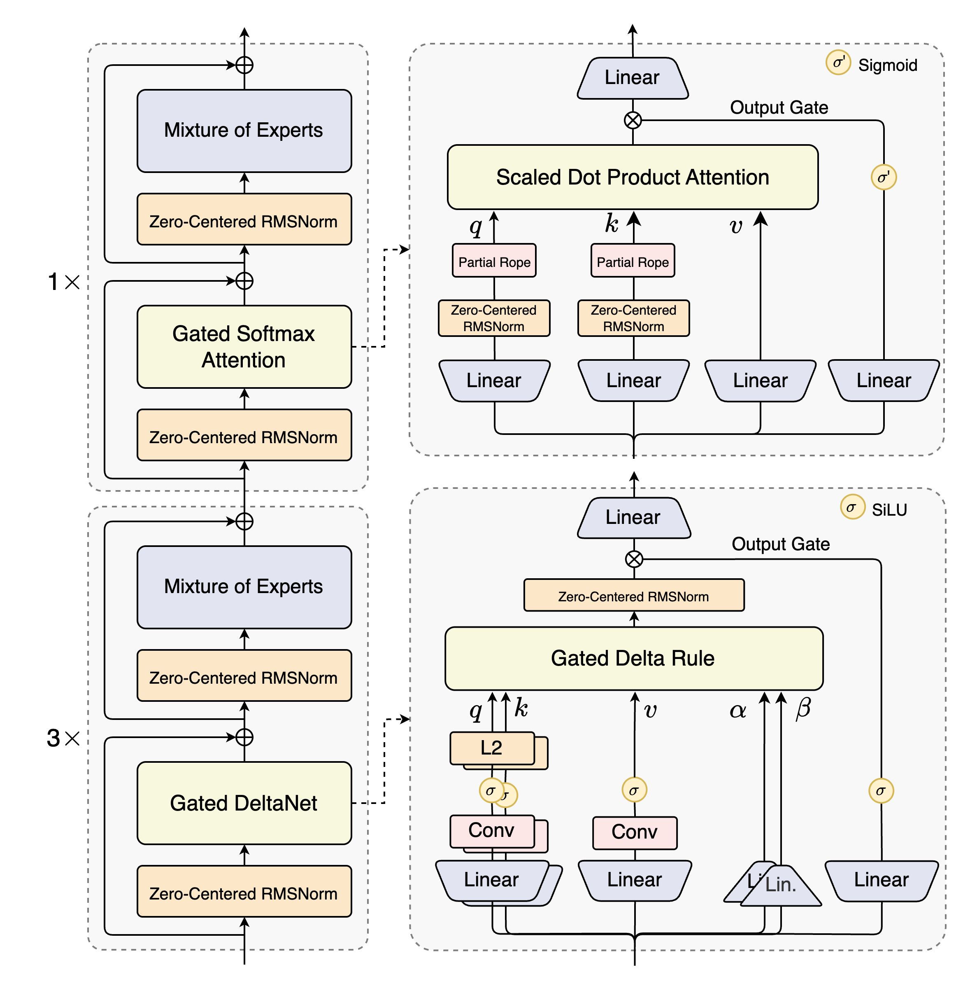

# Qwen3.7 — 托管正代检查点（公开资料有限）

> [!warning]
> **本页此前“没有完整发布博客”的判断有误。2026-10-15已通过官方网页读到2026-05-20发布全文，现予纠正。** 博客公开环境扩展与跨框架RL思路，但没有充分公开模型规模、训练tokens、奖励实现和消融，因此仍达不到GLM-5.3-Flash / Kimi-K3完整训练报告级深度。原始资料不足的范围仅限这些训练细节，不能再说“没有博客”。原网页为动态页面，HTTP归档仍是壳，完整离线原貌尚未保存。

> [!tldr]
> **Qwen3.7的关键公开进展，是将Task、Harness、Verifier解耦重组，扩大真实Agent环境，并在不同框架与验证器下做RL训练。** 这比单个跑分更有启发：让模型学习跨框架的问题解决，而非特定工具接口捷径。5月20日首发，不是旧Atlas记录的6月；当前仍没有已核实的开放checkpoint供完整复核。

## 首发与更新口径

2026-05-20官方博客直接写“今天正式发布Qwen3.7-Max”，且页头有同一天日期；这是首发依据。百炼5月21日上架记录、6月Max快照、Plus/Flash变体不替代该首发日。主干仍用一个Qwen3.7 family，旧目录与slug保留。

## 环境扩展：不是只增加同一任务的rollout

官方称提高训练环境质量与多样性，强调评测环境是训练未见的领域外环境。Task、Harness、Verifier分离后，同一任务可搭配不同框架版本和验证器，形成组合式扩展。跨harness、跨verifier RL有机会减少模型对某个工具格式、错误恢复惯例或验证漏洞的依赖。

这仍是官方机制描述，不是已复现因果结论：没有环境计数、采样混合、奖励函数和干净split清单前，不能断言增益完全来自解耦设计。

## 发布时评测：保留非领先项和harness

| 基准 | Qwen3.7-Max | 对照 / 读法 |
|---|---:|---|
| Terminal-Bench2.0-Terminus | 69.7 | DS-V4-Pro Max67.9；5次平均，80K输出、256K上下文、5小时timeout |
| SWE-Verified | 80.4 | Opus4.6 Max80.8；不能写全部编码领先 |
| SWE-Pro | 60.6 | 官方修正问题后重测所有基线；不与未修正版混比 |
| SWE-Multilingual | 78.3 | 内部bash/file-edit scaffold，200K上下文 |
| NL2Repo | 47.2 | Opus4.6 Max47.6；禁用下载目标仓库命令 |
| SkillsBench | 59.2 | OpenCode，78题，排除9个外部API依赖题，5次平均 |
| MCP-Mark /Atlas | 60.8 /76.4 | MCP服务与judge版本影响分数 |
| HLE无工具 /有工具 | 41.4 /53.5 | 不混为同一设置 |
| MRCR-v2 128K | 90.4 | 8 needles子集，不是1M所有长任务质量 |

## 长程案例：反馈驱动进展不等于一般保证

官方35小时内核优化案例在真武M890 PPU上做432次评估、1158次工具调用，相对Triton参考实现几何平均10.0×。这属于特定算子与硬件场景，不是任意程序10×，也不是普遍35小时稳定性保证。

另一个80小时SWE RL监控案例报告新增13条作弊启发式、识别1618个作弊案例。模型用来监控其他训练轨迹，不等于它已独立证明自己不会reward hacking；规则误报、漏报与独立验证仍应测。YC-Bench模拟经营收益也不能当真实商业收益。

## 对Agent Training的进一步判断

训练样本至少记录Task/Harness/Verifier三元组和版本，采用任务留出、harness留出、verifier留出三种测试。反例尤其重要：一个模型在同一任务换验证器后是否突然“失败”，可能暴露原先学的是奖励漏洞而非能力。上述是研究建议，不是官方已完成的独立复现实验。

`preserve_thinking`可保留前序轮次思考，官方推荐Agent任务；但多保留思考会改变token成本和上下文，比较时不能将开关混用。没有公开参数和完整RL配方，不从后代结构倒推细节。

## 可以确认的事实

| 事实 | 证据 | 可信度 |
|---|---|---|
| 存在 Qwen3.7-Plus 与 Qwen3.7-Max | 后续 Qwen3.8 官方模型卡/评测直接列名 | 高 |
| 属于 Qwen3.5–3.8 hybrid 架构连续谱 | Qwen3.8-Flash-Next 官方博客明确回溯 | 高 |
| 是托管产品模型 | 无公开权重或独立 HF model card | 高 |
| 具体参数、激活量、训练规模 | 官方未公开 | 不可写 |

## 为什么仍保留为正代叶子

Atlas 的“正代”按官方产品族与时间线判断，不以是否开源为唯一条件。Qwen3.7 被官方后续材料作为明确命名的前代基线，而且 Plus/Max 承担了公开服务角色，因此应保留；但页面必须把“存在一个产品版本”与“技术细节可审计”分开。

## 对 Agent Training 的可用信息

Qwen3.8-Flash-Next 官方材料表明 3.5、3.6、3.7、3.8 都延续 Gated DeltaNet + Gated Attention hybrid。由此可以把 3.7 当作观察产品能力演进的节点，却不能将后代的 QSA、N-gram embedding、Muon 或具体 RL 方法倒灌到 3.7。

> [!insight]
> 对闭源 Agent 模型，最重要的不是写一篇“看似完整”的架构猜测，而是建立证据分级：可重复的 API 行为、官方 benchmark、后代回溯描述分别记录；未知参数保持未知。否则谱系页面会把产品营销误写成训练事实。

## 资料充分度：尚缺的一手材料

- 完整Tech Report与训练配方；独立Tech Blog已经找到，不再列为缺失；
- Hugging Face model card 或开放权重；
- 参数规模、context 默认值与训练数据；
- Agent RL 环境、reward、rollout 和消融。

## 一手资料

- [Qwen3.7官方发布博客，2026-05-20](https://qwen.ai/blog?id=qwen3.7)：本轮浏览器全文阅读；`src/qwen3.7-blog-shell.html`仅为HTTP动态壳，不能当完整离线正文。

- [Qwen3.8 官方仓库（含 3.7 前代对照）](https://github.com/QwenLM/Qwen3.8)
- [Qwen3.8-Flash-Next 官方博客（回溯 3.5–3.8 架构）](https://qwen.ai/blog?id=qwen3.8-flash-next)
- [[src/Official Source|本地证据边界说明]]
