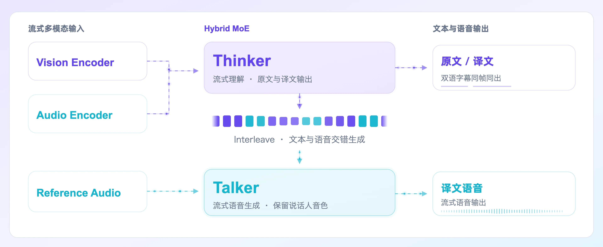
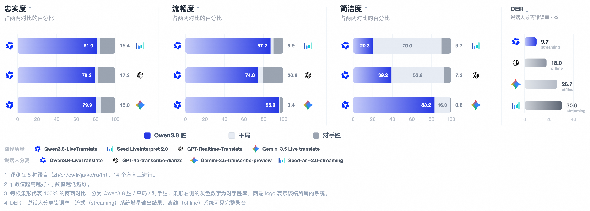

# Qwen3.8-LiveTranslate

> [!tldr]
> Interleave 实时同传架构，官方主页报告平均延迟 LAAL 2.8→2.3 秒。 同传的质量与等待时间共同决定可用性。Interleave 让输入与翻译输出交错，减少完整句子等待；仍要检验跨说话人、术语和语气保持，低延迟不代表低错译。

## 一页速览

| 维度 | 当前证据 |
|---|---|
| 发布时间 | 2026-09-18 |
| 类型 | 专项支线 / family · Speech |
| 关键事实 1 | 发布：2026-09-18 |
| 关键事实 2 | Interleave architecture |
| 关键事实 3 | LAAL：2.8→2.3 秒 |
| 检查日期 | 2026-10-13；官方原始资料在同级src/ |

## 实时同传：延迟、上下文和说话人一起建模

9月18日博客明确发布。Hybrid MoE的Thinker–Talker双模块以Interleave衔接：Thinker把视频、音频、原文和译文按时间排成一条因果序列，Talker依据译文和源音频生成译语。已听音频和已出译文可缓存，而不是每一轮重新处理完整历史。

## 新能力对应不同错误类型

| 能力 | 要解决的错误 | 验收方式 |
|---|---|---|
| 实时说话人分离 | 内容归错人、音色跳变 | 重叠说话、交替发言 |
| 原文译文同步 | 译句无法核对原话 | 双语时间戳与源句对应 |
| 长上下文消歧 | 专名、指代跨轮漂移 | 同名实体与历史术语测试 |
| Interleave | 流式时序不稳、重复重算 | 延迟分布与历史缓存 |

字均延迟LAAL2.8秒降到2.3秒，不等于首包延迟或完整句等待时间。支持输入/文本60种语言、音频输出29种，不能写成60种语音合成。Omnilingua-MSpeaker覆盖14个语向，FLEURS测试70个语向，语向数量亦不是语言数量。

## 对 Agent Training 的意义

语音翻译的训练目标必须同时管语义保真、说话人身份与时序。只奖励最后翻译文字会遗漏说话人归属和声音同步；只优化低延迟则可能提前译出错误专名。应画质量—LAAL曲线，并测试上下文截断、输入打断、网络抖动、语言切换和未听完句子时的修订。

官方demo中西游记对话与同音词展示了能力形态，不是完整benchmark。模型参数、完整预训练与RL配方未公开，无法提供GLM式架构消融精读；本文依据已读完整博客。动态页面原貌的离线归档仍需补齐，不以HTML壳冒充完整正文。

## 对 Agent Training 的启发

> [!insight]
> 保留带人工对齐的流式音频，按说话人记录漏译、术语错译、修订次数与延迟分布。官方正文仍未成功抓取，暂不推断参数和训练数据规模。

以上是基于已读官方资料的研究判断，不是官方保证，也没有在本机运行模型推理或复现论文成绩。下一步优先补独立验证器、固定任务/版本和完整失败轨迹，避免只保存最好样例。

## 一手资料与导航

- [S1] [Tech Blog](https://qwen.ai/blog?id=qwen3.8-livetranslate)

原始下载文件与SHA-256见 [[src/retrieval_manifest.json|抓取记录]]。报告保留链接，不抓PDF；动态网页响应若只有壳文件，不将其标成完整离线正文。

- [[Topics/13_base_model/Base Model MOC|基模主题索引]]
- [[qwen3_8-livetranslate_poster_zh.html|中文Poster]]

> 📊 相关可视化: [[qwen3_8-livetranslate_poster_zh.html|Qwen3.8-LiveTranslate 中文Poster]]
