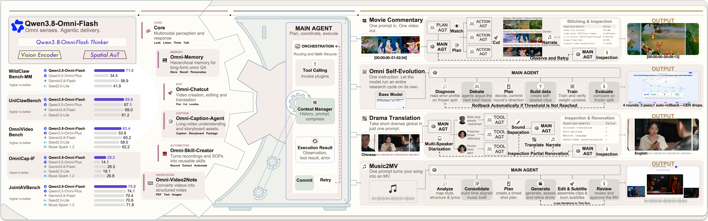

# Qwen3.8-Omni-Flash

> [!tldr]
> 原生全模态 Agent，面向音视频理解、工具计划和创作任务交付。 模型从音视频理解延伸到规划与创作交付，评测单位因此应从单轮识别转向完整任务。官方博客直抓为空壳，当前笔记仅覆盖已核实发布定位，完整训练与结果待报告源码精读。

## 一页速览

| 维度 | 当前证据 |
|---|---|
| 发布时间 | 2026-09-18 |
| 类型 | 专项支线 / family · Omni |
| 关键事实 1 | 正式发布：2026-09-18 |
| 关键事实 2 | 音频、视频与工具工作流 |
| 关键事实 3 | 报告：arXiv 2609.25611 |
| 检查日期 | 2026-10-13；官方原始资料在同级src/ |

## 从多模态输入转向按需取证与交付

9月18日发布；1M上下文支持文本、图像、音频和视频，普通Omni路线输出文本，Realtime另有音频输出。两者合为family支线，不冒充新的通用Qwen正代。长素材的瓶颈不仅在感知，还在重复上传、上下文状态、工具调度与结果核验。

## 主动取证比一次塞入全部帧更重要

| OmniVideoBench | Static | Agentic |
|---|---:|---:|
| Accuracy | 63.4 | 67.8 |
| 每query tokens | 145736 | 79117 |

这里根据具体表格计算的token降幅约45.7%，不能与另一摘要口径混写。Agent通过粗到细片段定位，让预算集中在与问题相关的证据；保持多轮上下文是这一对比的条件，不能拿两个完全不同截帧策略当纯模型消融。

## 模型、插件与 Harness 是不同贡献

Qwen-MM-Plugins扩展长程素材理解与创作，Qwen-Live Harness负责实时交互、任务委派、记忆及上下文。Video2Note、长视频记忆、Skill提炼与MV制作属于工具工作流，不意味着模型直接原生输出所有最终文件。复现实验应固定模型、插件版本和harness，分别做“仅模型”和“完整系统”。

## 结果里的改进和回退要一起看

| 官方指标 | 3.8OmniFlash | 3.5OmniPlus |
|---|---:|---:|
| WildClawBench-MM | 71.0 | 34.5 |
| UniClawBench | 69.6 | 67.1 |
| AgenticVBench | 36.8 | 14.5 |
| OmniGAIA | 74.0 | 57.2 |
| DailyOmni | 85.1 | 85.1 |
| OmniCloze | 63.2 | 64.2 |
| FLEURS-ASR WER↓ | 9.3 | 7.2 |
| AliMeeting DER / cpWER↓ | 3.4 / 17.2 | 88.1 / 89.6 |

多项Agent提升不代表每项音频基础能力都更好。FLEURS识别与翻译有部分回退；cpWER和DER也不能与普通WER混用。WildClawBench-MM、AgenticVBench使用Claude Code，UniClawBench使用OpenClaw，OmniGAIA无Harness；不能把四个分数相加为通用Agent总分。

## Agent 驱动小模型研发：仍需隔离评测

官方四川话实验在12小时内对Qwen2.5Omni3B开展4轮迭代，构建3413条数据，CER25.79%→15.30%。这是探索性案例：还应检查训练样本与WenetSpeech-Chuan评测隔离、选模是否使用同一测试集、最终在新说话人上的泛化。

发布API支持low/medium/xhigh（默认xhigh）且默认保留thinking。价格下降估算以2分钟素材×30、720p1fps等条件计算，不可推广为所有分辨率/帧率每小时费用。

> [!warning] 阅读与归档边界
> 已读浏览器渲染的完整博客，保存官方图和报告链接；直接下载的HTML是动态壳，完整离线正文原貌还需补存。Tech Report尚未完成源码精读，架构、数据细节只写已取得证据。

## 对 Agent Training 的启发

> [!insight]
> 测试音视频摘要的时间戳和来源引用，再测工具编排到最终文件的完整链。工具成功率、音视频事实误读和任务完成状态必须分别统计。

以上是基于已读官方资料的研究判断，不是官方保证，也没有在本机运行模型推理或复现论文成绩。下一步优先补独立验证器、固定任务/版本和完整失败轨迹，避免只保存最好样例。

## 一手资料与导航

- [S1] [Tech Blog](https://qwen.ai/blog?id=qwen3.8-omni-flash)
- [S2] [Tech Report](https://arxiv.org/abs/2609.25611)

原始下载文件与SHA-256见 [[src/retrieval_manifest.json|抓取记录]]。报告保留链接，不抓PDF；动态网页响应若只有壳文件，不将其标成完整离线正文。

- [[Topics/13_base_model/Base Model MOC|基模主题索引]]
- [[qwen3_8-omni-flash_poster_zh.html|中文Poster]]

> 📊 相关可视化: [[qwen3_8-omni-flash_poster_zh.html|Qwen3.8-Omni-Flash 中文Poster]]
