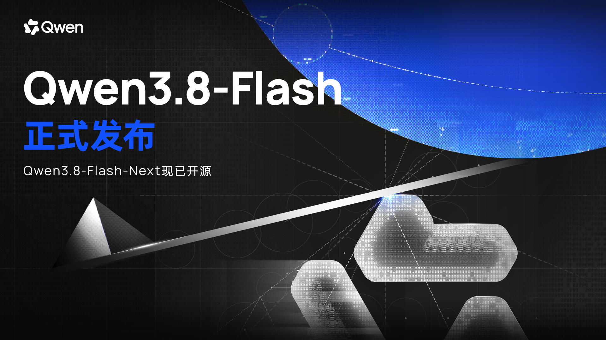
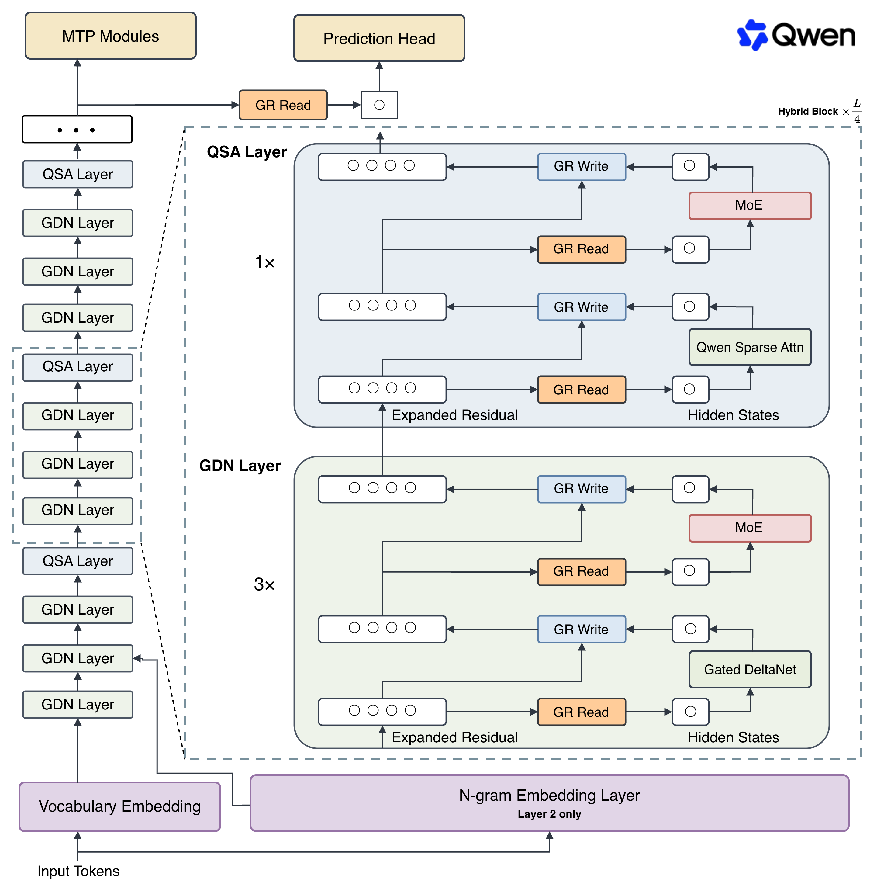
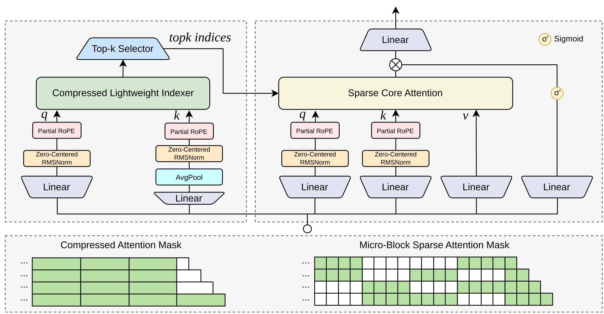
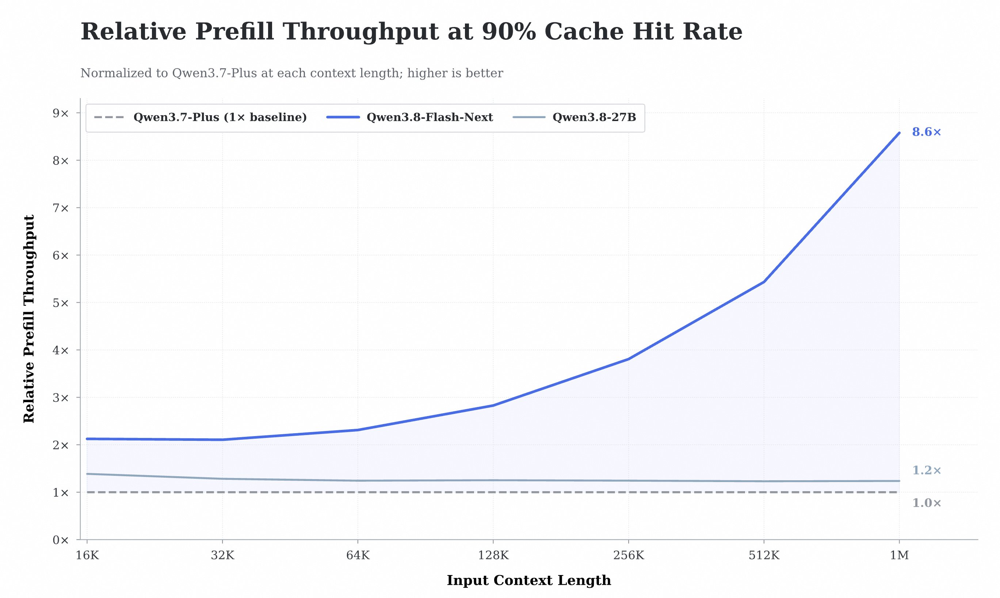

# Qwen3.8-Flash-Next：全新架构，迈向极致性价比

官方将 Flash-Next 定义为 Qwen4 架构的先导预览，角色类似 Qwen3-Next 对 Qwen3.5 的关系。系统升级集中在 Attention、Residual、Embedding 和 Optimization：

- GDN + QSA hybrid attention；QSA 在 micro-block 粒度筛选上下文。
- Gated Residual 将 residual stream 扩展为四分支，动态控制读写。
- 51B N-gram embedding 通过 host-memory offload 与异步 prefetch 扩容量。
- Muon 与 AdamW 按参数类型分工，并重新拟合 scaling law。

公开主干为 125B、每 token 激活 6B，另有 51B N-gram embedding；原生 262K context，通过 YaRN 扩展到 1M。官方称训练开销约为 Qwen3.7-Plus 的 1/9，同时 coding 与 office 能力更强。

技术报告只保留链接，不将 PDF 下载进 Vault：[GitHub technical report](https://github.com/QwenLM/Qwen3.8-Flash-Next/blob/main/tech_report.pdf)。

