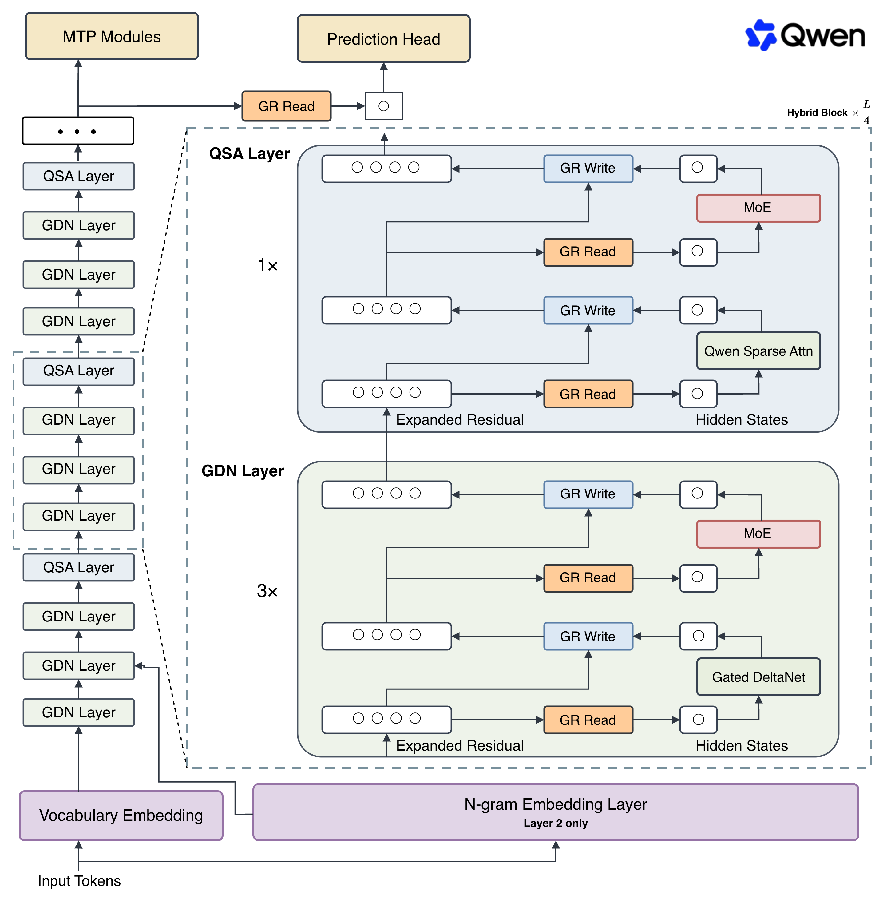

# Qwen3.8-Flash-Next - Hugging Face

官方开放权重模型卡。模型类型为带 vision encoder 的 causal language model，支持 Transformers、vLLM、SGLang、TokenSpeed 等框架。

## 公开配置

| 组件 | 配置 |
|---|---|
| Core parameters | 125B / 6B activated |
| Extra parameters | 51B N-gram embedding + 4B MTP |
| Layers / hidden | 48 / 2560 |
| Layout | 12 × [3 × (GDN → MoE) + 1 × (QSA → MoE)] |
| Experts | 512；10 routed + 1 shared active |
| QSA budget | 512 blocks / 2048 tokens |
| Context | native 262,144；extendable to 1,000,000 |
| License | qwen-community-1.0 |

模型卡明确区分：`Qwen3.8-Flash-Next` 是开放权重架构，生产服务 `Qwen3.8-Flash` 在其基础上增加默认 1M context 与官方内置工具。

