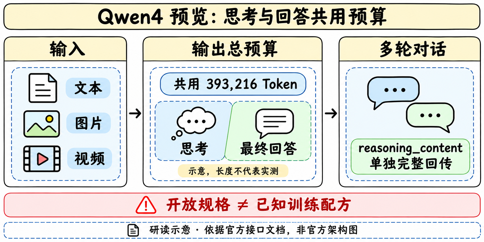

> [!tldr]
> Qwen4-Max-Preview是官方明确命名的新一代旗舰多模态预览模型，11月11日10:00北京时间开放。当前最可核查的变化是接入窗口、共享输出预算和多轮思考回传协议，不能从产品规格反推出未公开的训练架构或能力增幅。

> [!warning] 资料充分度
> 已读阿里云官方模型页、模型上架公告、Token Plan与兼容性公告，并在内置浏览器核对。尚未取得本代Tech Report、系统评测表、官方架构图与开放权重；参数、MoE结构、训练数据、RL配方、视觉token和量化方式均不填猜测。尚不足GLM-5.3-Flash/Kimi-K3完整报告级精读。下图是依据接口文档制作的手绘研读示意，非官方架构或实测。

## 发布、家族与访问窗口

> [!tldr]
> 主干新正代记Qwen4，Max-Preview是本代预览服务；不与Qwen3.8混为同一SKU，也不把预览当长期GA承诺。

| 字段 | 官方当前披露 |
|---|---|
| 模型ID |`qwen4-max-preview`|
| 实际预览 |2026-11-11 10:00至2026-11-25 24:00，UTC+8|
| 版本稳定性 |预览期间不做变更；预览结束后下线|
| 接入 |仅Token Plan，当前不支持按量计费|
| 输入 |文本、图片、视频；未声明原生音频输入或图像生成|
| 上下文 |1M Token|
| 最大输出 |393216 Token，思考与最终回答共享|
| 协议 |OpenAI Chat Completions / Responses，Anthropic Messages|
| 工具与格式 |Function Calling、联网搜索/内置工具、JSON Object/Schema|

模型页的“更新时间12:51:31”与“公告11/11”都不能覆盖正文明确的10:00开放时刻。兼容性公告列11/2只是协议公告，不据此把Qwen4首发提前到11/2。官方研究入口www.qwen.ai本轮DNS失败，发布事实由可读官方模型页与上架公告交叉支持，未宣称研究博客查全。

## 推理预算、多轮状态与复现

> [!tldr]
> 把思考和最终回答视为同一有限输出资源；历史reasoning字段与content字段分开，才能避免迁移时把接口误用当作模型退化。

`max_tokens`与`max_completion_tokens`对本代等价，均限制思考与最终回答总量。若原调用只给最终回答预留少量token，迁移后思考会先消耗预算，可能提前截断；应记录两个阶段实际token和finish reason。该调整不追溯改变此前已上线Qwen模型的行为。

默认开启思考，`reasoning_effort`可选low、medium、xhigh，默认xhigh；它与`thinking_budget`不可同时设置。不能将“默认最强思考”推成同延迟或最低成本。在Chat Completions中`preserve_thinking`默认开启，历史assistant消息需要在`reasoning_content`完整回传，不拼到`content`。另两套API是否有完全等价字段须分别核对，不机械复制。

Token Plan使用套餐专用base URL与API Key；普通按量API的key/base URL未获本页保证可复用。本轮没有购买套餐、接受协议、获取key或调用收费服务。

## 证据缺口与训练研究判断

> [!tldr]
> 本轮可以建立正确接口基线，还不能证明能力超过Qwen3.8或其他模型。评测要固定预算与真实输入，而不是用“新一代旗舰”替代成绩。

| 证据 | 可以说明 | 不足以说明 |
|---|---|---|
| 官方模型页/上架公告 |新模型身份、10:00预览、规格与接口|训练算法、参数规模、同预算胜率|
| 工具调用支持 |接口可以表达外部工具交互|每个任务能成功执行或可靠恢复|
| 1M窗口 |规格上的容量上限|1M全文检索/推理成功率或实际吞吐|
| 图片/视频理解 |支持的输入模态|图像生成、原生音频或三维动作能力|

> [!insight]
> 先固定模型ID、预览时间、协议版本、effort、共享输出上限、历史回传与Workspace，再比较Qwen3.8/Qwen4在未见仓库和多轮工具任务上的终态成功率。分别记录格式错误、预算截断、遗漏思考历史、工具恢复和每成功产物成本；这些接口因素应作为消融变量，不能全部归因于训练方法。预览结束的下线日期也应进入复测记录。

- [官方模型页](https://help.aliyun.com/zh/model-studio/qwen4-max-preview)
- [官方上架公告](https://help.aliyun.com/zh/model-studio/newly-released-models)
- [API兼容性公告](https://help.aliyun.com/zh/model-studio/api-compatibility-upgrade-notice)
- [Token Plan](https://help.aliyun.com/zh/model-studio/token-plan-overview)
- [[qwen4_max_preview_poster_zh.html|中文Poster]]
