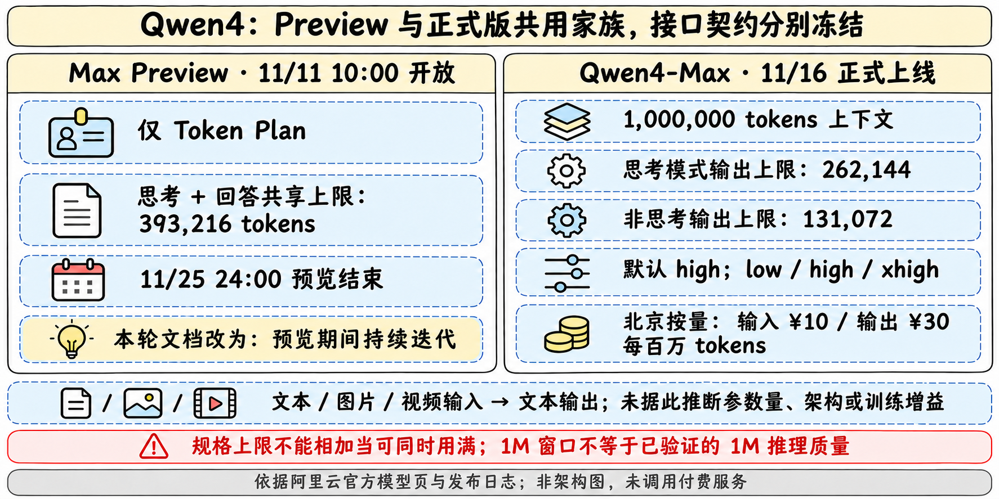
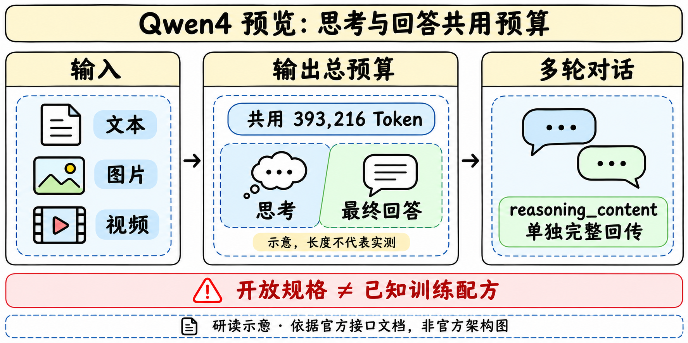

> [!tldr]
> Qwen4-Max 于官方日志11/16正式上线，与11/11首发的Max Preview合并为同一个Qwen4正代。正式版新增可核对的标准按量价格、模式预算和思考摘要/密文接口；没有公开的训练与受控评测证据，不能把产品上线直接当作权重或能力增幅已验证。

> [!warning] 资料不足与版本变化
> 已完整读取正式版与当前Preview官方模型页、各地域上架日志，并归档原HTML。尚未获得Qwen4专属HF卡、Tech Report、架构/训练/RL配方、受控评测与官方原始架构图。手绘图依据接口文档，是研读示意而非架构推断。此前Preview文档写“期间不做变更”，当前改为“持续迭代升级”；变更发生在两次快照之间，具体编辑时刻未独立证实，旧规则不可继续当当前承诺。

## 正式版：11/16上线与可核对规格

> [!tldr]
> 官方日志给出11/16上架日，未给精确开放时分。family首发仍11/11 10:00 UTC+8，不另建Qwen4正代或新SKU节点。

|字段|Qwen4-Max正式版|
|---|---|
|model ID|qwen4-max|
|输入/输出|文本、图像、视频→文本；不推成原生音频或图像生成|
|总上下文|1,000,000 tokens|
|非思考：最大输入/输出|991,808 / 131,072|
|思考：最大输入/输出|983,616 / 262,144|
|最大思维链|262,144；与其它上限不能相加当可同时用满|
|默认|enable_thinking=true、preserve_thinking=true、effort=high、thinking_budget=131072|
|effort|low/high/xhigh；minimal→low、medium→high、max→xhigh，按协议字段分别传|
|温度/top_p|思考1.0/0.95；非思考0.7/0.8|
|其它采样|top_k20、repetition_penalty1.0；presence_penalty思考0/非思考1.5；logprobs默认false|
|max_completion_tokens默认|思考262144、非思考131072|
|支持|流式、并行工具、搜索、前缀补全、JSON Object/Schema、显式/隐式缓存、思考摘要/密文|
|接口|OpenAI Chat Completions/Responses、Anthropic Messages、DashScope|
|当前不支持|批量推理、模型调优、自行模型部署|

正式版页面在北京、新加坡、法兰克福、弗吉尼亚、东京、香港列出可用能力，服务部署范围分别有中国内地/国际/全球；这是供应商声明的路由范围，不能据此推断用户数据跨地域流动或所有地区同一权重。北京及除新加坡外所列标准价为输入¥10、输出¥30每百万tokens（思考+回答）；新加坡¥10.938/¥32.813。缓存另列计费链接，未在本文把缓存价猜成普通输入价。北京免费额度100万tokens及90日规则按页面条件，不宣称当前账号已获额度。本文未调用付费服务。

正式版的摘要用于展示、密文用于后续轮次恢复历史思考，需按协议原样回传密文，不能把Preview的reasoning_content方式无差别复制到所有新接口。显式缓存TTL5m/1h。北京/新加坡AutoTPM档位5M/10M/20M与月消费等级关联，其它所列地域RPM30,000/TPM5M；这些是限流声明，不是实际吞吐承诺。

## Preview：保留历史并更正稳定性承诺

> [!tldr]
> Preview仍仅Token Plan，11/11 10:00–11/25 24:00（UTC+8）；393216共享输出与正式版预算分别记录。以下既有研读的默认xhigh、reasoning_content等指Preview，不外推正式版。

### Preview历史与访问窗口

> [!tldr]
> 主干新正代记Qwen4，Max-Preview是本代预览服务；不与Qwen3.8混为同一SKU，也不把预览当长期GA承诺。

| 字段 | 官方当前披露 |
|---|---|
| 模型ID |`qwen4-max-preview`|
| 实际预览 |2026-11-11 10:00至2026-11-25 24:00，UTC+8|
| 版本稳定性 |旧快照称不变；当前官方明确持续迭代升级，预览结束后下线|
| 接入 |仅Token Plan，当前不支持按量计费|
| 输入 |文本、图片、视频；未声明原生音频输入或图像生成|
| 上下文 |1M Token|
| 最大输出 |393216 Token，思考与最终回答共享|
| 协议 |OpenAI Chat Completions / Responses，Anthropic Messages|
| 工具与格式 |Function Calling、联网搜索/内置工具、JSON Object/Schema|

模型页的“更新时间12:51:31”与“公告11/11”都不能覆盖正文明确的10:00开放时刻。兼容性公告列11/2只是协议公告，不据此把Qwen4首发提前到11/2。官方研究入口www.qwen.ai本轮DNS失败，发布事实由可读官方模型页与上架公告交叉支持，未宣称研究博客查全。

## 多轮预算与研究判断

> [!tldr]
> 把思考和最终回答视为同一有限输出资源；历史reasoning字段与content字段分开，才能避免迁移时把接口误用当作模型退化。

`max_tokens`与`max_completion_tokens`对本代等价，均限制思考与最终回答总量。若原调用只给最终回答预留少量token，迁移后思考会先消耗预算，可能提前截断；应记录两个阶段实际token和finish reason。该调整不追溯改变此前已上线Qwen模型的行为。

默认开启思考，`reasoning_effort`可选low、medium、xhigh，默认xhigh；它与`thinking_budget`不可同时设置。不能将“默认最强思考”推成同延迟或最低成本。在Chat Completions中`preserve_thinking`默认开启，历史assistant消息需要在`reasoning_content`完整回传，不拼到`content`。另两套API是否有完全等价字段须分别核对，不机械复制。

Token Plan使用套餐专用base URL与API Key；普通按量API的key/base URL未获本页保证可复用。本轮没有购买套餐、接受协议、获取key或调用收费服务。

### 尚未证明的训练与能力增益

> [!tldr]
> 本轮可以建立正确接口基线，还不能证明能力超过Qwen3.8或其他模型。评测要固定预算与真实输入，而不是用“新一代旗舰”替代成绩。

| 证据 | 可以说明 | 不足以说明 |
|---|---|---|
| 官方模型页/上架公告 |新模型身份、10:00预览、规格与接口|训练算法、参数规模、同预算胜率|
| 工具调用支持 |接口可以表达外部工具交互|每个任务能成功执行或可靠恢复|
| 1M窗口 |规格上的容量上限|1M全文检索/推理成功率或实际吞吐|
| 图片/视频理解 |支持的输入模态|图像生成、原生音频或三维动作能力|

> [!insight]
> 先固定模型ID、预览时间、协议版本、effort、共享输出上限、历史回传与Workspace，再比较Qwen3.8/Qwen4在未见仓库和多轮工具任务上的终态成功率。分别记录格式错误、预算截断、遗漏思考历史、工具恢复和每成功产物成本；这些接口因素应作为消融变量，不能全部归因于训练方法。预览结束的下线日期也应进入复测记录。

- [官方模型页](https://help.aliyun.com/zh/model-studio/qwen4-max-preview)
- [官方上架公告](https://help.aliyun.com/zh/model-studio/newly-released-models)
- [API兼容性公告](https://help.aliyun.com/zh/model-studio/api-compatibility-upgrade-notice)
- [Token Plan](https://help.aliyun.com/zh/model-studio/token-plan-overview)
- [[qwen4_max_preview_poster_zh.html|中文Poster]]

- [正式版官方模型页](https://help.aliyun.com/zh/model-studio/qwen4-max)
