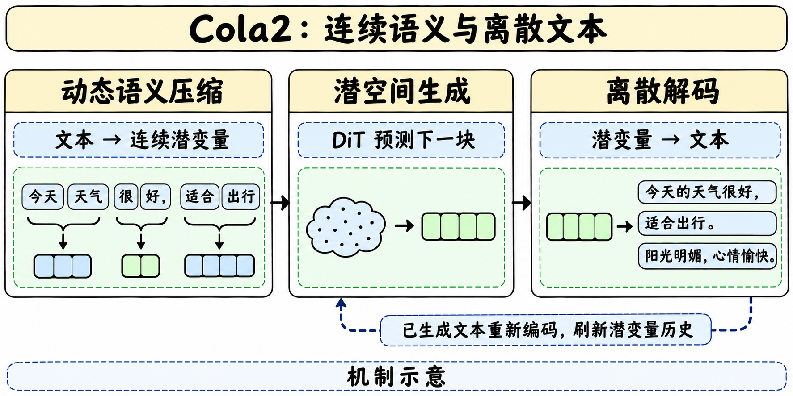
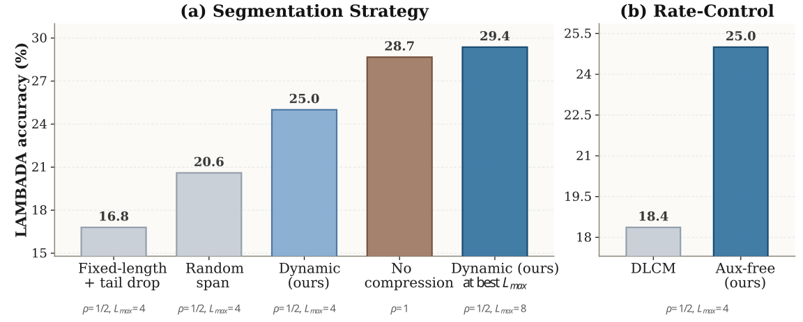
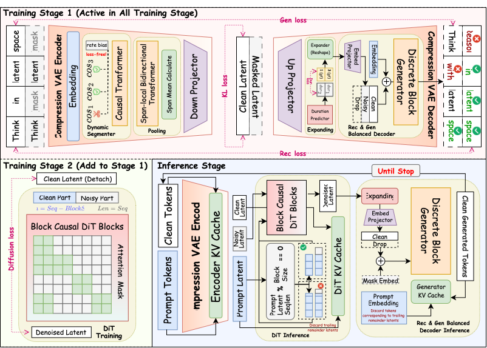
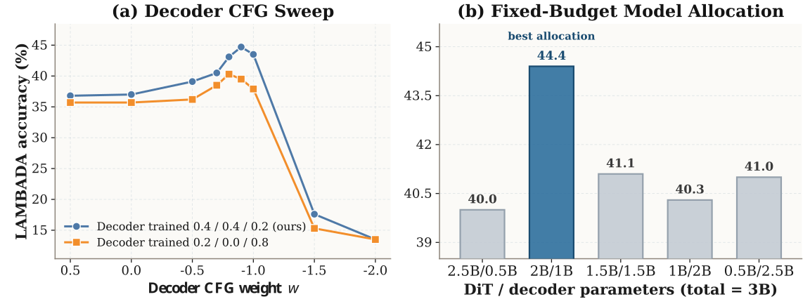
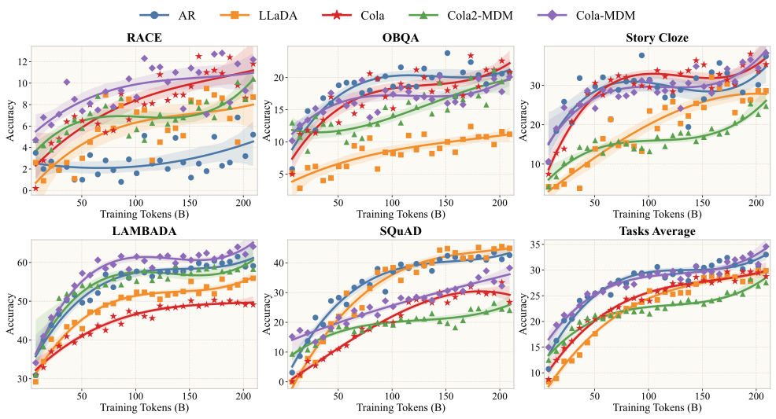

> [!abstract] TL;DR
> Cola2 在压缩后的连续语义空间逐块生成，再由 token 解码器把每段语义写成文本。关键设计是让 token 预测塑造潜表示，同时阻断潜先验损失对编码器的梯度。公开检查点可用来复测，但尚不足以判断等算力下是否优于普通自回归模型。

> [!warning] 资料充分度
> 已核对技术报告 TeX、原始模型卡、官方图、推理代码及固定配置。公开资料支持逐节分析方法和评测，但缺少训练实现、完整数据混配与论文原始评测种子，训练复现深度仍达不到完整可复现审计标准。

## 发布与定位

**一句话**　这是 Seed 与学术机构合作的连续潜空间语言建模研究模型。论文 v1 于 10 月 22 日提交（稿件首页署 10 月 23 日），模型权重于 11 月 6 日公开。HF 上传提交为北京时间 16:58:42，14:59:36 的建仓时间只是先导证据。

| 证据 | 已确认内容 |
|---|---|
| HF 固定 revision | 8 个 safetensors 分片、tokenizer、自定义推理模块、8 个任务评测 JSONL |
| 官方 GitHub | Transformers 兼容推理实现、配置、评测脚本和参考结果。代码为 Apache 2.0 |
| 论文与项目页 | 方法、消融、受控规模对照和发布检查点评测 |
| 复现边界 | 已核对模型卡、配置、推理与评测协议。缺少训练代码、完整数据配方和原始随机种子，本次未运行权重 |

## 机制与训练

**一句话**　让解码任务决定什么值得压缩，再让 DiT 学会在这个空间生成下一个潜块。

### 一段话如何被压缩

模型根据 token 的边界分数，把相邻 token 分成 1–8 个 token 的 span，每段用一个 64 维潜变量表示。公开配置的平均压缩率目标为 0.5，约等于平均两个 token 占用一个潜位置。控制器调节切分阈值，让平均压缩率回到目标附近，不必在训练目标上叠加压缩率损失。模型因此可以为局部密集信息保留更多潜位置。

论文的受控切分消融在压缩率 0.5、最大 span 为 4 时，动态切分平均分为 25.0%，较随机和固定切分分别高 4.4、8.2 个百分点。把最大 span 放到 8 后是 29.4%，而该设置下未压缩对照为 28.7%。这些是小规模设置中的结果，不代表任意数据上压缩都无损。

### 编码器接收什么反馈

1. **阶段 I**训练压缩 VAE 和离散解码器。论文受控实验用块因果掩码扩散解码器，在干净、加噪和丢弃潜条件下训练，让解码器既能重建指定语义，也能依靠离散上下文预测文本。
2. **阶段 II**增加约 4B 的块因果 DiT，通过 Flow Matching 拟合在线潜变量。先验损失在潜表示处停止梯度，token 预测梯度仍可穿过潜变量更新编码器。这样，潜表示仍直接服务于离散预测。
3. **阶段 III**继续训练 DiT。公开检查点的离散实现采用 Qwen3-4B-Base 初始化的 span-causal 路径，和论文受控实验中的掩码扩散解码器是不同配置。

大检查点用 Qwen3-4B tokenizer 重切 OLMo 2 数据，训练序列长 4,096。阶段 I 用 52.43B source tokens；阶段 II 再用 125.83B；阶段 III 冻结阶段 II 的 EMA VAE，只训练 DiT，追加 167.77B。这个预算不包含 Qwen3-4B-Base 初始化的既有训练投入。

### 文本为什么要再编码一次

每轮 DiT 在已有干净潜前缀的条件下去噪新潜块，长度预测器为每个新潜位置确定 span 长度。解码器写完一段文本后，按固定 span 布局重新编码已提交 token，再把得到的潜变量放入后续上下文。下一轮条件因此与实际输出一致，能减少潜轨迹和实际文本长期偏离。

公开默认值是 8 个潜位置一块、8 个 Euler 去噪步、DiT CFG 10、decoder CFG −0.9、每次提交一个 span。负 CFG 是作者协议的参数约定。离散 token 即使用贪心选取，连续阶段仍从随机高斯噪声开始，复测需控制随机种子。

## 评测怎么读

**一句话**　受控实验比较模型设计，最终检查点展示一个尚未收敛的发布版本能做到什么。

| 任务（作者协议，%） | Cola2 | Llama 3 8B | Qwen3 8B Base | LLaDA 8B Base |
|---|---:|---:|---:|---:|
| RACE | 69.91 | 75.77 | 90.65 | 87.40 |
| NarrativeQA | 32.70 | 42.70 | 37.30 | 36.00 |
| HellaSwag | 41.75 | 39.21 | 68.13 | 69.65 |
| StoryCloze | 80.42 | 79.49 | 97.44 | 95.94 |
| LAMBADA | 63.00 | 75.70 | 71.20 | 67.90 |
| ARC-Easy | 87.62 | 90.86 | 97.35 | 93.85 |
| TruthfulQA | 54.10 | 63.04 | 72.58 | 64.87 |
| MMLU | 51.32 | 63.19 | 72.31 | 61.27 |
| **8 项平均** | **60.10** | **66.25** | **75.87** | **72.11** |

约 210B token 的受控实验比较 AR、LLaDA、Cola DLM、未压缩 Cola-MDM、压缩 Cola2-MDM。未压缩 Cola-MDM 整体缩放表现最强。压缩版本收敛更慢，约 150B 之后继续缩小与 LLaDA 的差距，210B 附近仍未饱和。该结果支持扩大训练规模继续验证，也显示压缩带来的早期代价。

发布检查点用 346.03B source tokens，平均落后 Llama 3 8B 6.15 个百分点，在 HellaSwag 和 StoryCloze 分别领先 2.54、0.93 个百分点。**报告里的 43 倍比较的是各自报告的 token 数**。不同 tokenizer、数据和初始化都会影响对比，DiT 和解码器推理成本也没有折算为同一口径。

## 复现与研究启发

**一句话**　先复现同一权重的评测协议，再分别检验压缩、解码与反馈对长文本一致性的影响。

- 固定 HF revision 与 GitHub commit，先用 200 例 smoke test 核对加载、提示模板、答案抽取与运行时。完整对照用三次潜噪声采样，报告方差。
- 在同一权重上测 latent feedback 开关，以跨段实体与约束一致性为主指标。分开扫 DiT 步数和 decoder CFG，记录正确率、延时及峰值显存。
- 将离散贪心与 DiT 随机性分开记账。区分压缩遗漏、长度预测不准、解码误写与上下文漂移。

> [!insight] 对 Agent Training 的启发
> Cola2 每次提交文本后都会用可观察结果刷新压缩上下文。可以用这个机制提出一项独立实验：让长程代理在提交工具动作后依据真实执行结果更新压缩记忆，测量后续动作偏离实际状态的频率。Cola2 的语言评测没有覆盖这个假设。

## 来源与边界

**一句话**　读实现用固定模型卡和官方配置，读研究结论用技术报告与作者项目页。

- [HF Model Card](https://huggingface.co/ByteDance-Seed/Cola2) · [权重上传记录](https://huggingface.co/ByteDance-Seed/Cola2/commits/main)
- [Tech Report · arXiv](https://arxiv.org/abs/2610.31305) · [Tech Report · PDF](https://arxiv.org/pdf/2610.31305)
- [作者项目页](https://hongcanguo.github.io/Cola2/) · [GitHub 推理与评测](https://github.com/ByteDance-Seed/Cola2)
- [本地 HF 原卡](src/hf_model_card.md) · [配置](src/config.json) · [抓取清单](src/retrieval_manifest.json)

> 📊 相关可视化 [[cola2_poster_zh.html|Cola2 中文研究 Poster]]
