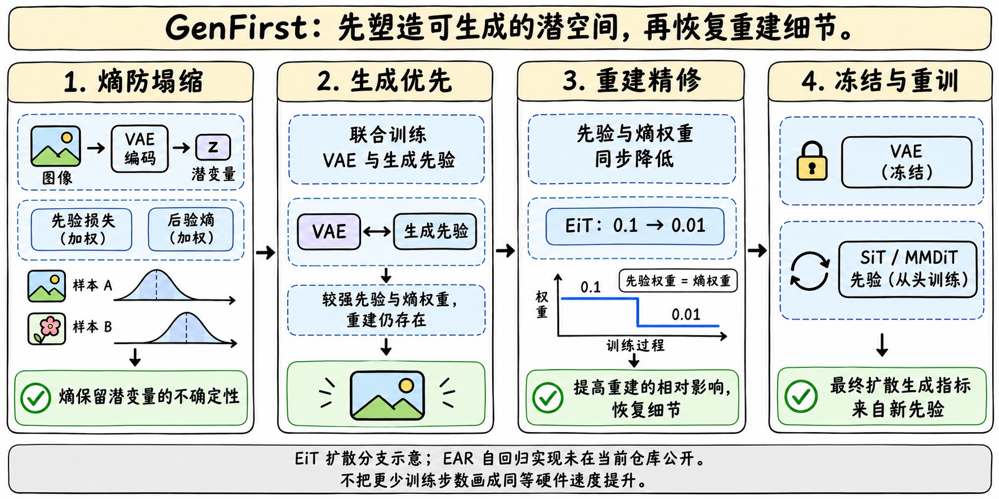
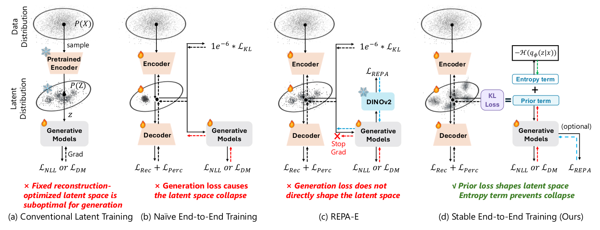
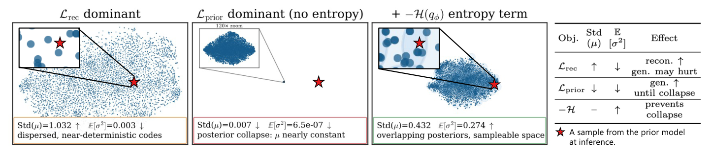
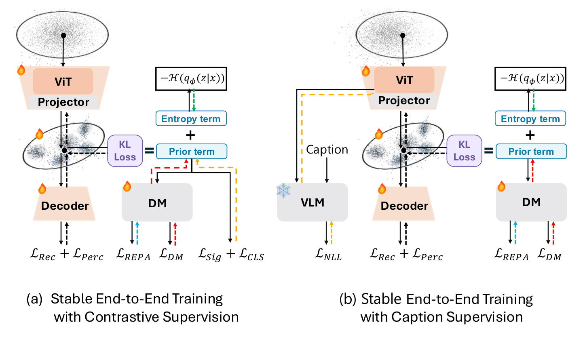

# GenFirst：先让潜空间容易生成，再恢复重建细节

> [!tldr]
> GenFirst 的核心贡献是一个训练顺序：显式保留后验熵，先用较强生成先验塑造潜空间，再同时减小先验和熵权重，让重建获得更高的相对影响。扩散分支最终还会冻结 VAE，从头训练新先验。最好的生成分数不能直接归给端到端阶段留下的那个扩散模型。

> [!warning] 证据边界与尚未达到的标准
> 已亲读 arXiv v1 的 paper.tex、suppl.tex 方法、训练、消融与限制，官方项目页、HF 卡、GitHub README 和评测文档；原图与源码已归档。原始资料并不少，但存在 A/B 标号和 80-epoch guidance 设置的官方内部矛盾；权重首次公开日、独立复测与完整训练语料比例仍不足，不能达到逐 checkpoint 精确复现与独立验收标准。没有下载 PDF、权重、数据集，也没有执行官方代码。

## 定位、日期与材料

> [!tldr]
> 这是 Seed 与中科大合作的生成建模研究支线。论文公开日是 8 月 29 日；11 月 3 日是本 Atlas 首次观测到官方公开 HF 包，不能当作已证实的权重首次发布日期。

| 事件 | 核实到的时间 / 状态 | 如何使用 |
|---|---|---|
| 论文 v1 提交 | 2026-08-29 15:39:14 UTC，即北京时间 23:39:14 | 作为方法/论文首次公开日期；保留 arXiv submission history |
| HF 仓库 createdAt | 2026-10-29 03:26:09 UTC | 仅仓库元数据，不能证明当时已公开 |
| 本轮公开观测 | 2026-11-03，公开且非 gated，列出模型与 VAE 文件 | 作为发现时间，权重首发日期仍待核 |
| 当前发布范围 | EiT 扩散 / flow-matching 实现、VAE 与配套 latent statistics | EAR 连续自回归实现没有在当前仓库公开 |
| Atlas 组织 | Seed → 图像生成 / 潜空间研究支线，一族管理 | 不把参数精度、训练轮数、A/B 或各 VAE 拆成新正代 |

该工作不是 Seed2.x 通用大模型的参数升级。它研究的是图像或文本如何被编码成适合生成的连续表示，以及生成先验怎样反过来塑造这个表示。作者项目页明确给出中科大与 ByteDance Seed 的归属。[S1–S3]

发布物是原始 PyTorch checkpoint，需要相应训练仓库；不是可直接调用的 diffusers pipeline。官方说 VAE 必须与对应 latent statistics 成对使用，错配会输出噪声，未必报异常。HF 权重许可是 CC BY-NC 4.0，代码自有部分 MIT；第三方组件与数据许可另行约束，不能把代码许可等同权重许可。[S1][S2]

## 为什么会塌缩，方法改了什么

> [!tldr]
> 重建、先验拟合和熵对后验分布施加不同的力。直接增加生成损失、却沿用很小的 KL 权重，会让先验压力压倒熵；显式熵项解决塌缩，分阶段优化缓解生成和重建争夺同一表示的问题。

传统流程先训练 VAE 重建图片，再冻结它训练生成模型。重建擅长保留某一张图片的细节，但这样的潜空间可能有空洞、曲折的分布，生成先验很难采到合适的点。让先验直接回传到编码器是自然方案，却容易出现后验方差趋零、不同图片被挤到近似同一个 code 的塌缩。[S4 §3]

对高斯参考先验，KL 可以拆成先验拟合减后验熵。沿用约 10^-6 的 KL、再增加较强的 learned-prior loss，会额外增强拟合压力，却几乎没增强保持不确定性的力。GenFirst 将先验项与后验熵分别显式加权。SiT 的目标是 flow-matching 速度误差，不是可直接计算的 latent likelihood；它额外保留 10^-6 KL 约束数值尺度，防止把 latent 无限放大、让噪声相对变小的捷径。这个小 KL 与主要防塌缩的显式熵是两件事。

$$
\mathcal L_{\mathrm{E2E}}=\mathcal L_{\mathrm{rec+perceptual}}+\lambda_p\mathcal L_{\mathrm{prior}}-\lambda_H\mathcal H(q_\phi(z|x))
$$

这里将重建、LPIPS、GAN 合写为第一项，仅为研读记号；SiT 还需小 KL。两个阶段保持重建相关权重不变，令 λH=λp，再把二者一起降低。因此“重建增强”是相对影响增强，不是把重建项绝对系数突然调大，更不是第一阶段不做重建。

| 阶段 / 分支 | 可训练模块 | 公开的关键配置 | 应避免的误读 |
|---|---|---|---|
| EAR 生成优先 | VAE + 连续 AR prior | 500 epochs；prior / entropy 都为 1 | 论文分支，当前代码包未包含 EAR |
| EAR 重建精修 | 同上 | 140 epochs；二者都降至 0.25 | 熵没有完全关掉 |
| EiT 生成优先 | VAE + SiT | 80 epochs；二者为 0.1 | 保留重建与熵，不是只训练先验 |
| EiT 重建精修 | 同上 | 40 epochs；二者为 0.01 | 相对增加重建影响 |
| EiT 最终先验 | 冻结 VAE，新 SiT | 256² 训练 800 epochs；512² 训练 400 epochs | 这是额外训练，不能从总成本中删掉 |
| 可选 decoder 精修 | 只训练 decoder | ImageNet256 对应结果额外 10K steps | 论文 80-epoch 无引导 gFID 3.00→2.79；不是所有结果都用了 |

SiT-XL 是 28 层、宽 1152、16 heads；不同 VAE 对应 f8d4 / f16d32 和不同 patch 配置。T2I 最终使用 MMDiT-XL/2、冻结 CLIP-L；较小 MMDiT-L/2 可以用于 VAE 端到端塑形。论文训练流程与当前 README 的新增 FLUX.2 三阶段 recipe 需要分开看，不能把后者当成所有 v1 数字的训练方案。

## 实验：生成改善与重建代价

> [!tldr]
> 最有说服力的对照是“同一个新先验，换不同冻结 VAE”。同时，重建质量仍会牺牲；好的 gFID 不代表好 rFID，也不代表所有任务一起改善。

### 训练协议对照

| 分支 / 设置 | gFID ↓ | IS ↑ | rFID ↓ | PSNR ↑ | SSIM ↑ |
|---|---:|---:|---:|---:|---:|
| EAR / Frozen VAE | 36.33 | 46.55 | 0.53 | 26.18 | 0.72 |
| EAR / Naive E2E | 294.90 | 1.48 | 0.70 | 25.11 | 0.68 |
| EAR / Stable E2E | 5.10 | 145.22 | 1.26 | 21.93 | 0.58 |
| EAR / 冻结 E2E VAE、重训 prior | 5.67 | 137.39 | 1.26 | 21.93 | 0.58 |
| SiT 80ep / Frozen VAE | 7.90 | 122.60 | 0.74 | 25.67 | 0.72 |
| SiT 80ep / Naive E2E | NaN 塌缩 | — | — | — | — |
| SiT 80ep / Stable E2E | 92.38 | 13.94 | 0.57 | 25.13 | 0.71 |
| SiT 80ep / 冻结 E2E VAE、重训 prior | 3.57 | 166.49 | 0.57 | 25.13 | 0.71 |

这是论文 Table1 的分析设置，EAR 训练至收敛，SiT 按 80 epochs；不要与不同 VAE、800 epochs 的旗舰表直接比较。SiT 联合训练本身的 92.38 很差，优势在于它留下的 VAE 对后续新先验更友好。EAR 则在联合阶段的 5.10 略优于冻结后 5.67；不能把“都必须重训才有效”说成普遍结论。

### 发布卡中的最终模型

| EiT prior / 分辨率 | 先验 epochs | 无引导 gFID / IS | 引导 gFID / IS |
|---|---:|---|---|
| SiT / 256² | 80 | 2.79 / 175.4 | 1.38 / 271.3 |
| SiT / 256² | 480 | 1.60 / 216.8 | 0.988 / 270.7 |
| SiT / 256² | 800 | 1.45 / 226.7 | 0.969 / 283.4 |
| SiT / 512² | 80 | 未报告 | 1.63 / 278.9 |
| SiT / 512² | 400 | 未报告 | 1.23 / 286.1 |
| MMDiT / 512² A | 按 T2I recipe | GenEval 0.8987 | DPG-Bench 82.60 |
| MMDiT / 512² B | 按 T2I recipe | GenEval 0.8920 | DPG-Bench 82.06 |

ImageNet gFID/IS 使用 50K 样本、torch-fidelity 和 MAR reference；SDE 250 steps。256² 引导含 weak-20ep autoguidance 与 CFG，512² 是 plain CFG，二者不能混写。T2I 是 Euler50、CFG7、区间[0.35,1.0]，无 prompt rewriting。项目页称 ≥70× fewer steps 是达到某参考 FID 的先验训练步数比较，不是包含 VAE 塑形成本的总 GPU 时间或同硬件墙钟加速。

### 消融揭示什么

| 同预算 loss 策略（EAR 分析） | 引导 gFID ↓ | rFID ↓ | PSNR ↑ |
|---|---:|---:|---:|
| GenFirst | 2.10 | 1.26 | 21.93 |
| 常数权重 | 3.04 | 3.27 | 19.52 |
| Cosine decay | 5.45 | 0.66 | 23.87 |
| PI 自适应 | NaN 塌缩 | — | — |
| Frozen VAE | 6.97 | 0.53 | 26.18 |

GenFirst 在这组设置平衡得更好，但重建依然差于 frozen VAE。SiT 权重消融中 1→0.1 的 FID4.44/rFID0.61，0.1→0.01 为3.57/0.57，0.01→0.01 则3.84/0.48：继续减弱先验换来更好重建、却使生成退步。[S4 appendix]

REPA 也不是已被替代：相同 SD-VAE 的 vanilla SiT 为17.20，加入 prior-only REPA 为7.90；E2E VAE 无 REPA 为8.09，塑形阶段加 REPA 为6.83，再在 prior-only 加 REPA 为3.57。低分来自互补组件，不能全归于训练顺序。

## 扩展：共享表示与统一图文

> [!tldr]
> 表示学习监督可加入同一个潜空间，但有重建与生成的代价；统一图文的 GenEval 使用百分制，不能与上一个表的0–1直接混读。扩展模型不是新一代通用 Seed。

| Qwen3-VL ViT + projector | rFID ↓ | PSNR ↑ | GenEval ↑ | DPG ↑ | Linear Probe Top-1 ↑ |
|---|---:|---:|---:|---:|---:|
| E2E | 0.42 | 27.79 | 0.89 | 83.70 | 77.71 |
| E2E + SigLIP | 0.39 | 27.64 | 0.90 | 83.76 | 79.25 |
| E2E + VLM-NLL | 0.46 | 27.19 | 0.89 | 83.49 | 81.69 |

预训练 Qwen3-VL ViT 的 probe 是79.64。VLM-NLL 达81.69，却没有同时达到最好的重建或 DPG；不能只展示超过预训练 probe 的一个数字。SigLIP 与 caption-NLL 作用位置不同，后者不是简单把两个最终分数加权。

统一图文使用 Cola 文本 VAE、FLUX.1 图像 VAE与双向 block-causal MMDiT，分别学习 p(image|text) 与 p(text|image)。端到端使用较小 MMDiT-L/2，冻结后重训 XL/2；T2I 使用后续 SFT checkpoint，I2T 使用 pre-SFT checkpoint。不能用同一个“统一模型”标签掩盖不同评测 checkpoint。

| 统一图文潜空间设置 | GenEval（%） | DPG | CIDEr | BLEU-4 | METEOR | ROUGE-L | SPICE | CLIPScore |
|---|---:|---:|---:|---:|---:|---:|---:|---:|
| 冻结 text + image VAE | 79.88 | 63.96 | 20.03 | 5.36 | 13.72 | 29.01 | 8.03 | 53.21 |
| E2E text、冻结 image | 81.87 | 68.24 | 30.19 | 7.46 | 16.81 | 32.95 | 11.12 | 55.96 |
| E2E joint text + image | 86.57 | 72.68 | 33.28 | 7.76 | 17.74 | 34.16 | 11.81 | 57.97 |

I2T 使用 COCO Karpathy test split 与 pycocoevalcap。论文明确统一图文实验因计算限制，E2E 仅 T2I 的一半步数，prior-only 样本量约30.8%；不能与充分训练的独立 T2I 模型作无条件优劣结论。

## 复现风险与研究判断

> [!tldr]
> 先固定材料版本和评测协议，再谈效率或机制归因。两处官方矛盾、A/B 对应关系、checkpoint与归一化统计的配对，都是比抄一个最好分数更重要的复现信息。

### 目前保留的官方矛盾

| 项目 | 原始材料差异 | 本笔记处理 |
|---|---|---|
| T2I A/B | 主文、appendix开头、配置表、HF/README表指 A=ImageNet-SiT，B=T2I-MMDiT；suppl“Text-to-image EiT”一段反写 | 按文件路径记录配对，保留冲突；不默默统一原文 |
| 80ep ImageNet guidance | README统一写 autoguidance1.3、CFG1.5、区间[0.2,0.7]；suppl该80ep结果写 CFG2.0、区间[0.2,0.85] | 不声称任意脚本默认参数能精确重现1.38；待作者澄清 |
| 训练数据 | 卡只写公开数据、未列各corpus；论文列出公开集合名称但比例不足 | 不把“公开数据”当作完整可复现数据清单 |
| FLUX.2 新 recipe | 当前仓库有f8d32三阶段与高分辨率/OCR混合训练；v1主要表用其他VAE | 单独标版本与用途，不把0.041 rFID归入v1所有模型 |
| 首次公开日 | arXiv8/29明确；HF创建10/29、首次观测11/3不是同一事件 | 节点用论文日，权重首日留空，不增加虚假的11月发布行 |

### 我对 Agent Training 的启发

> [!insight]
> 可迁移的是“多个训练目标的学习速度不同，优化顺序会改变共享表示”的实验思路，不是把图像生成的熵项原样加到 Agent RL。若研究轨迹表征、action tokenizer 或 world-model latent，可以比较先塑造可预测/可生成状态、再恢复细节，与恒定权重/反向课程；同时监控表征塌缩、信息保存、可生成性、最终任务成功和总成本。

建议最小实验固定编码器、先验架构、数据顺序与总训练预算，比较固定 VAE、朴素联合、显式熵但恒权重、GenFirst、反向课程。保留一个冻结表示后从头训练同尺寸 prior 的对照，否则收益可能只是某次共同训练的优化便利。评价同时报告重建、生成和下游可验证任务，不把一个表示 probe 或 distribution-level FID 当作 Agent 任务完成率。

作者明确承认重建—生成权衡没有消失，EAR 的 CFG 伸缩仍有限，T2I 数据规模小于大规模系统。这些限制应与最佳数字一起阅读。独立复现尚未执行，不能把本笔记的核对写成重跑成绩。

## 原始资料与导航

> [!tldr]
> 可读原文、TeX源码、评测协议和官方图已离线归档；PDF只保留官方链接。源文件与本笔记判断分开，失败路径明确记录。

- [S1] [🤗 HF Model Card](https://huggingface.co/ByteDance-Seed/GenFirst)：当前发布范围、原始结果表、许可与模型/VAE配对。
- [S2] [🧩 Official README / Code](https://github.com/ByteDance-Seed/GenFirst)：训练、评测、docs、代码文本与新增recipe。
- [S3] [🌐 官方项目页](https://tom-zgt.github.io/GenFirst/)：机制解释、完整对照表与原图。
- [S4] [📄 Tech Report](https://arxiv.org/pdf/2608.29335)：PDF未下载；实际阅读的是e-print中的paper.tex与suppl.tex，过滤PDF后归档。
- [Submission history](https://arxiv.org/abs/2608.29335)：8/29首次提交；arXiv HTML v1 返回404已记录，不能声称读过HTML全文。

源码位于 src/paper-source/，下载清单见 [[src/retrieval_manifest.json|原始材料清单]]；代码仅阅读未执行。源码包中的PDF图已过滤；采用官方项目页PNG/JPG作图。手绘图是研读说明，不是官方实测图。

- [[Topics/13_base_model/Base Model MOC|基模主题索引]]
- [[genfirst_poster_zh.html|中文研究 Poster]]

> 📊 相关可视化: [[genfirst_poster_zh.html|GenFirst 中文 Poster]]
