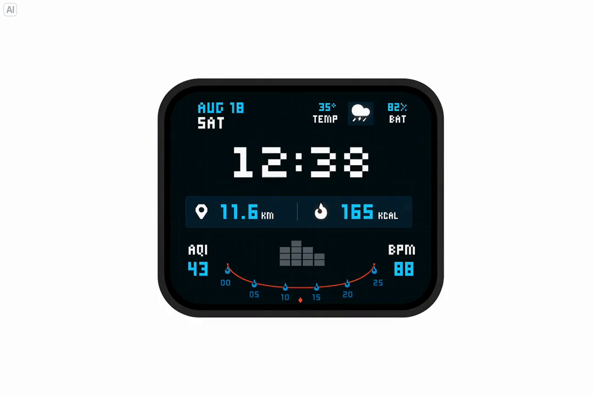
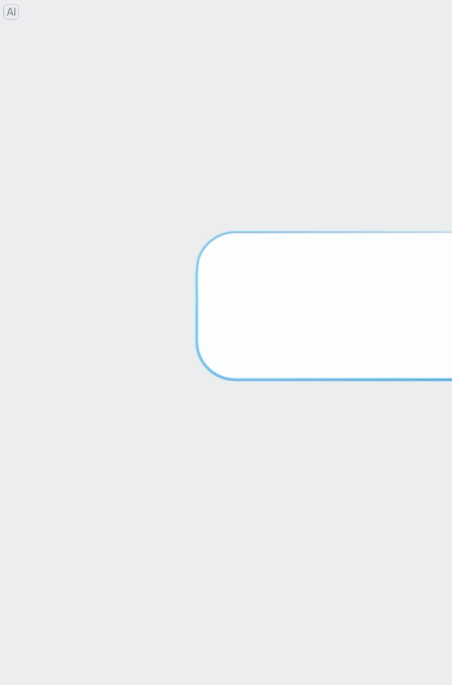
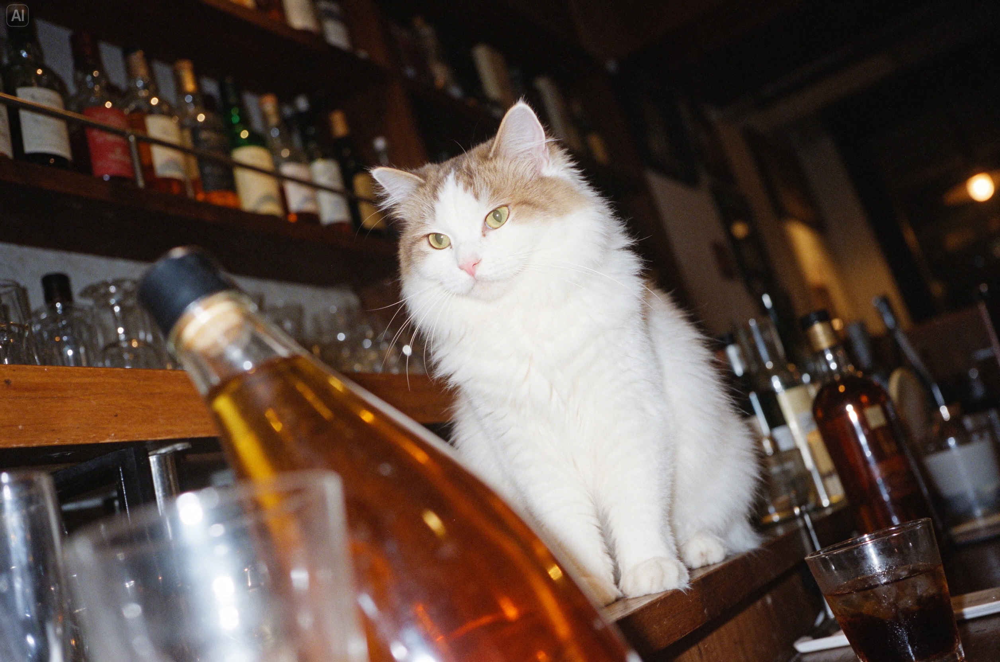
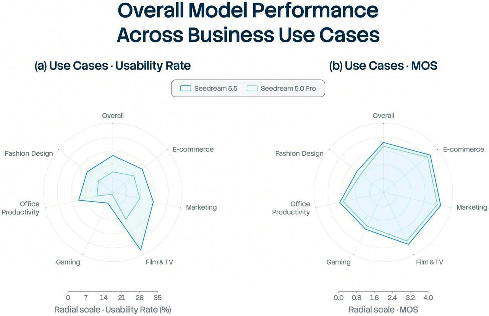
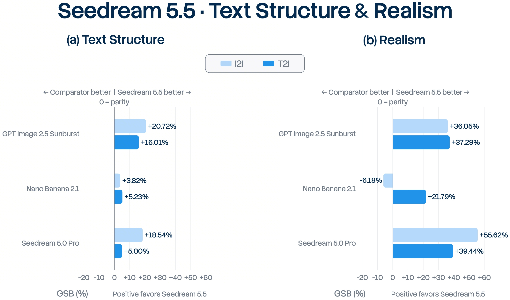
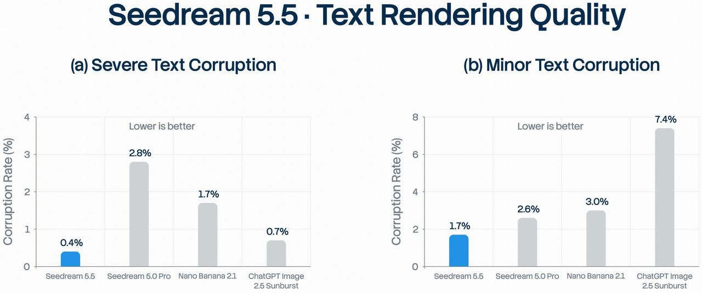
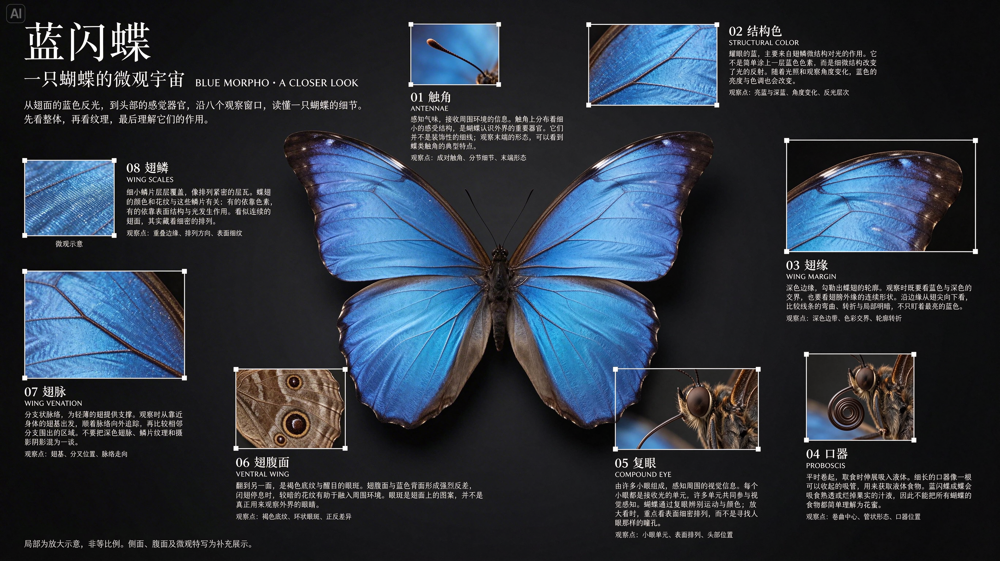
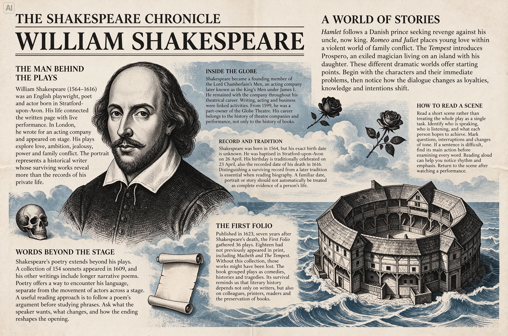

# Seedream 5.5：生成结果能否成为下一轮可靠的工作材料

> [!tldr] 我的判断
> 官方把三个目标放在一起：连续多轮修改仍保持未编辑内容、原生透明/半透明素材、自然的摄影质感。它更像视觉创作工作流中的生成与编辑工具；晚间正式博客给出了生产场景可用率、MOS、GSB与文字崩坏率；仍未披露底层架构或完整评测数据。应先评价“修改成功且未破坏已有结果”，再评价单张图片是否好看。

> [!warning] 已补正式博客，但原始技术资料仍有限
> **本笔记已亲自阅读11月9日正式 Tech Blog、官方模型页和三张评测图，确认首发日，并补齐百轮编辑、原生RGBA、六类场景结果与负向对比。官方尚未披露参数/架构、训练数据配方、完整样本、提示词、采样配置、评审人数、一致性与置信区间，也未找到已核实的HF模型卡或Tech Report。因此仍达不到GLM-5.3-Flash / Kimi-K3完整技术报告精读的披露深度；未做模型实测。** 资料少的部分明确留白，不能把官方定性结论扩展成已复现事实。

## 身份、日期与一手来源

**正式首发日期为2026-11-09。** 晚间官网正式文章标注该日期，并在正文明确“今天，我们正式发布”。下午仅有模型页，曾把11月记为归档月份、日期待核；现在用发布博客修正原条目，进入近30天精确日期表，不新增重复节点，也不以导航变化或抓取时间推定发布日。

| 项目 | 已确认内容与边界 |
|---|---|
| 团队 / 产品族 | ByteDance Seed / Seedream，图像生成与编辑专项支线 |
| 首发依据 | 2026-11-09正式Tech Blog的日期与发布正文互相印证 |
| 核心升级 | 多达100轮连续编辑展示、非编辑区域保持、原生RGBA、摄影质感与密集小字 |
| 上线口径 | 官方称即梦、豆包、豆包工作、火山方舟陆续上线；未逐账号实测服务可用性 |
| 后续Pro版本 | 官方称后续推出；当前不作已发布SKU或独立正代 |
| 参数 / 架构 / 数据 | 未披露，不推断DiT结构、参数量或训练方法 |
| 权重 / 许可证 / API价格 | 未核实，不能据体验入口标为开源或全面开放API |

- 📰 [Tech Blog · 11月9日正式发布](https://seed.bytedance.com/zh/blog/more-realistic-images-more-stable-editing-across-100-rounds-introducing-seedream-5-5) — 日期、能力、评测与上线口径的主要依据。
- 🌐 [Model Page · 官方模型页](https://seed.bytedance.com/zh/seedream5_5) — 动画与更多精选案例。
- 🗂 [官方研究目录](https://seed.bytedance.com/zh/research) — 已列出同题发布文章。
- 本地原文：[[src/seedream-5-5-launch.html|完整博客HTML]]、[[src/official_launch_blog|博客文字与官方图索引]]、[[src/official_model_page|模型页文字与案例]]。URL、时间和原图hash见`src/retrieval_manifest.json`。

## 多轮编辑：要同时看修改与保持

正式博客补充通过专项训练实现保持，并展示同一人物100轮连续编辑；这证明作者提供了长序列案例，不等于所有输入均能100轮无失败。官方模型页写明“支持非编辑区域像素级保持”，并展示逐步添加和替换家具、灯具与装饰，同时调整颜色、位置与透视。另一组例子连续修改人物发型、眼镜、服装、背景和桌面道具。重点是一个已有画面经过多次操作后还能继续使用，而非每次重新生成一张视觉相近的图片。

图为官方精选展示，不能据此得到总体成功率或所有场景的像素一致性。相机视角、阴影、遮挡与材质会相互影响：只看最终图可能掩盖中间轮次的漂移，也可能把合理的光照联动误判成失败。

建议把同一轮验收拆成两个判断：目标属性是否按指令改变，受保护内容是否仍满足约束。对允许编辑区域使用任务相关的语义判据，对明确保护的区域比较像素差异和结构一致性；区域边界、重新编码、颜色空间与允许误差必须事先固定。不要把一个图像相似度分数直接叫作“编辑成功率”。

| 任务 | 必须检查 | 单独看美观会漏掉什么 |
|---|---|---|
| 家具替换 | 新物体位置、尺度、透视、接触关系 | 房间结构被悄悄改动 |
| 人像多轮修改 | 指定属性、身份与受保护区域 | 每轮变成不同人物 |
| 图表/表盘编辑 | 文本、数字及布局对应关系 | 图像漂亮但数值错位 |
| 连续操作后撤回 | 被撤销属性与历史状态 | 不可逆的累积漂移 |

这些是建议实验设计，不是官方已经报告的 benchmark。

## 透明素材：输出应能真正参与合成

官方强调原生透明与半透明背景，列举独立图层、RGBA 提取、贴纸和艺术字。价值在于结果能放进新的设计中，减少背景去除、边缘修复和重新合成的步骤。

这里展示的是官方案例动画；**动画本身不是模型输出文件的 alpha 通道证据**。正式验收应获取实际输出文件，检查通道、软边缘、半透明材料及不同底色下的合成效果。透明玻璃、羽毛、毛发和细小孔洞比硬轮廓贴纸更能暴露问题。

建议对同一素材在浅色、深色和复杂背景上合成，查看边缘色溢出、预乘alpha解释是否一致，以及阴影是否被错误烘焙进透明区。对分层输出还应检查每层的坐标、缩放和人物身份；“每张都好看”不能保证组合后对齐。

## 真实质感：区分创作观感与事实正确性

官方页面描述自然光影、材质与肌肤纹理，并给出闪光灯/胶片风格、室内暖光、街头抓拍和雨后反射等案例。以下保留一张官方摄影质感图，供核对视觉呈现。

这些展示支持其产品关注点，但不是盲测偏好率，也不是对真实世界事实的验证。照片风格、文字遵循、物体关系和局部编辑保持是不同维度。不能从“像真实摄影”推导出“画面记录真实事件”，也不能推导为物理关系始终正确。

评测时应固定提示词、输入图、采样预算与候选选择规则。分别报告观感偏好、指令完成、结构/文字错误和返工次数；展示未筛选样本及失败案例，避免只比较每个模型最漂亮的一张图。页面未公开的分辨率、延迟、价格或批量限制，需要后续实测或官方文档验证。

## 正式评测：生产可用率、偏好与文字错误分开看

**我的判断：最有价值的变化是把“图好看”推进到“图可交付”，但公开评测仍属于作者侧专家判断。** 博客说明依托MagicArena，由资深图像评测专家评分，覆盖电商、营销、影视、游戏、办公与服装设计。需分清可用率、平均主观评分MOS、GSB偏好差与文字崩坏率，它们的分母和业务含义不同。

六场景均比5.0 Pro提升，官方特别说明影视与办公的可用率均达到前代两倍以上。图左轴是可用率百分数，右轴为MOS；雷达图没有逐点标值，**不按图形估读精确数值，也不把两倍可用率误写成两倍MOS或两倍通用智能**。整体可用率仍明显低于100%，需要把失败与人工返工算入成本。

下表为原图明确标注的全部GSB值，正值偏好Seedream5.5，负值偏好对手。T2I指文生图，I2I指图生图；GSB不能直接当胜率，原文未提供Good/Same/Bad原始票数与计算细则。

| 对照模型 | 文字结构 I2I | 文字结构 T2I | 真实感 I2I | 真实感 T2I |
|---|---:|---:|---:|---:|
| GPT Image 2.5 Sunburst | +20.72% | +16.01% | +36.05% | +37.29% |
| Nano Banana 2.1 | +3.82% | +5.23% | **−6.18%** | +21.79% |
| Seedream 5.0 Pro | +18.54% | +5.00% | +55.62% | +39.44% |

对5.0 Pro四项均正向，其中真实感I2I为+55.62%；但相对Nano Banana2.1的真实感I2I为−6.18%，所以不能概括为“所有任务全面领先”。横向对照模型名称来自Seed官方图，本次没有独立确认对照产品版本与推理设置。

| 模型 | 严重文字崩坏率 ↓ | 轻微文字崩坏率 ↓ |
|---|---:|---:|
| Seedream 5.5 | **0.4%** | **1.7%** |
| Seedream 5.0 Pro | 2.8% | 2.6% |
| Nano Banana 2.1 | 1.7% | 3.0% |
| ChatGPT Image 2.5 Sunburst（图中名称） | 0.7% | 7.4% |

相对5.0 Pro，严重错误由2.8%降至0.4%，是**降低2.4个百分点**，按这两个公开数相除约为85.7%的相对降幅；轻微错误下降0.9个百分点。此计算只解释官方数值，不构成独立复现。两种错误的互斥性、样本数与分母未说明，不能简单相加后宣称总体成功率97.9%。

原图保留了中英文及密集小字的评估口径，但未提供逐样本语言分布、文字长度和错误标注规则，也没有置信区间。低错误率不能替代数字、金额、实体名称等任务约束的逐项核对。

## 案例阅读：精选样本支持什么

图解和报纸演示密集文本的排布与渲染目标，不证明每一段文字都符合事实或所有输出都无错字。博客还展示自然肤质、布帘与雨中赛车；完整原图保存在同级`src/assets/`。这些是精选案例，与专家比较及最终产物验收应分开记录。

## 对 Agent Training 的启发

> [!insight] 让可编辑产物进入可验证的工作流
> 适合研究设计 Agent 如何把长任务拆成可回滚的局部操作：保存原图与状态、明确受保护区域、调用生成/编辑工具、用独立检查器验证修改、失败时恢复到上一状态。模型负责提出视觉候选，验证器负责判断任务约束是否满足；不要让同一生成器的自我评价充当唯一验收。

我会优先测连续多轮下的漂移，而不是先堆叠单次生成题。比较固定轮数中的完成率、受保护区域错误、撤回成功率与总返工成本。若使用它合成训练数据，还需记录完整输入输出、编辑历史和可验证标签，避免把宣传精选图的质量当作批量数据质量。

当前不能从公开页面确认它使用了什么 RL、蒸馏或视觉反馈机制；也不能宣称它已经改善了某个 Agent benchmark。已有 [[Topics/13_base_model/ByteDance_Seed/2606_seed2_1/Seed2.1|Seed2.1]] 面向通用 Agent，Seedream 则是图像生成/编辑工具族，两者不要合并成新的通用基模正代。

## 仍需补齐的证据

首发日已由正式博客核实；能力与部分作者侧指标已补齐。仍缺完整技术报告、训练和数据治理说明、评测原始样本与统一采样配置、评审人数/一致性、置信区间、真实输出文件和长轮失败分布，以及API价格、权重与许可证。后续原地补充；Pro仍为预告。

> 📊 相关可视化：[[seedream_5_5_poster_zh.html|中文 Poster]]
