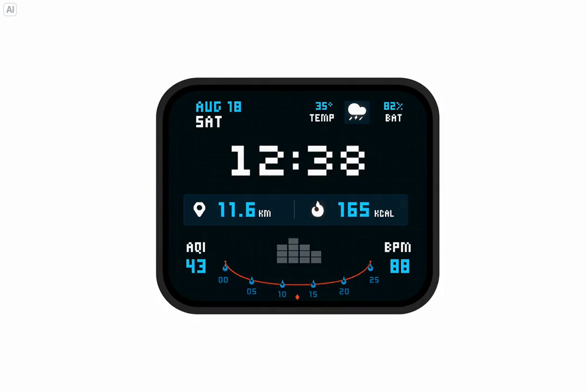
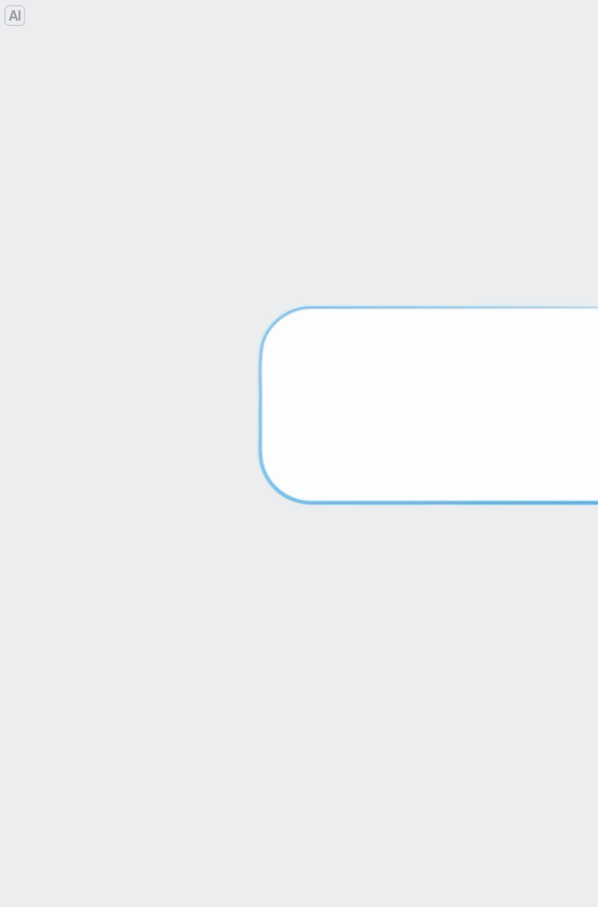

# Seedream 5.5 · 官方模型页文字摘录与来源索引

来源：https://seed.bytedance.com/zh/seedream5_5

原始完整 HTML：[[seedream-5-5.html]]。以下为官方页面核心文字及案例说明，保留中文表述；这不是 HF 模型卡，也不冒充技术报告。

## 官方定位
创造力与精确执行能力共同提升的多模态图像生成模型。

## 多轮编辑
应对多次修改，都能精准调整想改的部分，支持非编辑区域像素级保持。

官方展示逐步添加和替换家具、灯具与装饰，调整配色与摆放，保持空间透视和光影协调；另有人物发型、眼镜、服装、背景与桌面道具的多轮修改案例。

## 透明素材
原生支持透明与半透明背景，直接生成可再创作的素材。官方案例包含独立透明底图层、RGBA 素材提取、透明底贴纸和艺术字。

## 真实质感
呈现更自然的光影、更细腻的材质与肌肤纹理，让每一张画面都真实自然。

## 披露边界
页面未给出可核实的首发日、训练架构、参数量、训练数据、定量评测协议、权重许可证或技术报告。2026-11-09 是本次发现/归档日期，不能替代模型发布日期。
