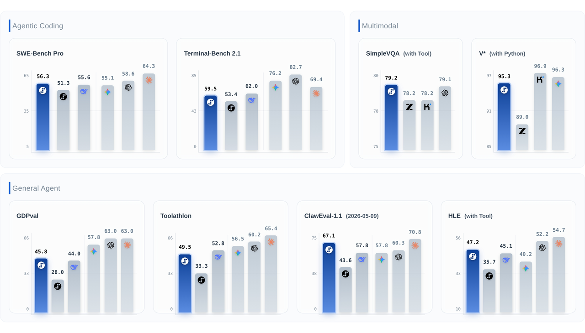

# Step 3.7 Flash：感知、搜索和验证一体的高频 Agent 模型

> [!tldr]
> **Step 3.7 Flash 把198B/11B稀疏模型的目标从纯文本解题推进到带视觉观测的真实工作流。** 它值得读的是视觉证据如何进入搜索、工具与代码验证，而不是把“400tokens/s”和“前沿模型97%效果”两个营销数字直接拼成普适结论。

> [!warning] 原始资料深度不足
> 已亲读并归档官方HF卡和2026-05-29发布博客，保存官方评测图与原网页SVG。**目前取得的原始资料不足以达到 GLM-5.3-Flash / Kimi-K3 的完整技术报告级深度**：没有充分核实预训练配比、Agent RL奖励、视觉训练阶段与架构消融。以下不是技术报告全文精读，不能用API用例推定训练算法。

## 定位与规格

| 项目 | 官方描述与边界 |
|---|---|
| 首发 | 2026-05-29，发布页明示日期 |
| 总参 | 约198B：196B语言主干 +1.8B视觉编码器，数值有取整 |
| 激活 | 约11B /token，不等于全部权重仅11B |
| 输入 / 输出 | 视觉与文本输入，文本输出 |
| 上下文 | 256K |
| 推理预算 | low /medium /high |
| 许可证 | 模型卡标注Apache-2.0 |

官方定位是高频Agent任务：视觉界面与图表、搜索核实、多步骤工具执行、并行编码。虽然是多模态，它仍是官方正代3.7 family，不因为“能看图”自动归入专项支线；BF16、FP8、NVFP4只记录为部署格式。

## 方法能读到哪一层

首先，视觉编码器使任务状态不仅来自文本日志，还可来自界面、图表或截屏。其次，模型把感知结果接到检索与工具链中；发布页展示的流程是观察不完整证据后主动搜索核实，而不是单次给图回答。最后，代码任务需要在多文件仓库中定位问题、生成补丁、运行验证。

这些是能力和工作流定位。**官方材料没有充分公开支撑它们的具体训练损失、rollout过滤和奖励权重**，因此不能把“保持轨迹完整性”改写成某种已知RL算法。模型层、scaffold层与外部搜索服务应分开记录。

## 结果：同时保留强项和短板

| 基准 | HF卡报告 | 读法 |
|---|---:|---|
| SimpleVQA，Search | 79.2 | 带搜索，不是纯视觉闭卷能力 |
| V*，Python | 95.3 | 带工具设置 |
| ClawEval-1.1 | 67.1 | 该比较组下一名59.8，不能泛化任意Agent任务 |
| Toolathlon | 49.5 | 多工具协调，仍有大量未成功任务 |
| HLE，with Tool | 48.1 | 与博客数字不同，见下方版本说明 |
| SWE-Bench Pro | 56.3 | 卡内工程能力口径 |
| Terminal-Bench2.1 | 59.5 | 卡内亦承认相对顶尖模型仍有提升空间 |
| GDPval-AA | 45.8 | 不能与别的版本GDPval分数混用 |

### 冲突不抹平：HLE 47.20 与48.1

原始发布博客列HLE with tools为47.20，当前HF卡为48.1。本笔记没有找到足够证据证明是相同checkpoint、harness和推理预算，因此分别保留来源，**不擅自取较大值替换旧值**。发布时表格与后续卡更新是两个观察时点，不应更改模型首发日期。

### 跨 scaffold 的反例更有研究价值

博客StepSWEBench汇总从Step3.5的56.50到3.7的67.08，但Claude Code这一列是73.0→71.5，存在退步。它提醒我们：平均提高不等于在每个harness里都提高。不能只截最有利的单项结果。

## Advisor Mode：混合系统成绩不是单模型成绩

官方描述一种小模型执行、大模型按需给建议的系统，给出约97% Opus4.6编码效果、任务成本$0.19对$1.76的案例。这是**特定advisor系统和评测场景**，不能改写成“Step3.7独立达到所有Opus任务的97%”。需要记录advisor调用次数、额外输入输出、失败升级和总墙钟时间，才知道成本是否真正降低。

## 部署：吞吐上限与可用配置不能互相替代

“最高400tokens/s”缺少这里可复现的全部硬件、并发和长度条件，故只保留为官方声称，不作为本地实测。卡中给出vLLM专用镜像、TP8、expert parallel、step3p5 reasoning/tool parser、MTP；NVFP4另涉及ModelOpt和FP8 KV配置，不能把示例直接视为任意设备的显存保证。

API有全球和中国两个域名，密钥与base URL须匹配。公开卡中示例不是实际令牌，不把真实凭据放进笔记。当前价格会变化，本笔记不把发布卡价格写成永久报价；实际选型前再核对官方平台。

> [!insight] 对 Agent Training 的启发
> 训练与评测可加入“视觉证据不足时是否主动找证据”“搜索后是否反驳自己的初判”“跨scaffold结果能否保持”三类检查。若使用advisor，分别报告executor独立表现和完整系统表现，避免把昂贵教师的贡献记到小模型头上。

## 一手来源

- [S1 · HF Model Card](https://huggingface.co/stepfun-ai/Step-3.7-Flash)，原始MD：[[src/Step-3.7-Flash-model-card]]。
- [S2 · Tech Blog，2026-05-29](https://static.stepfun.com/blog/step-3.7-flash/)，原始HTML：`src/official-blog.html`，雷达图是原页面SVG而非重绘数据。
- 尚未核实独立完整Tech Report，故不提供猜测的PDF地址。
- 后续正代参照：[[Topics/13_base_model/stepfun/260920_Step_5_Preview/Step-5-Preview]]。

> 📊 中文 Poster：[[step-3-7-flash_poster_zh.html]]
