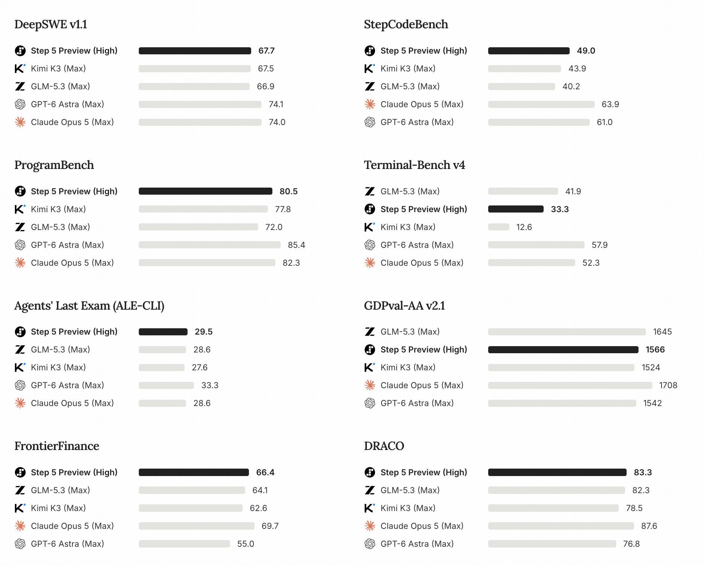

# Step 5 Preview

> [!tldr]
> Step 5 Preview 是600B总参数、27B激活的长程Agent旗舰。2026-10-15巡检已确认FP8、BF16、NVFP4三个官方权重仓库公开可访问；它们共用9月20日首发的同一family，而非三个新正代。真正需要补验的是长上下文的显存预算、工具/推理解析器、量化轨迹误差及有条件的模型许可。

## 一页速览

| 维度 | 当前证据 |
|---|---|
| 发布时间 | 2026-09-20 |
| 类型 | 主干正代 / family · 主干正代 |
| 关键事实 1 | 600B总参数 / 27B激活，稀疏MoE |
| 关键事实 2 | FP8、BF16、NVFP4同一family；公开权重文件可列出 |
| 关键事实 3 | 1M为输入+输出总预算，不是二者各有1M |
| 检查日期 | 2026-10-15；原卡、许可证、仓库revision及官方图保存在同级src/ |

## 一次完整的主干发布，而非 API 功能更新

2026年9月20日首发的稀疏MoE，总参600B、激活27B，支持1M上下文和视觉输入。此前官方模型页预告10月15日开放权重；本次10月15日已实际核验三个HF仓库，而非只根据预告日期宣布开放。以下日期保持原family首发，不因新权重格式、HF仓库创建或文档修改重新排序。

## 2026-10-15：从服务预览到可检查的权重包

三个仓库的API元数据均为private=false、gated=false，且列出了safetensors文件。这里只读取原始卡、许可证与文件清单，不下载数百GB模型，也没有运行推理。因此“公开可访问”与“本地加载/质量已验证”明确区分。

| 官方仓库 | 观察到的revision | 权重分片文件数 | 解释 |
|---|---|---:|---|
| Step-5-Preview | 364b3b03fed2477aa0953fe855a2c4c8c48ee3cc | 28 | 默认FP8包 |
| Step-5-Preview-BF16 | 7734b7ffac118d70d8398bfa3eb0fab007eb45b1 | 28 | 独立BF16 checkpoint |
| Step-5-Preview-NVFP4 | bc246cc2848e17b37f377eda8fd825c5b3018d1f | 95 | 官方低比特格式，仍属同代 |

三个原始README逐字保存。FP8与BF16卡哈希相同，NVFP4卡只在许可元数据上有少量差异，主体仍主要给FP8/BF16配置；不能根据NVFP4仓库存在，自行扩写其未给出的显存、并发或量化无损结论。NVFP4包的U8存储张量数也不能直接当作模型参数总数来与BF16比较。

### 上下文与模态：保留卡内不一致

模型卡规格表写Context Window、Maximum Output均为up to 1M，但部署说明进一步限定：**1M token limit覆盖输入与输出合计**。不能宣称同时输入1M再输出1M。示例设置1048576是服务上限，不是所有显存/并发下都能实际运行。

简介写text、images、video，规格表Input只列text、image。这里保留差异：视觉与文本有明确规格，视频输入的具体接口/采样和本地实现支持仍须逐项验证，不能把简介自动扩张成所有部署方式都可收任意视频。

### 硬件与运行方式不是训练方法

| 格式 / 引擎 | 官方示例硬件 | 主要条件 |
|---|---|---|
| FP8 / vLLM | 4×B300或8×H200 | TP/TEP/DEP；适配step5推理与tool-call parser |
| BF16 / vLLM | 8×B300或16×H200（两节点） | 独立BF16权重；KV与运行缓冲另占显存 |
| FP8 / SGLang | 4×B300或8×H200 | B300与H200的MoE/attention backend不同 |
| BF16 / Transformers | 两节点16×H200 | 全模型文件分片convert→generate流程尚未端到端验证 |

把FP8服务命令加上dtype=bfloat16不会恢复BF16权重。B300示例的MegaMoE仅用于开启expert parallelism的路径，H200改用默认后端；max-num-seqs是每个DP rank的预算，不能在不同DP配置下简单当作全服务并发数。

MTP/EAGLE、prefix cache、HiCache、MoE backend和并行方式是服务机制。它们可能改变延迟、吞吐和显存，但不能据此反推模型采用哪种RL目标、训练奖励或网络层数。本次也没有替用户运行带trust-remote-code的加载命令。

### StepFun Model License 1.0，不是无条件Apache-2.0

已保存并读取实际LICENSE.txt；以下只是便于定位原条款的研究记录，不是法律意见。模型卡称Apache-2.0-style，但增加归属与商业许可条件，故不能直接标为Apache-2.0。

- 再分发保留许可证、通知与修改说明，并提供模型卡或链接。
- 条款2(b)对达到特定用户量或收入门槛的商业产品/服务规定Powered by StepFun AI展示义务。
- 条款2(c)对特定硬件厂商场景和符合收入门槛的MaaS经营者规定另签商业协议，并列有内部使用、认证分发渠道等适用边界。
- 派生模型定义覆盖量化、蒸馏等情形，不能因下载NVFP4或基于输出训练就忽略原许可。是否适用应结合完整原文和具体组织/部署方式审核，不能只看本页摘要。

> [!warning] 训练证据仍不足，不能把新模型卡当成Tech Report
> 已读完整发布页、三份HF卡和许可证，能确认公开权重、规格和部署边界；但完整架构细节、预训练数据配比、后训练RL算法、奖励与关键消融仍未核实。达不到GLM-5.3-Flash / Kimi-K3完整技术证据深度。原始动态发布页完整离线正文仍有归档缺口；HF原卡现已补齐，不再写“尚未获得权重”。

图：官方HF卡中完整八面板图，未经裁切。High / Max推理预算不同；GDPval-AA2.1快照截至2026-09-20，不是10月新重测。本次没有运行任何评测。

## 编程任务：从短修复到长程迭代

StepCodeBench覆盖553个仓库、9类任务、20个领域、33种语言，含功能修改、bug修复、重构、文档生成、性能调优、代码生成、CI/CD、转换和环境配置。49.0%是avg@4，不是四次至少一次成功的pass@4。内部自研benchmark需要看任务和评判器是否公开，不能仅凭多语言覆盖推导无污染。

| 官方结果 | Step5Preview High | GLM5.3 Max | KimiK3 Max |
|---|---:|---:|---:|
| DeepSWE1.1 | 67.7% | 66.9% | 67.5% |
| StepCodeBench | 49.0% | 40.2% | 43.9% |
| ProgramBench pass rate | 80.5% | 72.0% | 77.8% |
| Terminal-Bench4 | 33.3% | 41.9% | 12.6% |
| ALE-CLI | 29.5% | 28.6% | 27.6% |
| GDPval-AA2.1 | 1566 | 1645 | 1524 |

DeepSWE使用SWE-agent、temperature1.0、top_p0.95。不同effort并不完全统一。TB4仍低于GLM5.3，不能把几个领先项浓缩为全面最强。

## 长任务更值得看验收约束

MLA kernel优化在单H100、head dimension512、batch1、64heads、8192tokens条件下，运行24小时，各模型4次取最好；Step5约22小时达到前向+反向508TFLOPS。这是best-of-4特定配置，不是任意kernel的吞吐。

另一个24小时实验以Qwen3-30B-A3B和生产API annotator构建后训练数据，AIME24从53.3%升到60%。需要进一步核对训练数据、测试集合和选模过程是否隔离；这不是无成本自主改进的证明。Pokémon案例达到第三枚徽章，只完成约三分之一主线，不能写成已经通关。

## 金融工作：证据与计算链，而非直接投资建议

内部FinStepBench分别检查LiveSearch、CorporateValuation、DeepResearch，考察来源追溯、假设、计算一致性和报告交付。FrontierFinance为66.4%，涵盖220个专家问题和11543项标准。实际应用仍应验收原始报告期、数值引用、公式与敏感性分析；专业回答通过rubric不等于决策可直接使用。

> [!warning] 评测边界
> HLE with tools中Step5与GLM5.3在纯文本子集，其他模型在完整集合；这些分数不能直接排序。当前已读完整官方发布页与三份HF卡，公开权重已核验可见，训练recipe仍未核实；动态正文的完整离线原貌仍待补归档。

## 对 Agent Training 的启发

> [!insight]
> 现在已有同一family的多精度权重，下一步应固定revision、harness、step5解析器、任务和推理预算，对比BF16/FP8/NVFP4的最终状态成功率、JSON/工具解析失败、长轨迹错误与每成功GPU秒。另以短上下文与接近1M的任务分桶，分开报告权重显存、KV显存和prefill/生成耗时。只有受控对比才能把收益归因于量化或服务配置，而非模型版本变化。

以上是基于已读官方资料的研究判断，不是官方保证，也没有在本机运行模型推理或复现论文成绩。下一步优先补独立验证器、固定任务/版本和完整失败轨迹，避免只保存最好样例。

## 一手资料与导航

- [S1] [Official Model Page](https://www.stepfun.com/step-5-preview)
- [S2] [HF Model Card · FP8](https://huggingface.co/stepfun-ai/Step-5-Preview)
- [S3] [HF Model Card · BF16](https://huggingface.co/stepfun-ai/Step-5-Preview-BF16)
- [S4] [HF Model Card · NVFP4](https://huggingface.co/stepfun-ai/Step-5-Preview-NVFP4)
- [S5] [模型许可证原文](https://huggingface.co/stepfun-ai/Step-5-Preview/blob/main/LICENSE.txt)

原始下载文件与SHA-256见 [[src/retrieval_manifest.json|抓取记录]]。报告保留链接，不抓PDF；动态网页响应若只有壳文件，不将其标成完整离线正文。

- [[Topics/13_base_model/Base Model MOC|基模主题索引]]
- [[step-5-preview_poster_zh.html|中文Poster]]

> 📊 相关可视化: [[step-5-preview_poster_zh.html|Step 5 Preview 中文Poster]]
