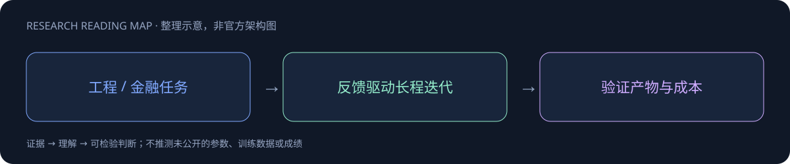
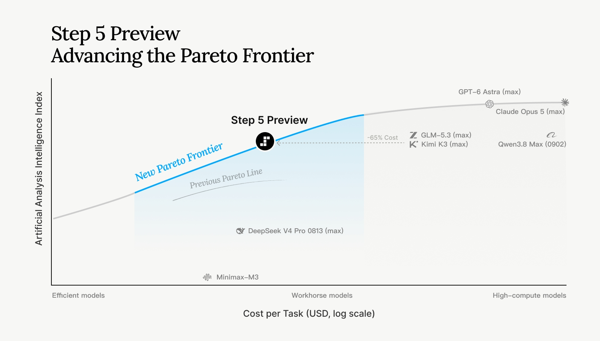
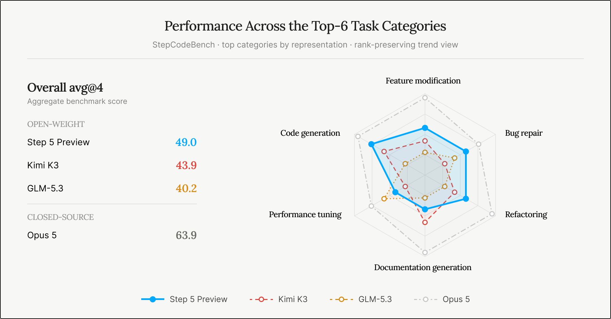
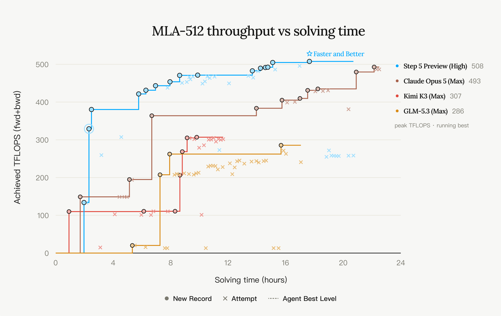

# Step 5 Preview

> [!tldr]
> 旗舰 Preview；官方强调能力、效率与长期 Agent 工作的平衡。 官方发布入口能够确认新旗舰；本轮直抓发布正文仅返回 JavaScript 外壳，尚不能核验全部架构和训练细节。保存新闻入口与模型页，明确保留精读待补状态。

## 一页速览

| 维度 | 当前证据 |
|---|---|
| 发布时间 | 2026-09-20 |
| 类型 | 主干正代 / family · 主干正代 |
| 关键事实 1 | 正式发布：2026-09-20 |
| 关键事实 2 | Preview 阶段 |
| 关键事实 3 | 长期工具交互与复杂工程 |
| 检查日期 | 2026-10-13；官方原始资料在同级src/ |

## 一次完整的主干发布，而非 API 功能更新

2026年9月20日首发的稀疏MoE，总参600B、激活27B，支持1M上下文和视觉输入。官方计划10月15日开放权重；当前10月13日尚未到这一日期，因此不能提前标成已开源。

## 编程任务：从短修复到长程迭代

StepCodeBench覆盖553个仓库、9类任务、20个领域、33种语言，含功能修改、bug修复、重构、文档生成、性能调优、代码生成、CI/CD、转换和环境配置。49.0%是avg@4，不是四次至少一次成功的pass@4。内部自研benchmark需要看任务和评判器是否公开，不能仅凭多语言覆盖推导无污染。

| 官方结果 | Step5Preview High | GLM5.3 Max | KimiK3 Max |
|---|---:|---:|---:|
| DeepSWE1.1 | 67.7% | 66.9% | 67.5% |
| StepCodeBench | 49.0% | 40.2% | 43.9% |
| ProgramBench pass rate | 80.5% | 72.0% | 77.8% |
| Terminal-Bench4 | 33.3% | 41.9% | 12.6% |
| ALE-CLI | 29.5% | 28.6% | 27.6% |
| GDPval-AA2.1 | 1566 | 1645 | 1524 |

DeepSWE使用SWE-agent、temperature1.0、top_p0.95。不同effort并不完全统一。TB4仍低于GLM5.3，不能把几个领先项浓缩为全面最强。

## 长任务更值得看验收约束

MLA kernel优化在单H100、head dimension512、batch1、64heads、8192tokens条件下，运行24小时，各模型4次取最好；Step5约22小时达到前向+反向508TFLOPS。这是best-of-4特定配置，不是任意kernel的吞吐。

另一个24小时实验以Qwen3-30B-A3B和生产API annotator构建后训练数据，AIME24从53.3%升到60%。需要进一步核对训练数据、测试集合和选模过程是否隔离；这不是无成本自主改进的证明。Pokémon案例达到第三枚徽章，只完成约三分之一主线，不能写成已经通关。

## 金融工作：证据与计算链，而非直接投资建议

内部FinStepBench分别检查LiveSearch、CorporateValuation、DeepResearch，考察来源追溯、假设、计算一致性和报告交付。FrontierFinance为66.4%，涵盖220个专家问题和11543项标准。实际应用仍应验收原始报告期、数值引用、公式与敏感性分析；专业回答通过rubric不等于决策可直接使用。

> [!warning] 评测边界
> HLE with tools中Step5与GLM5.3在纯文本子集，其他模型在完整集合；这些分数不能直接排序。当前已读完整官方发布页，保存静态网页响应与官方图，但动态正文的完整离线原貌仍待补归档；训练recipe和开源权重截至本次尚未获得。

## 对 Agent Training 的启发

> [!insight]
> 取得完整正文和报告后再校验参数、上下文、benchmark 与硬件条件；Preview 任务应记录版本漂移，不把当前宣传数字当稳定服务保证。

以上是基于已读官方资料的研究判断，不是官方保证，也没有在本机运行模型推理或复现论文成绩。下一步优先补独立验证器、固定任务/版本和完整失败轨迹，避免只保存最好样例。

## 一手资料与导航

- [S1] [Official Model Page](https://www.stepfun.com/step-5-preview)

原始下载文件与SHA-256见 [[src/retrieval_manifest.json|抓取记录]]。报告保留链接，不抓PDF；动态网页响应若只有壳文件，不将其标成完整离线正文。

- [[Topics/13_base_model/Base Model MOC|基模主题索引]]
- [[step-5-preview_poster_zh.html|中文Poster]]

> 📊 相关可视化: [[step-5-preview_poster_zh.html|Step 5 Preview 中文Poster]]
