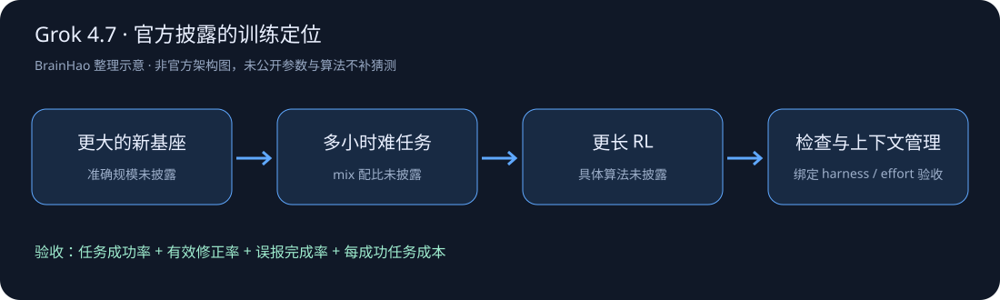

# Grok 4.7

> [!tldr]
> Grok 4.7 不是一个新工具入口：官方明确说它使用比 4.6 更大的新 base model，进行更长、偏向多小时任务的 RL，并加强自我检查和上下文管理。2026-09-21 正式可用，Fast 只是同族速度/价格变体。

## 从 4.6 到 4.7，变化在哪里？

官方给出的路线是“更大新基座 → 更难长任务 mix → 更长 RL → 更强自我验证和长期上下文管理”。另外训练模型原生理解 Grok Bot harness，让对话和一般知识工作不只依赖外围提示工程。

这是有意义的训练定位，但不足以还原配方。新 base 的准确参数量、预训练数据、RL 算法、奖励定义、环境数量与策略滞后控制均未披露。不要把“更长 RL”擅自写成某种具体 GRPO / PPO 实现。

> [!warning] 原始技术资料不足
> 本文已完整读官方发布博客并保存原始 HTML；目前没有可核验的独立技术报告或 HF model card。**因此达不到 GLM-5.3-Flash 那种带完整架构、数据与训练消融的精读深度，原因是原始资料较少。** 图中路线是整理示意，不冒充官方架构；成绩只记录官方明确披露的值。

## 分数上升，哪些条件也变了？

以下是发布时官方对照表。4.7 多数列使用 xHigh，4.6 使用 High；DeepSWE 的星号特别标成 4.7 High。不是在统一 effort 下仅改变版本的严格消融。

| 任务 | Grok 4.7 | Grok 4.6 | 差值 / 注意事项 |
|---|---:|---:|---|
| CursorBench 4.0 | 46.3% | 40.4% | +5.9 个百分点；版本 4.0 |
| DeepSWE v1.1 | 71.0% | 65.2% | +5.8 点；4.7 此项 High |
| EEBench | 64.0% | 53.0% | +11.0 点；电气工程专项 |
| AA Briefcase v1.1 | 1657 | 1546 | +111；不是百分比 |
| Terminal-Bench 4.0 | 37.6% | 20.3% | +17.3 点；不要混用 TB 2.0 |
| Harvey Legal Agent | 19.6% | 15.8% | +3.8 点；法律工作特定任务 |
| HealthBench Professional | 56.7% | 48.5% | +8.2 点；不能当临床安全保证 |

作为对照，官方表中的 Fable 5.1 Max 为 CursorBench 51.8、TB4 57.9，均高于 4.7；DeepSWE 对照 GPT-5.6 Sol Max 为 72.7，高于 4.7 的 71.0。因此“price-performance 有竞争力”不能改写成“所有能力领先”。

价格上 4.7 与 4.6 保持输入 $2/M、输出 $6/M tokens；Fast 变体官方称输出速度 2×、价格 2×。这是 serving 档位，不新增一条正代。每个完成任务的总费用仍受到输出 tokens、effort、失败重试和工具次数影响。

## 安全不是一个拒绝率就够了

官方说换了新的 safeguard stack，并在 LatchBio biosafety benchmark 报告 62.4%，在自有 HackerBench v0.3 上 risky dual-use prompts 放行率为 3.3%。这里的 3.3% 是风险提示的放行率，不是所有输入上的误报率，也不是 jailbreak 全部成功率。

对于安全任务，应该分别看：

- 合法安全工作是否被误拒，必要工具操作能否正常完成。
- 危险或越权目标是否被阻断，是否泄漏中间步骤。
- 工具返回带恶意指令时，是否仍守住原始权限与用户目标。

官方还提供邀请制的 cyber red-team 能力访问。这不是一般用户默认可用的同一部署条件，不能把 partner-only 行为和生产公共服务混为一谈。

## 发布阶段与证据范围

| 项目 | 截至 2026-10-13 的已核验信息 |
|---|---|
| 首发 | 官方博客 2026-09-21 |
| 可用入口 | Cursor、Grok Build、API、其它 coding harness 和 routers/cloud |
| 输入/输出单价 | $2 / $6 每百万 tokens，发布时起价 |
| Fast | 同族 serving 变体，输出速度与价格均称 2× |
| 权重 / HF card | 未找到可核验的公开对应条目 |
| 独立报告 | 未找到已明确关联的 Tech Report |
| 精确参数、context 上限、完整训练配方 | 发布博客未披露，不填写猜测值 |

## 对 Agent Training 的研究判断

> [!insight]
> 最值得检验的是长任务 RL 是否真的改善“发现错误后修正”，而不只是多花 tokens。把任务成功率与验证触发次数、有效修正率、误报完成率、上下文压缩后约束保持率一起记录。

建议在固定 harness、effort、工具权限和真实 token 预算的条件下对照 4.6/4.7。另设置“客观不可完成”任务：环境资源缺失或约束冲突时，模型应停下来说明缺口，而不是靠更长运行编造完成。对于长上下文任务，在压缩前后放同一条关键限制，验证最终动作有没有越界。

这是基于公开训练定位的研究启发，没有在本机做模型运行或第三方复现。缺少完整技术报告时，保持判断与事实分开。

## 一手资料与导航

- [S1] [Tech Blog：Introducing Grok 4.7](https://x.ai/news/grok-4-7)，2026-09-21。
- [[src/retrieval_manifest.json|官方原始 HTML 抓取记录]]。
- [[Topics/13_base_model/Base Model MOC|基模主题索引]]
- [[grok_4_7_poster_zh.html|中文 Poster]]

> 📊 相关可视化: [[grok_4_7_poster_zh.html|Grok 4.7 中文 Poster]]
