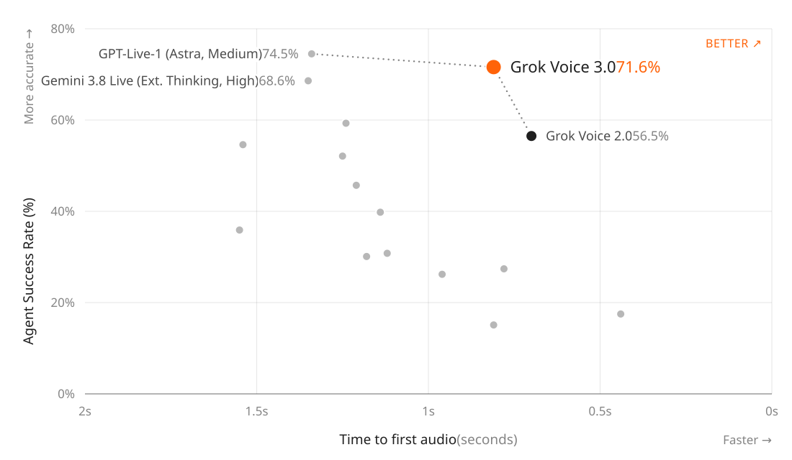

# Grok Voice 3.0

> [!tldr] 先看结论
> 这不是 Grok 4.x 的新通用正代，而是独立的实时 speech-to-speech 支线。核心变化是：语音客服任务成功率明显改善，同时维持亚秒级首音频响应；但“综合指数第一”不等于每项 Agent 指标第一，τ-Voice 仍低于同表 GPT-Live-1。

> [!warning] 资料深度边界
> 本笔记已逐项读取官方 Tech Blog、评测表与两张网页内嵌矢量图。当前可核实资料主要是发布博客，没有找到本次模型的官方 HF Model Card、开放权重或完整训练 Tech Report，因此达不到 GLM-5.3-Flash / Kimi-K3 中可展开训练配方与论文消融的深度。下文明确区分发布者披露、图表数据与研究判断；不会补造架构、参数规模或 RL 算法。

## 发布与定位：音频输入，音频交互，而非只做转写

官方发布页标注 **2026-10-14**。页面同时披露 Voice Agent API 已可使用，`grok-voice-latest` 用户已自动切到新版。这个别名会漂移，做可复现实验时必须另记请求日期、服务返回的模型标识与可用的固定版本信息，不能只保存 latest 字符串。

模型处理的是自然语音对话中的推理、插话、停顿、轮次交替和工具任务，不应与仅输出文字的 Grok Voice Transcribe 2.0 合并。上代 Voice 2.0、这次 Voice 3.0 则是同一实时语音产品线的不同阶段，尺寸或量化镜像不另拆节点。

| 项目 | 本次能确认的内容 |
|---|---|
| 产品族 | Grok Voice，实时语音专项支线 |
| 首发日期 | 2026-10-14，官方博客明确日期 |
| 交互形态 | speech-to-speech，支持实时 Agent 场景 |
| 服务价格 | 发布时 $0.08 / 分钟，即 $4.80 / 小时；不是每百万 token 价格 |
| 价格相对上代 | 官方称保持 Voice 2.0 的价格 |
| 权重、参数与训练数据 | 本次资料未公开，不能推断 |

## 成功率与响应速度必须放在一起看

图 1：来自官方网页的内嵌 SVG，保留全部数据点和标签；仅将依赖站点的 CSS 变量显式化以支持离线显示，并未重画实验数据。原始 SVG 同存于 src/assets/official-speed.original.svg。

Grok Voice 3.0 在图中为 **71.6% τ-Voice、0.81 秒平均 time to first audio**。博客称相对 GPT-Live-1 的延迟低约 40%；它衡量的是开始输出音频的响应时间，不是整段任务完成时间，也不是网络传输完全可忽略的模型纯前向时延。

| 模型 / 设置 | τ-Voice 成功率 | 解释 |
|---|---:|---|
| Grok Voice 3.0 | 71.6% | 相对上代 +15.1 个百分点 |
| Grok Voice 2.0 | 56.5% | 同一产品线基线 |
| GPT-Live-1（Astra, Medium） | 74.5% | 本项仍高于 Voice 3.0，不能写成全面超过 |
| Gemini 3.8 Live（Extended Thinking, High） | 68.6% | 推理设置与另外两者不同 |

研究判断：实时 Agent 优化的不是单个 accuracy 标量，而是任务完成率、用户感知等待和打断后的恢复能力组成的约束面。若响应更早但执行错误，首音频变快没有业务价值；若成功率提升来自更长思考，也要说明用户等待预算。这里的主要证据是更接近该权衡面的一个服务工作点，不是证明底层网络结构更先进。

## 官方完整对照表：不要把三种“成功率”混在一起

发布页给出的表格注明参考 Artificial Analysis **2026-10-13** 的结果；这是评测快照时间，不是本模型首发日。

| 指标 | Voice 3.0 | Voice 2.0 | GPT-Live-1 Astra / Medium | Gemini 3.8 Live / High |
|---|---:|---:|---:|---:|
| AA Speech-to-Speech Index | 86.9 | 81.3 | 83.2 | 82.6 |
| Big Bench Audio | 98.5% | 97.2% | 90.1% | 97.7% |
| Speech Agent Arena Elo | 1070 | 1011 | 1048 | 990 |
| Task Success Rate | 94.8% | 94.6% | 87.4% | 89.1% |
| Full Duplex Bench | 97.0% | 95.1% | 94.9% | 91.9% |

τ-Voice 71.6%、表内 Task Success Rate 94.8%、EVA-Bench accuracy 74% 是不同评测口径，不能拼成同一个客服解决率。综合指数提升 5.6 分，但普通 Task Success Rate 只升 0.2 个百分点，说明收益分布并不均匀。Elo 也不是百分制准确率，不能与 98.5% 相减。

EVA-Bench 部分由发布博客引用 ServiceNow 的评价，提到 200 多个现实企业语音情境及 accuracy / customer experience 联合表现。本笔记未独立复跑该环境，也未得到本次全部逐题记录，因此保留为官方引用的外部评测结果，不称为本地复现。

## 任务成本与分钟价格是两件事

图 2：官方网页矢量图，数据为一次 Big Bench Audio 评测运行中的平均任务成本。该图不是统一任务时长下的分钟单价比较。

| 模型 / 设置 | 平均每任务费用（USD） |
|---|---:|
| Grok Voice 3.0 | 0.025 |
| GPT-Live-1（Astra, Medium） | 0.030 |
| GPT-Realtime-2.1（High） | 0.055 |

分钟单价相同并不保证每成功任务费用相同，话轮数、音频时长、澄清次数和重试次数都会改变账单。任务费用低也不能直接当成效率收益的因果证明，需要保持任务、终止条件和工具调用计费口径一致。

## 部署案例说明可用性，不替代独立验收

官方描述 Tesla 车内每天数百万次交互，以及 Starlink 约每天 20,000 通客服电话、约 70% 无人工解决、四分之一销售电话产生购买。这些数字属于部署案例陈述，并不是公开测试集得分，也没有披露抽样、失败归因和版本分流细节。不能把“约 70%”当作所有企业都可获得的保证。

语音可以触发日历、邮件和购买等工具动作，并不意味着应自动授予这些权限。实际产品需将身份验证、金额上限、不可逆操作确认和人工接管条件放在执行系统中；博客没有给出足够资料来确认这些边界已经被单靠模型解决。

> [!insight] 对 Agent Training 的启发
> 建议把语音客服 rollout 的 reward 分成四类可观测事实：业务最终状态是否正确、是否越权、是否能处理插话后的新约束、用户实际等待多久。奖励“立刻开口”容易诱导无意义填充，奖励“独立解决”容易抑制必要的澄清和转人工。这里提出的是实验设计，不是对 xAI 未公开训练目标的描述。

## 可复现评测应该补哪些记录

- 固定一套任务和相同权限的工具环境，保留最终状态 verifier；不要让自然对话评分取代业务验收。
- 按口音、背景噪声、打断、需求中途改变分桶，报告 p50 / p95 首音频延迟与端到端任务时长。
- 对每个模型同时记录成功率、未授权动作、澄清/人工接管次数、每成功任务的音频分钟与总费用。
- 将失败的“听错信息”“忘记约束”“工具操作错误”“假称已完成”分开，分别转成语音 SFT、纠错轨迹或偏好样本。

## 一手来源与资料包

- [Tech Blog：Introducing Grok Voice 3.0](https://x.ai/news/grok-voice-3) — 主要事实、日期、完整对照表和两张官方图。
- [官方语音服务说明](https://docs.x.ai/developers/model-capabilities/audio/voice) — 部署入口；本笔记不将 API 功能更新算成新正代。
- 原始 HTML、抽取正文、图表原始与离线版 SVG 均保存在本模型 src/，未下载 PDF。
- 关联阅读：[[Topics/13_base_model/Alibaba_Qwen/Variants/260920_Qwen_Audio_3_1_Realtime/Qwen-Audio-3.1-Realtime]]。后者可作为同一评测框架的候选，不表示已有严格可比成绩。

> 📊 相关可视化: [[Topics/13_base_model/xAI_Grok/Variants/261014_Grok_Voice_3/grok_voice_3_poster_zh.html|Grok Voice 3.0 中文 Poster]]
