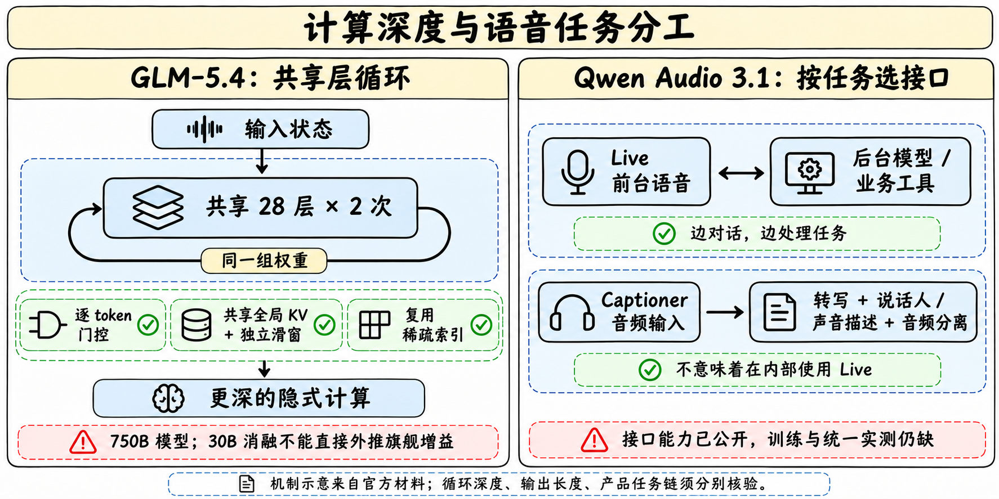
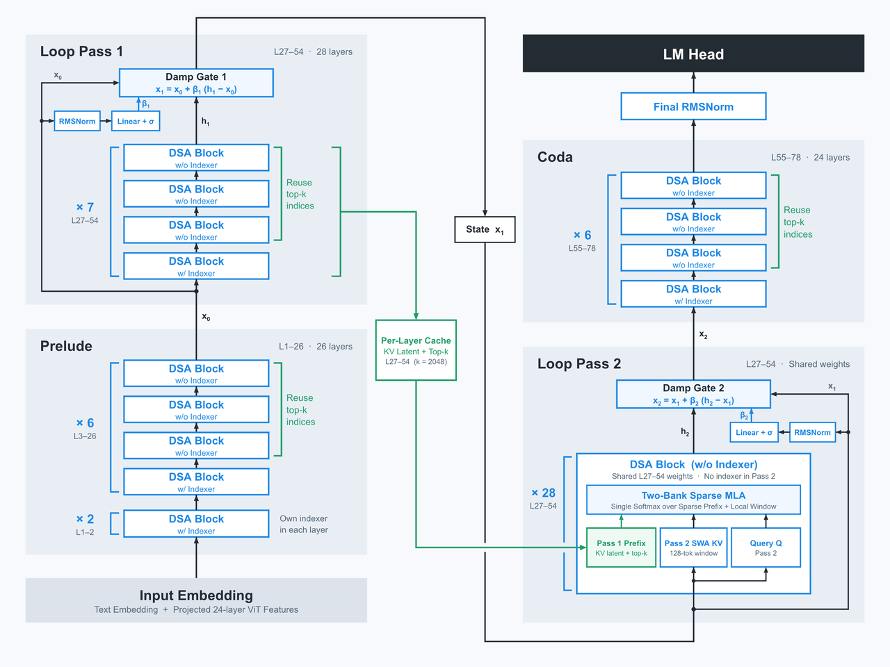
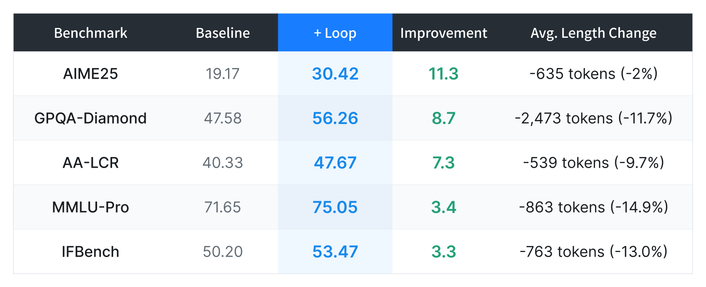
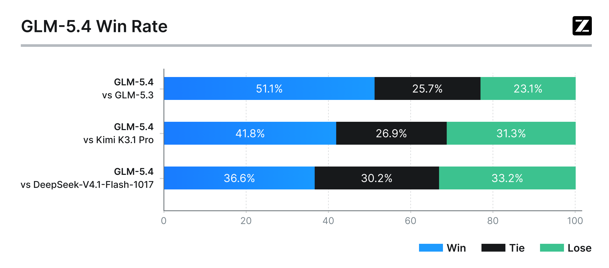

# GLM-5.4 — 把部分推理深度移入共享层循环

> [!tldr]
> 我的判断：这次值得研究的是“继续训练已有底座，使共享层多次更新隐状态”的工程路线。750B模型并没有变成2T–3T参数；更长的有效计算深度、较短的显式CoT和服务吞吐是不同量。博客最清晰的定量证据来自30B等参数消融，不能直接充当旗舰成绩。

> [!warning] 资料与开放边界
> 已读官方Tech Blog的静态JS源码、开发者Markdown、ZCode FAQ、AutoClaw公告及两张完整技术原图。源码仅静态阅读，未执行网页脚本。发布日来自博客内嵌date=2026-11-23，非文档lastModified。HF本轮完整库存未见5.4权重；官方称安全加固后计划开放，通用Model API仍待安全评估。训练语料、完整后训练算法、750B逐任务可复算结果和延迟负载分布仍缺。

## 发布、规格与可用性

> [!tldr]
> GLM-5.4是新主干；已有Coding Plan/Chat/ZCode可用，不等于通用API或开放权重已交付。

| 项目 | 当前官方证据 | 不能推出 |
|---|---|---|
|首发|2026-11-23 Tech Blog日期、AutoClaw同日公告|文档更新时间不是更早首发|
|规模|750B尺度底座；GLM-5共享28层执行两遍|“媲美2T–3T”不是实际参数量|
|输入 / 输出|视频、图像、文本、文件 / 文本|代码生成视频不是原生视频生成输出|
|上下文 / 最大输出|1M / 128K；ZCode约966K自动压缩|最大窗口不等于长程检索质量|
|思考|Low / High / Max，默认Max|不同effort不宜混比|
|产品状态|Coding Plan、ZCode、Chat；API coming soon|不要把网页订阅额度当API价格|

FAQ明确当前没有GLM-5.4 Flash，5.3和5.3-Flash仍可选，不会自动替换。当前周额度计划5.4可用token为5.3的1.5倍；旧V1不包含该优惠。AutoClaw V2/V3/Team公告的范围与ZCode FAQ分别归因，不以局部产品说明覆盖所有计划。

## 架构：共享权重、状态更新与KV分工

> [!tldr]
> 循环的是L27–54同一组权重，逐次状态和部分KV各自保留；为避免状态尺度爆炸和缓存翻倍，门控、混合KV与索引复用一起设计。

原图显示Prelude L1–26，循环L27–54共28层，Coda L55–78共24层。底部是文本embedding与投影后的24层ViT特征。第一遍循环的每层KV latent及top-k索引保存；图中k=2048，第二遍沿用第一遍稀疏prefix，并维护自己的128-token滑窗KV，以同一次softmax联合两路证据。第二遍不再运行indexer。图中的78层位置编号和额外28次层执行，不能简单换算成独立106层参数。

每次独立逐token门控把候选状态写回残差，示意式为 \(x_{i+1}=x_i+\beta_i(h_i-x_i)\)。这里的门控大小随token和遍次变化，不是当前已经实现按token动态选择任意循环次数。博客称第一遍保守建立全局状态、第二遍较大更新做精化；困难token第一遍也会更积极。自适应循环次数仍被列为后续探索。

从零训练的共享深度模型在等预训练计算下仍可能落后非共享模型，因此本次选用已预训练底座继续训练。该动机不能被误写成已证明所有循环架构都更省FLOPs。共享全局缓存节省额外完整上下文缓存，但仍有第二遍计算、滑窗和门控开销。

## 等参数消融：完整五行与条件

> [!tldr]
> 下表是30B、200K长上下文SFT后、thinking开启的对照。约多10%总训练计算，展示了质量与输出长度变化；不是750B GLM-5.4对其他旗舰的排行榜。

| Benchmark | Baseline | +Loop | 官方四舍五入增益 | 平均输出长度变化 |
|---|---:|---:|---:|---|
|AIME25|19.17|30.42|11.3|-635 tokens（-2%）|
|GPQA-Diamond|47.58|56.26|8.7|-2473（-11.7%）|
|AA-LCR|40.33|47.67|7.3|-539（-9.7%）|
|MMLU-Pro|71.65|75.05|3.4|-863（-14.9%）|
|IFBench|50.20|53.47|3.3|-763（-13.0%）|

AIME表值相减为11.25，官方显示11.3是舍入，不改写原表。博客“多数10–14%”是概括，MMLU-Pro原表为14.9%，AIME仅2%，应逐行保留。缺多随机种子、显著性、逐题差异和完整token/FLOP账本。输出更短不能证明端到端更快，因为内部多走了一遍共享层。

博客服务吞吐称低峰最高200tokens/s，高峰70–80；没有并发、输入长度、硬件、首token或分位数。它与200K SFT消融不是同一实验。模型仍可能进入marathon thinking；不能由少数基准CoT下降推断所有任务都短。

## 旗舰偏好比较的有限证据

> [!tldr]
> 开发者页另给旗舰Win/Tie/Lose图；缺题集与评审细节，不把偏好胜率当标准benchmark准确率。

| 比较对象 | Win | Tie | Lose |
|---|---:|---:|---:|
|GLM-5.3|51.1%|25.7%|23.1%|
|Kimi K3.1 Pro|41.8%|26.9%|31.3%|
|DeepSeek-V4.1-Flash-1017|36.6%|30.2%|33.2%|

官方图值按原样保留（舍入后可能不精确和为100）。没有评审人数、样本量、任务分布、打平规则、effort、显著性和是否盲评；只能作为供应商偏好比较。它与30B等参数消融是不同证据，不能交叉归因。

## Generalized Coding与Agent训练启发

> [!insight]
> 可转化的问题是：把显式推理token换成隐式深度，能否在相同端到端计算与相同外部环境下减少失败恢复成本？答案需要固定预算实验，发布演示并未证明。

视频剪辑、FreeCAD六轴机械臂、游戏与GLSL几何场景是代码驱动产物演示；没有成功率分母、失败样本或统一工程约束。生成模型输出、渲染工具结果和真实物理控制分别验收。对Agent训练可固定同底座、数据、环境、工具schema与总FLOPs，比较非循环/两遍循环；再独立比较门控、全KV复制/共享加滑窗、索引重算/复用。统计工具终态、引用正确、恢复步骤、输出token、内核时间和KV峰值。没有开放checkpoint时，该路线只能是建议，不能填虚构消融结果。

## 来源与关联

> [!tldr]
> Tech Blog解释机制，开发者页给接口契约，FAQ给具体产品限制；三类材料不可互相替代。

- [Tech Blog](https://z.ai/blog/glm-5.4)；原始HTML壳与包含正文的JS分开保存。
- [官方模型文档](https://docs.z.ai/guides/llm/glm-5.4)与同源Markdown。
- [ZCode FAQ](https://zcode.z.ai/en/docs/qa)、[AutoClaw公告](https://autoclaw.z.ai/en/blog/model/GLM-5.4/)。
- [[GLM-5.3-Flash]]、[[Kimi-K3]]：可对照混合注意力、后训练和工具预算披露。

> 📊 相关可视化: [[glm54_poster_zh.html]]
