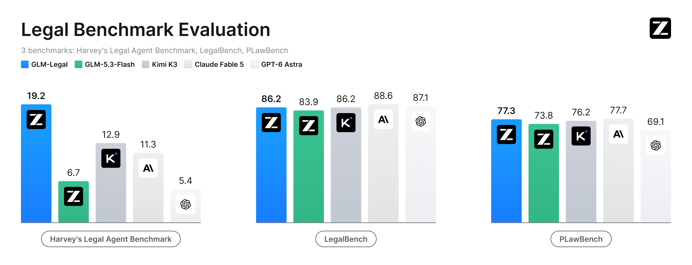
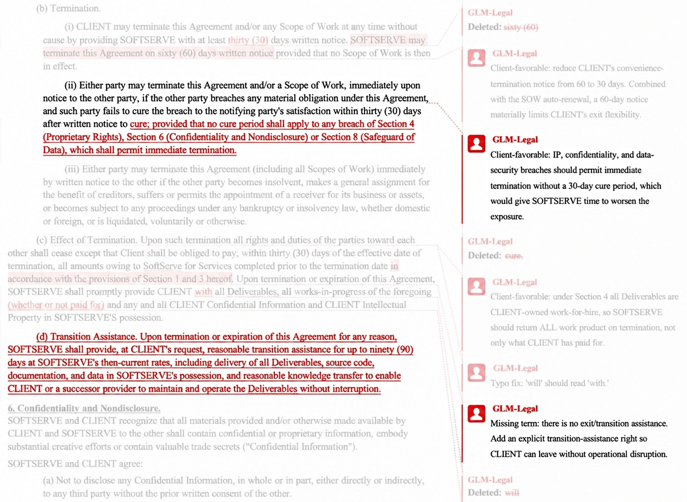
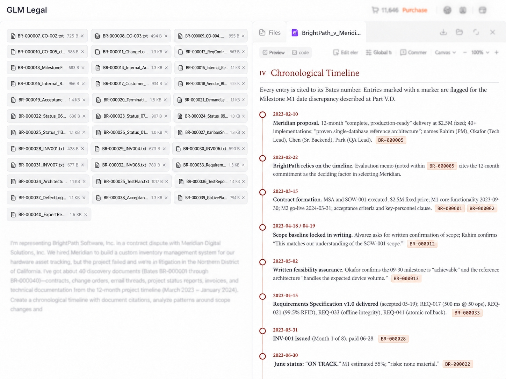
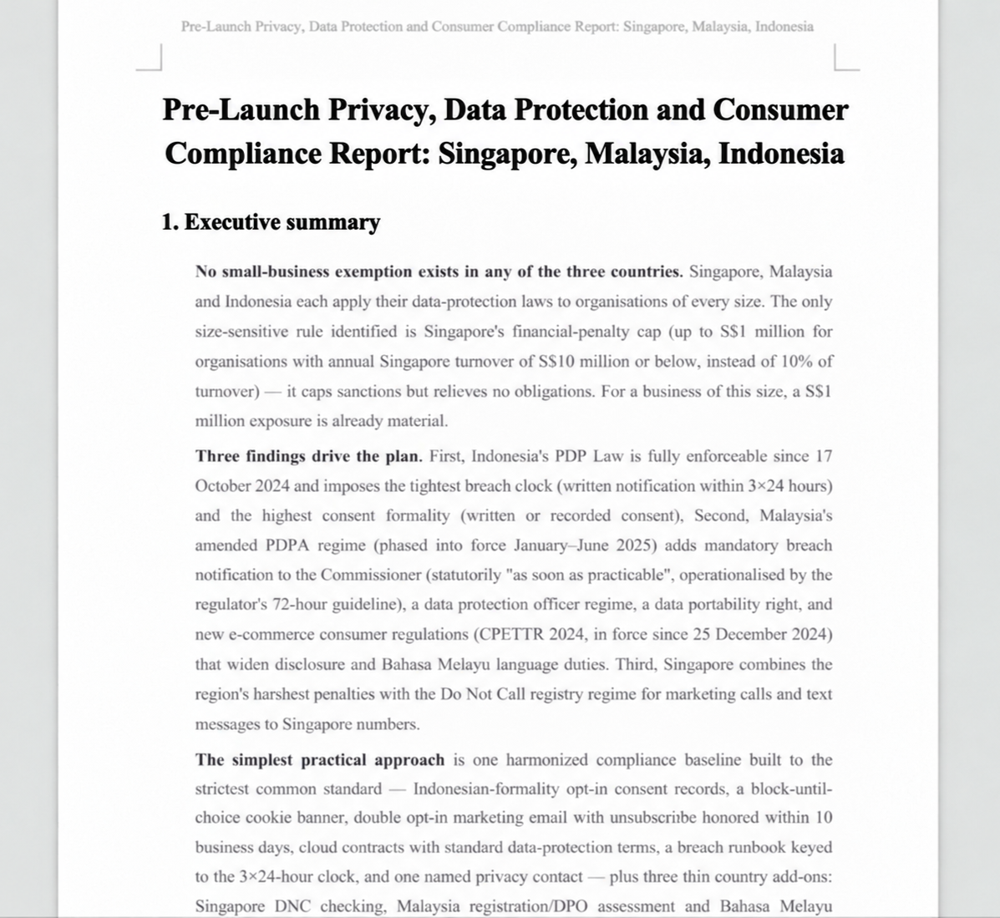

# GLM-Legal

> [!tldr]
> 我认为 GLM-Legal 的贡献不是把法律词汇灌进模型，而是把“从材料识别问题、连接证据与规则、完成合格交付件”的整条链变成训练环境，并让模型和 Harness 联合迭代。它基于 GLM-5.3-Flash，是独立领域支线，不是 GLM-5.4 正代。

> [!warning] 资料深度说明
> 官方目前主要公开技术博客、评测图和产品案例；本次官方 HF 清单没有找到 GLM-Legal 独立模型卡或权重，博客也没有给出完整 Tech Report、训练数据规模、RL 算法、奖励公式与消融。因此，本笔记达不到 GLM-5.3-Flash 那种完整架构与训练证据的深度：原因是原始技术资料较少，而不是用推测补齐。图中的成绩是官方披露，未在本地复现。原始 HTTP 返回动态验证壳；正文已通过官方浏览器页面读完，不能把该壳称作完整离线原貌。

## 发布与定位

| 项目 | 已确认信息 |
|---|---|
| 首次公开 | 2026-10-12，Z.ai 官方 Research 博客 |
| 10 月 13 日 | AutoClaw 博客转载/产品介绍，不是第二个新模型 |
| 基座 | GLM-5.3-Flash |
| 专项任务 | 合同审阅、证据分析、合规研究及法律交付件 |
| 访问 | 博客邀请申请 API Beta；AutoClaw 接入表述为即将可用 |
| 权重 / 许可 | 未核实独立权重与许可；不自动继承基座的开放许可 |
| 参数、上下文、价格 | 博客未给出 GLM-Legal 自身的明确规格 |

## 解决的问题：法律知识正确，不等于法律工作完成

法律任务的难点是约束同时成立：事实不能遗漏，论证有依据，引用对应法域与事项，文件符合交付格式。一个答案可能逐句通顺，却没有处理客户真正关心的退出、交接或损失问题。模型需要把散落的合同、邮件、进度报告和事实记录组织成可核验的工作产品。

因此这里应区分三层能力：知道法律概念；把事实与规则建立有效联系；在真实工具与文件中完成符合 brief 的交付件。LegalBench 更偏领域推理，Harvey LAB 更接近第三层，不能把三个 benchmark 当作同一种能力的重复测量。

## 训练路线：领域中训 → 模型与 Harness 共演化 → 实务反馈

官方把中训描述为扩充高质量法律语料，建立概念、法规与解释框架。这能解释领域知识的来源方向，但不能推出具体 token 数、国家配比、数据授权方案或隐式检索机制。

后训练使用数万个真实感法律环境进行强化学习。Harness 管理任务上下文、工具集和执行反馈；模型学习计划、推进任务以及按约束生成交付件。双方迭代不是“换一个更好的 prompt”这么简单：训练暴露的失败可以指向 Harness 的材料组织或工具反馈瓶颈；Harness 修复又会改变模型看到的执行约束。

实务反馈检查四件事：关键问题与边界是否覆盖，论证与引用是否可靠，是否符合事项 brief，下游能否直接使用而不大量返工。官方提出把遗漏事实、浅层分析和格式偏差追溯到原始模型能力、上下文编排和工作流逻辑。注意：它没有公开这些信号如何被量化成 reward，更不能据此宣称采用某个具体 RL 算法。

## 评测：提升主要体现在整件任务完成，而非普遍胜出

下表逐项抄录官方图；不同 benchmark 的分数含义不同，不跨列取平均。

| 官方图模型 | Harvey LAB | LegalBench | PLawBench |
|---|---:|---:|---:|
| GLM-Legal | 19.2 | 86.2 | 77.3 |
| GLM-5.3-Flash | 6.7 | 83.9 | 73.8 |
| Kimi K3 | 12.9 | 86.2 | 76.2 |
| Claude Fable 5 | 11.3 | 88.6 | 77.7 |
| GPT-6 Astra | 5.4 | 87.1 | 69.1 |

Harvey LAB 采用严格 all-pass，覆盖 24 个执业领域；19.2% 相对基座 6.7% 提升 12.5 个百分点，也意味着大多数任务仍没有通过全部要求，不能写成“法律工作已可靠自动化”。LegalBench 比基座高 2.3 分，却不是表内最高；PLawBench 比基座高 3.5 分，也略低于 Fable 5。领域后训练的收益不能被改写成每个维度都 SOTA。

博客称 Harvey LAB 与 LegalBench 由 Vals 独立评估并给出评估页。本次未完整复核其配置、任务集、工具预算与统计区间；特别是 Muse Wonder 官方使用 Harvey LAB-AA，不能与这里的 LAB 19.2 直接排榜。

## 三个案例怎样体现“完成工作”

合同示例中，基座给出泛泛的交接建议；Legal 将退出条件转成具体条款，并利用原合同既有的成果归属条款解释交付范围。要点是读取已有约束，再形成可编辑的 redline，而不是把“30 天”“90 天”视为任何合同都应采用的通用法律建议。这些数值只属于官方演示案例。

40 份项目争议材料的案例不仅列出对外 60% 和内部约 41% 的矛盾，还把内部预警、管理层披露决定与合同支付条款相连，形成需要进一步验证的争议理论。最重要的质量门槛是分清事实、推断和待查要件，而非让故事更有说服力。

跨境合规示例将要求组织成优先级、实施步骤和待核实国家差异。它展示交付结构，不构成对任何实际司法辖区的法律意见；生产使用必须由合格专业人员复核。

## 对 Agent Training 的启发

> [!insight]
> 把一次失败拆成“资料未进入上下文”“模型误解规则”“工具无法实施”“交付件未满足 brief”，分别修环境、Harness、数据或 reward。只增加法律问答 SFT 无法证明能修复这四种不同原因。

可执行的实验是固定基座、任务集、权限和预算，对比领域 SFT、领域 RL、Harness 修复以及二者组合；按遗漏关键事实率、无依据引用率、交付规范通过率与终态 all-pass 分别验收。最好保留未见过的法域与事项组合，而不是只在相似模板上验证。

## 来源与关联

- [Tech Blog · 官方首发](https://z.ai/blog/glm-legal)
- [官方所链接的 Vals 评估页](https://www.vals.ai/models/zai_glm-legal)
- [[Topics/13_base_model/Zhipu_GLM/2608_GLM_5_3_Flash/GLM-5.3-Flash|基座 GLM-5.3-Flash]]
- 原始响应和四张官方图位于本模型 `src/`；产品截图是案例，不是受控消融实验。

> 📊 相关可视化: [[Topics/13_base_model/Zhipu_GLM/Variants/261012_GLM_Legal/glm_legal_poster_zh.html|GLM-Legal 中文 Poster]]
